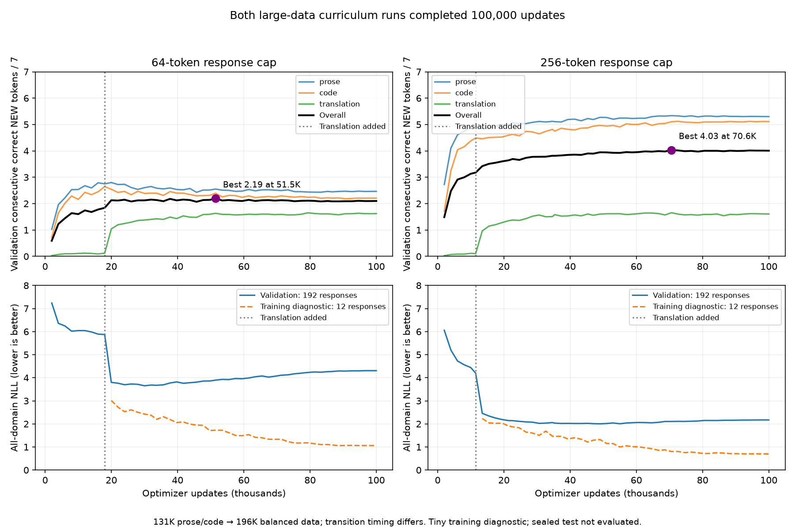
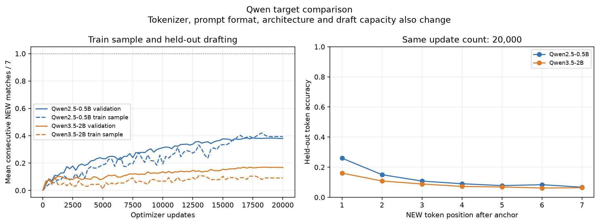
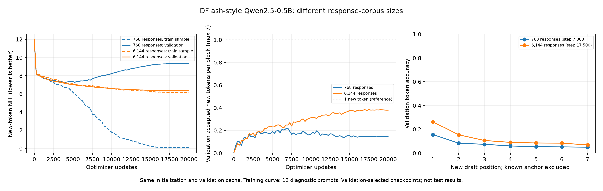

# Latent workspace block generation

[Short learnings write-up](docs/implementing-a-diffusion-style-drafter-from-scratch-and-learnings.md) · [One-page PDF with charts](results/drafter-learnings.pdf).

Completed training: [large-data curriculum findings](results/large-curriculum-final.md).
Two fresh 79M drafters for frozen Qwen2.5-0.5B finished 100000 updates on a
131k prose/code → 196k balanced curriculum. Best long-response validation reaches
**4.03 correct consecutive NEW tokens / 7**, versus 2.19 for short responses and
3.60 in the historical49k long-response study. Late overfitting favors retaining
the selected70.6k checkpoint. All12 short verified rollouts per head match Qwen;
[Longer verification and sealed-test qualification](results/qualification-findings.md)
now pass:24/24 longer outputs match Qwen; sealed test scores **3.94 NEW / 7**
(prose5.01, code4.96, translation1.84) on189 usable held-out prompts.



These are one-seed, adaptively selected validation results; curriculum/exposure
confound a pure data-size comparison. The selected long-response head meets the study
qualification criterion; further architecture/representation research remains open. See [open work](OPEN_WORK.md) and [study protocol](docs/dflash-fresh-grid.md).

Current priority: [J-space conditioning on the capable drafter](docs/jspace-capable-drafter.md),
then unverified two/three-token blocks and benchmark quality against frozen Qwen.
The qualified DFlash-style head supplies the baseline. The previous drafting test
is consumed; new variants require fresh held-out evaluation.
No backbone pretraining or collaborative proposal module.

The [completed Qwen3.5-2B quality comparison](results/dflash-qwen35-2b-findings.md)
did not improve drafting: selected checkpoints score **0.170 versus 0.387 NEW
matches / 7** on 184 shared validation source prompts. The drafter trained for the 2B target is weak on
training too (0.173). Both used 6144 responses and 20000 updates. Family, tokenizer,
prompt format and draft capacity also change; this is not a pure size ablation.
Prediction quality remains the priority. No 2B rollout verification was performed.
See the [DFlash comparison and fitting diagnosis](docs/dflash-fidelity.md) for
confirmed implementation differences and the remaining causal uncertainty.



The [completed response-data study](results/dflash-data-scaling.md) compares 768
versus 6144 training responses at the same 20000-update budget and on 192 shared
validation responses. Best accepted NEW prefixes improve from **0.218 to 0.384
out of seven**, but reliable multi-token drafting is still unsolved. All twelve
FP32 rollout prompts matched Qwen for both heads; the larger head's median observed
speed ratio was 1.095x on this small check, not a general performance claim.



See the [baseline protocol](docs/dflash-baseline.md) and
[data-scaling protocol/reference comparison](docs/dflash-data-scaling.md).
This is a compact Qwen2 adaptation, not a full DFlash paper reproduction. The earlier
[380-response fitting study](results/dflash-findings.md) established tiny-set
memorization; the new study demonstrates better held-out prediction with more data.
Neither establishes a sufficient final training corpus or optimization budget.

## Development

Run these commands from `exploration/latent-workspace/` in LM Exploration. This
folder retains its own uv project and lockfile. Before launching GPU work from a
new checkout, restore the existing local budget ledger as described in
[operations](docs/operations.md); it is not stored in Git.

```bash
uv sync --extra dev --extra modal
uv run pytest
uv run ruff check .
uv run modal run modal_app.py --config configs/smoke.json --run-id smoke-l40s
```

Modal uses its configured account, a dedicated app and volumes. Read
[operations](docs/operations.md) before launching; checkpoints and measured
results are persisted. A smoke test establishes plumbing, not model quality.

## Research references

- Chen et al., [DFlash: Block Diffusion for Flash Speculative Decoding](https://arxiv.org/abs/2602.06036),
  [official code](https://github.com/z-lab/dflash). Current baseline reference;
  stochastic verification and the paper's speedup results are not reproduced.
- Gurnee et al. (2026), [Verbalizable Representations Form a Global Workspace in
  Language Models](https://transformer-circuits.pub/2026/workspace/index.html),
  [arXiv:2607.15495](https://arxiv.org/abs/2607.15495).
- Anthropic, [Jacobian lens reference implementation](https://github.com/anthropics/jacobian-lens),
  reference commit `581d398613e5602a5af361e1c34d3a92ea82ba8e` (Apache-2.0).
- [Block Diffusion: Interpolating Between Autoregressive and Diffusion Language
  Models](https://arxiv.org/abs/2503.09573) (BD3-LM): a research baseline to
  reproduce later, **not** an implementation or quality claim for this code.
- [Qwen3.5-2B model card](https://huggingface.co/Qwen/Qwen3.5-2B).
- [Qwen2.5-0.5B model card](https://huggingface.co/Qwen/Qwen2.5-0.5B).

A [BibTeX bibliography](references/papers.bib) and [measured run evidence](results/README.md)
are retained in the repository.

See [experiment protocol](docs/experiment.md), [knowledge index](docs/knowledge/INDEX.md),
and [open work](OPEN_WORK.md). All dependencies and files belong to this project;
it has no connection to the Age of Agents game.

## Completed studies

The initial WikiText pilot did not produce useful generation. The subsequent
[mixed-domain learning-curve study](docs/data-budget.md) separated corpus size
from optimization exposure. Its original pool had an exact-window overlap;
clean follow-up runs removed it and preserved held-out data identities.

The [first measured data-budget curves](results/data-study-01.md) are available:
more data improved validation loss, but sample generations remain degenerate.
No sufficient training budget or useful drafter quality is established yet.


The [data-size curves](results/data-scaling.md) established a 196,608-window
mixed-domain diagnostic pool. The [trained conditioning study](results/conditioning-findings.md)
is now complete: 96 layer probes, nine Qwen2.5-0.5B decoder conditions, two
Qwen3-0.6B conditions, and a frozen-checkpoint test evaluation of all 11 heads.
All-layer residual conditioning helps, but compressed J-lens conditioning and
denoising do not improve on their respective controls here. Generation remains
poor; there is no demonstrated quality parity or speedup.


The [test report](results/conditioning-test.md) includes all domain measurements,
paired uncertainty and actual continuations. Test was withheld during training
and selection, then evaluated once; it is no longer an untouched holdout for
future adaptive work.

## Historical conditioning checkpoint

The all-layer Qwen2.5 diffusion head is saved on Modal and downloaded locally at
`artifacts/conditioning-all-best.pt`. Its checksum matches the frozen test head.
It is a research checkpoint with poor generation quality.

```bash
uv run modal volume get latent-workspace-qwen-runs \
  conditioning-all-01/size-196608-best.pt artifacts/conditioning-all-best.pt
uv run latent-workspace generate --checkpoint artifacts/conditioning-all-best.pt \
  --prompt 'Once upon a time' --tokens 24
```

Checkpoint files reference pinned pretrained Qwen weights; they do not bundle
those weights. See [current limitations and remaining work](OPEN_WORK.md).

## Reading the historical window-training curves

One **window** is a 128-token prefix and the following four target tokens. The
four-token generation block stays fixed. Curve labels such as 500/1000/2000/4000
count optimizer updates, not block length or learning-rate changes. At batch 128,
4000 updates sample 512000 windows with replacement—about 2.6 sampled passes over
196608 distinct windows. This is a fixed screening budget, not proof of convergence.

The [small-data follow-up](docs/small-data-controls.md) measures the entire training
subset alongside validation, with denser checkpoints and 96/768/3072-window sets.
It tests all-layer conditioning, whole-layer dropout, zero-content attention, and
both together. Learning rate remains 0.0003. Existing validation is reused for
exploration; the earlier test has already been evaluated and is not reused here.

[Completed small-data curves and control results](results/small-layer-controls.md):
12 fits show near-complete small-set memorization followed by validation overfitting.
Neither 25% layer dropout nor zero-content attention gives a clear validation gain
in this one-seed diagnostic. This does not establish a sufficient final data size.

Branch-only development: [training-prefix coverage prototype](docs/dflash-prefix-coverage.md),
not integrated into data preparation or used by the active main-branch fits.
