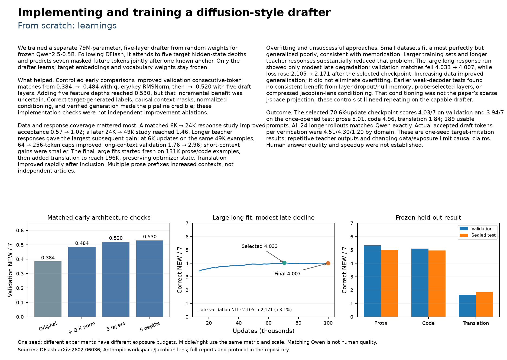

# Implementing and training a diffusion-style drafter from scratch: learnings

We wanted to train a small drafter around a frozen Qwen model and see whether it could predict several tokens together. We trained a **79M-parameter, five-layer drafter from scratch** for **Qwen2.5-0.5B**. It uses Qwen's hidden states and predicts seven new tokens after one known anchor. Qwen stays frozen throughout.

**What helped.** Query/key normalization improved our early validation score from **0.384 to 0.484** correct new tokens. A deeper drafter reached **0.520**. Using five hidden-state depths reached **0.530**, but that last difference was too small to be confident about. Getting the labels and context masks right was also necessary: the drafter should learn Qwen's next tokens without seeing them in its context.

**The biggest improvement came from the data.** More examples helped: **6K to 24K responses moved the score from 0.57 to 1.02**, and a later 49K run reached **1.46**. Longer responses helped even more. On the same 49K examples, at the same 6K updates, extending responses from 64 to 256 tokens moved long-context validation from **1.76 to 2.96**. We then trained on **196K examples across prose, code and translation**.

**The small runs looked like memorization.** They fit the training data well but did poorly on validation. More data and longer responses substantially improved that. The large long-response run only slipped slightly after its best checkpoint: **4.033 to 4.007** correct new tokens, with validation loss rising about **3.1%**. We kept the earlier checkpoint. Layer dropout, selected layers and the earlier compressed Jacobian-lens conditioning had not given us a consistent improvement.

**Where we ended up.** The selected drafter scored **4.03 out of seven on validation and 3.94 on test**: **5.01 for prose, 4.96 for code and 1.84 for translation**. All **24 longer verified generations** matched Qwen exactly. We now have a drafter that learns and generalizes on this evaluation. We have not yet shown better answer quality or an overall speedup.

[Full research PDF](../results/drafter-learnings.pdf) · [Measured evidence](../results/qualification-findings.md) · [DFlash](https://arxiv.org/abs/2602.06036) · [J-space / Jacobian lens](https://transformer-circuits.pub/2026/workspace/index.html)

[LaTeX source](../results/drafter-learnings.tex). Rebuild with `uv run --with matplotlib python scripts/render_drafter_learnings.py` (requires TeX Live and Poppler).

## Detailed report: what we built and how we trained it

### The drafter

The idea was to train a new, small drafting model for an already trained LLM. **The 79M drafter learns from random weights; Qwen2.5-0.5B stays frozen.** We use Qwen's tokenizer, token embeddings and output vocabulary weights. We train the drafter's own layers and its projection of Qwen's hidden states.

Following DFlash, we take Qwen's hidden states after blocks **2, 7, 12, 17 and 22**, join them together, and project and normalize them into context memory. The five draft layers attend to that memory and to the tokens in the proposed block. They use query/key RMSNorm, rotary positions and a gated MLP. One known anchor is followed by **seven masked positions**. The drafter predicts all seven in one pass. This is diffusion-style masked drafting; we are not doing repeated denoising rounds here.

### The training data

We train on **responses generated by Qwen**, rather than asking the drafter to copy human text that Qwen might not generate. For each response, we sample places to start a block. The drafter gets the anchor token and Qwen's hidden states strictly before it. It then learns the next seven tokens. The attention mask keeps future tokens out of its context and keeps separate training blocks from attending to each other.

We compared teacher responses capped at **64 tokens and 256 tokens**, training a fresh drafter for each. Both started on **131,072 prose/code examples**, then added translation to reach **196,608 balanced examples**. We kept the optimizer and sampling state when adding translation. Translation arrived at update 17,985 in the short-response run and 11,472 in the long-response run, so this final comparison also changes how long each model trained on translation.

### The training setup

Each model completed **100,000 updates**. A batch had 48 responses, eight sampled anchors per response and seven new-token labels per anchor: **268.8M label exposures per model**. These include repeated sampling of the same responses; they are not 268.8M unique tokens. We ran the training in bounded Modal jobs and resumed from checkpoints.

We used AdamW with learning rate 0.0006, weight decay 0.01, 4% warmup, a cosine schedule and gradient clipping at 1. The seed was 42. The loss was cross-entropy, with more weight on earlier draft positions using an exponential decay with gamma 4. The anchor was excluded from the loss. Qwen's hidden states were extracted during training, with its weights frozen.

### How generation works

Qwen processes the prompt and gives us the next token, which becomes the anchor. The drafter proposes the following seven tokens together. Qwen then checks that block. We keep the consecutive matching prefix and stop accepting at the first disagreement. We discard rejected cache positions, keep the committed context, and use Qwen's correction as the next anchor.

The verifier is why this path can reproduce Qwen's greedy output exactly. The drafter helps propose tokens; Qwen still decides which ones to commit. Our longer correctness checks used FP32 verification on the stored BF16 Qwen weights.

<!-- report-page -->

## Detailed report: what we learned and what comes next

### What made it work

Normalization helped early, and a deeper drafter helped too. The deeper model also had more parameters, so we have not separated depth from capacity. Adding more hidden-state depths gave a much smaller, uncertain improvement. These were separate early comparisons; we should not read them as a complete explanation of the final model's performance.

The strongest improvements came from **more training examples and longer teacher responses**. On the same 49K examples at 6K updates, longer responses moved long-context validation from **1.76 to 2.96**. In the final large runs, the best short-response model reached **2.195** correct new tokens and the best long-response model reached **4.033**. Longer responses let us sample more places in a continuation, including contexts after Qwen had already generated some text.

The long run's best checkpoint was at **update 70,585**. By 100,000 updates, its score was **4.007** and loss had risen from **2.105 to 2.171**. Training beyond 20K still helped, but the later gains were smaller. Four is a plateau for this setup, not an established ceiling for drafting.

### What we actually validated

We selected and froze the long-response checkpoint before opening the test. It scored **3.938 correct new tokens out of seven** across **189 usable prompts**, with 63 in each domain. Prose scored **5.014**, code **4.958** and translation **1.843**. We weight the three domains equally. A source-group bootstrap gave a 95% interval of **3.764 to 4.106** for the overall score, conditional on this one trained model.

We also ran **24 longer verified generations**, totaling **3,906 tokens**. Every output matched ordinary greedy Qwen generation. In these live runs, the average accepted new draft tokens per verification call were **4.514 for prose, 4.300 for code and 1.195 for translation**. That is a separate measurement from predicting blocks along recorded teacher responses. In both cases, the anchor is excluded and tokens after the first mismatch do not count.

### What did not help

On small datasets, the drafter could fit the training examples while validation remained poor. That looked like memorization. Scaling the data and using longer responses substantially improved generalization, although we still saw some late overfitting. Our training diagnostic only sampled twelve responses, so its gap from validation should not be treated as a full training-set measurement.

Earlier tests with weaker decoders did not show a consistent benefit from layer dropout/null memory, probe-selected layers or compressed Jacobian-lens conditioning. We learned much less from those tests because the drafting baseline itself was still weak.

### The J-space question

Now that we have a capable drafter, we are testing whether **adding J-space alongside the existing hidden states** helps it use the concepts represented there. We are comparing raw states, raw states plus sparse J-space, and raw states plus a random-frame control. Each starts from the same qualified drafter and gets the same data and updates, with fresh validation and test prompts.

At the last checked checkpoint, **4,237 of 30,000 updates**, the validation scores were **3.958 for raw states, 3.965 with J-space and 3.967 with the random frame**. All three started at 3.959. The changes are still tiny, and J-space has not beaten the random control. We do not yet have convincing evidence that semantic conditioning helps. We paused the run here rather than spending the remaining budget without a clear benefit. The checkpoints are retained, and the fresh test remains unopened.

### What this tells us

We have shown that our drafter can learn to imitate Qwen beyond its training examples. This is one seed, and some teacher responses are repetitive. We still need separate evidence for answer quality, speed, and what happens if we commit two or three tokens without verification. The original drafting test is now consumed; later model choices need fresh held-out evaluation.

The repository keeps the configurations, training curves, qualification results, paper references and checkpoint checksums. The selected baseline is best.pt in the fresh-grid-196608-r256-11 Modal run. The paused J-space comparison is tracked separately so its interim results do not get mixed into the completed baseline study.
