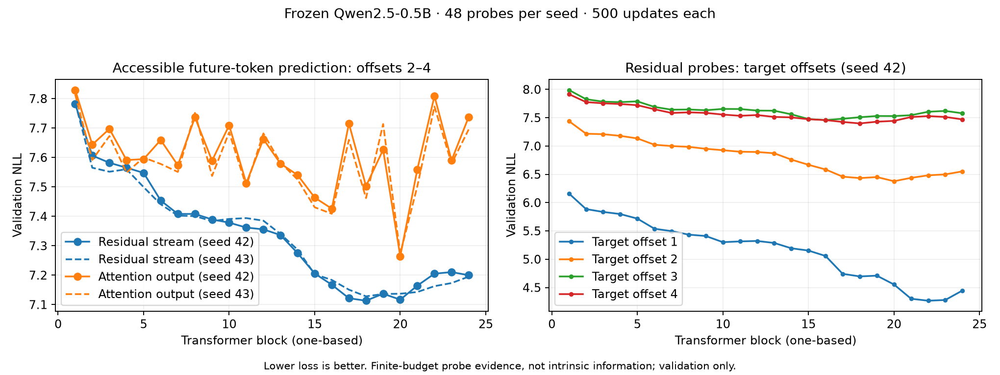
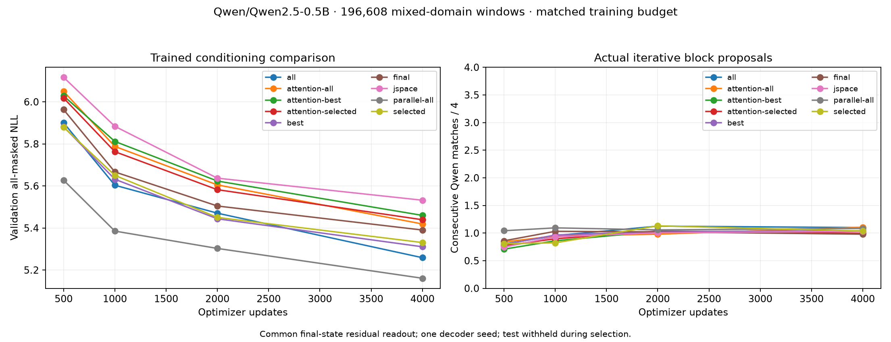

# Completed trained conditioning study

All 11 decoder runs completed on Modal: nine Qwen2.5-0.5B conditions and two
Qwen3-0.6B-Base conditions, each 4,000 updates at batch 128. Every run used the
same ordered 196,608 mixed-domain training windows and 192 validation/test windows;
[the corpus audit](conditioning-corpus-audit.json) verifies their identities.
Each decoder saw 2.048M target-token slots. Diffusion supervised 1,279,980 masked
positions; the parallel baseline supervised all 2.048M positions. Thus matching
examples/updates does not match the number or distribution of supervised labels.

The [test protocol](conditioning-test-protocol.json) was committed before test
access. Every checkpoint was selected by validation NLL. The test runner verified
source report hashes and evaluated all conditions once. No test-based retuning
was performed. The previous test split is now exposed and is not an untouched
holdout for future adaptive work.

## Layer information

Two independent seeds trained all 24 residual and 24 attention-output probes
(96 probes total, 500 updates each). The residual ranking favors the broad
17–20 region: top sets are 18/20/17 and 18/19/20. Attention layer 20 has a local
loss dip in both seeds and all three domains; both seeds select 20/16/15.
These probes omit the final-state shortcut and use only the last prefix token.
They measure accessible prediction under a finite training budget, not intrinsic
information. Offsets 3–4 remain difficult; no complete future answer is established.

## Trained diffusion conditioning

Decoder comparisons include a common final-state residual readout, so their
question is what conditioning adds beyond that shortcut. All 24 residual layers
outperform the probe-selected subsets at this budget. A good individual probe
ranking did not identify the best combined decoder memory.

| Fixed test comparison | Left NLL | Right NLL | Difference, source-group bootstrap interval |
| --- | ---: | ---: | --- |
| Qwen2.5 all residuals vs final | 5.411 | 5.519 | -0.108 [-0.170, -0.041] |
| Qwen3 all residuals vs final | 5.445 | 5.663 | -0.218 [-0.317, -0.115] |
| Compressed J-lens vs matching raw subset | 5.663 | 5.440 | +0.223 [+0.154, +0.290] |
| All-residual diffusion vs parallel | 5.411 | 5.332 | +0.079 [+0.008, +0.144] |

Intervals resample source groups within domains, conditional on these trained
heads. There is one decoder seed, a small 192-window test set, and multiple
exploratory comparisons; these are not multiplicity-corrected confirmatory claims.
Full per-domain measurements and actual continuations are in the
[test report](conditioning-test.md). NLL is all-masked marginal prediction loss,
not autoregressive sequence perplexity.

## What the experiment supports

- Multi-depth residual conditioning improves prediction over final-only in both
  tested Qwen families. Its generation benefit is small: Qwen2.5 consecutive
  agreement rises from 1.036 to 1.141 tokens / 4.
- The compressed top-25 J-lens adaptation, calibrated on 100 training prefixes,
  worsens loss versus its matching raw subset. This is not a rejection of the
  paper's full J-space representation; calibration convergence and alternative
  readouts were not established.
- Denoising does not outperform the parallel baseline in this setup. Parallel
  has lower NLL and essentially the same consecutive agreement (1.146 vs 1.141).
  The objectives and actual supervised-label counts differ as noted above.
- Useful block generation and efficiency are not established. All-residual
  diffusion has only 1.6% full-block Qwen agreement on test. Prose, code and German
  samples remain unreliable; no matched-quality speedup is claimed.
- Qwen3-0.6B does not solve the decoder-quality problem at this budget. Its family,
  depth and hidden width change, with 23.405M trainable head parameters versus
  23.009M for Qwen2.5, so this is not a pure backbone parameter-count experiment.

## Artifacts and limits

Raw reports, source/model/data revisions, training curves, frozen test protocol,
per-example measurements and configuration files are retained. Modal volume
`latent-workspace-qwen-runs` stores each run's `size-196608-best.pt` and resumable
`size-196608.pt`. The all-layer Qwen2.5 inference head is also downloaded to
`artifacts/conditioning-all-best.pt`; its checksum matches the tested head.
See [checkpoint manifest](conditioning-local-checkpoint.json).

Fifty local tests and both real-model GPU smokes passed. All jobs completed;
conservative cumulative allocation reservations are $192 of $200, not an actual
billing statement. This study covers Qwen2.5-0.5B and Qwen3-0.6B. Qwen3.5-0.8B
needs separate tokenization and adapter verification and was not trained here.
Before further adaptive experiments, establish a larger fresh held-out set and
repeat decoder conditions across seeds. Training changes should separately test
whether stronger token conditioning or target-model distillation improves joint
block quality; neither was implemented as part of this completed comparison.
