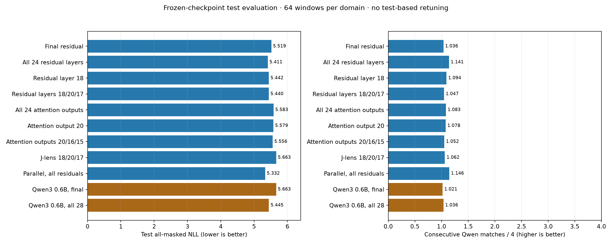

# Frozen-checkpoint test evaluation



All checkpoints were fixed by validation before test access. See
[frozen protocol](conditioning-test-protocol.json) and full raw suite
[report](conditioning-test-01.json). No test-based retuning was performed.

| Run | Update | Test NLL | Prose | Code | Translation | Qwen prefix / 4 | Full agreement |
| --- | ---: | ---: | ---: | ---: | ---: | ---: | ---: |
| conditioning-final-01 | 4000 | 5.519 | 5.409 | 4.966 | 6.182 | 1.036 | 1.6% |
| conditioning-all-01 | 4000 | 5.411 | 5.314 | 4.759 | 6.160 | 1.141 | 1.6% |
| conditioning-best-01 | 4000 | 5.442 | 5.299 | 4.823 | 6.203 | 1.094 | 2.1% |
| conditioning-selected-01 | 4000 | 5.440 | 5.327 | 4.823 | 6.170 | 1.047 | 0.5% |
| conditioning-attention-all-01 | 4000 | 5.583 | 5.477 | 4.975 | 6.297 | 1.083 | 1.6% |
| conditioning-attention-best-01 | 4000 | 5.579 | 5.483 | 4.969 | 6.286 | 1.078 | 1.0% |
| conditioning-attention-selected-01 | 4000 | 5.556 | 5.422 | 4.987 | 6.260 | 1.052 | 1.6% |
| conditioning-jspace-01 | 4000 | 5.663 | 5.601 | 5.101 | 6.288 | 1.062 | 0.5% |
| conditioning-parallel-all-01 | 4000 | 5.332 | 5.252 | 4.581 | 6.163 | 1.146 | 1.0% |
| qwen3-conditioning-final-01 | 4000 | 5.663 | 5.598 | 5.237 | 6.153 | 1.021 | 0.0% |
| qwen3-conditioning-all-01 | 4000 | 5.445 | 5.285 | 4.990 | 6.059 | 1.036 | 0.0% |

## Predeclared paired comparisons

- conditioning-all-01 minus conditioning-final-01: NLL -0.108, source-group bootstrap interval [-0.170, -0.041].
- conditioning-jspace-01 minus conditioning-selected-01: NLL 0.223, source-group bootstrap interval [0.154, 0.290].
- conditioning-all-01 minus conditioning-parallel-all-01: NLL 0.079, source-group bootstrap interval [0.008, 0.144].
- qwen3-conditioning-all-01 minus qwen3-conditioning-final-01: NLL -0.218, source-group bootstrap interval [-0.317, -0.115].

One decoder seed, 192 grouped test windows, multiple exploratory comparisons. Intervals are conditional on trained heads; not corrected for multiple testing.

All-masked NLL is not sequence perplexity. Qwen agreement is a diagnostic,
not deployed speculative decoding or measured speedup. Model-family comparisons
change architecture and projection parameter count as well as backbone size.

## Saved test continuations

### conditioning-final-01

**prose**

Prefix:
```text
= Robert Boulter =
Robert Boulter is an English film , television and theatre actor . He had a guest @-@ starring role on the television series The Bill in 2000 . This was followed by a starring role in the play Herons written by Simon Stephens , which was performed in 2001 at the Royal Court Theatre . He had a guest role in the television series Judge John Deed in 2002 . In 2004 Boulter landed a role as " Craig " in the episode " Teddy 's Story " of the television series The Long Firm ; he
```
Unanchored block continuation:
```text
 was himself in the episode episode in the episode episode in the episode episode in the episode , and the episode of the episode
```

**code**

Prefix:
```text
# test_hhfit.py --- 
# 
# Filename: test_hhfit.py
# Description: 
# Author: 
# Maintainer: 
# Created: Tue May 21 16:34:45 2013 (+0530)
# Version: 
# Last-Updated: Tue May 21 16:37:28 2013 (+0530)
#           By: subha
#     Update #: 9
# URL: 
# Keywords: 
# Compatibility: 
# 
# 

# Commentary: 

```
Unanchored block continuation:
```text
## the Python 3333. 11. 111.111.1
```

**translation**

Prefix:
```text
Translate English to German.
English: Gutach: Increased safety for pedestrians
German:
```
Unanchored block continuation:
```text
 Guticht hat die Sicheren, der Fahen werden, für die Verichtung der die Kommissionen werden,
```

### conditioning-all-01

**prose**

Prefix:
```text
= Robert Boulter =
Robert Boulter is an English film , television and theatre actor . He had a guest @-@ starring role on the television series The Bill in 2000 . This was followed by a starring role in the play Herons written by Simon Stephens , which was performed in 2001 at the Royal Court Theatre . He had a guest role in the television series Judge John Deed in 2002 . In 2004 Boulter landed a role as " Craig " in the episode " Teddy 's Story " of the television series The Long Firm ; he
```
Unanchored block continuation:
```text
 played himself in the episode of the episode " The "sister " "- "s "sister " in the
```

**code**

Prefix:
```text
# test_hhfit.py --- 
# 
# Filename: test_hhfit.py
# Description: 
# Author: 
# Maintainer: 
# Created: Tue May 21 16:34:45 2013 (+0530)
# Version: 
# Last-Updated: Tue May 21 16:37:28 2013 (+0530)
#           By: subha
#     Update #: 9
# URL: 
# Keywords: 
# Compatibility: 
# 
# 

# Commentary: 

```
Unanchored block continuation:
```text
#### 
##
# 
# This Theoretical of the GNU Radio for the GNU Radio for the GNU
```

**translation**

Prefix:
```text
Translate English to German.
English: Gutach: Increased safety for pedestrians
German:
```
Unanchored block continuation:
```text
 Guten hat wir: Ansicht. Die Sicherer der Menschenen werden.<|endoftext|>
```

### conditioning-best-01

**prose**

Prefix:
```text
= Robert Boulter =
Robert Boulter is an English film , television and theatre actor . He had a guest @-@ starring role on the television series The Bill in 2000 . This was followed by a starring role in the play Herons written by Simon Stephens , which was performed in 2001 at the Royal Court Theatre . He had a guest role in the television series Judge John Deed in 2002 . In 2004 Boulter landed a role as " Craig " in the episode " Teddy 's Story " of the television series The Long Firm ; he
```
Unanchored block continuation:
```text
 was released in the 2005 .
= = Background and =
 = Background = =
= = = = =

```

**code**

Prefix:
```text
# test_hhfit.py --- 
# 
# Filename: test_hhfit.py
# Description: 
# Author: 
# Maintainer: 
# Created: Tue May 21 16:34:45 2013 (+0530)
# Version: 
# Last-Updated: Tue May 21 16:37:28 2013 (+0530)
#           By: subha
#     Update #: 9
# URL: 
# Keywords: 
# Compatibility: 
# 
# 

# Commentary: 

```
Unanchored block continuation:
```text
##  The purpose of the `testtest.1`` in the `20 %s of the `
```

**translation**

Prefix:
```text
Translate English to German.
English: Gutach: Increased safety for pedestrians
German:
```
Unanchored block continuation:
```text
 Die Guticht Siegehtßen, die Äichtung für die der Gesamtsung. Die (geß
```

### conditioning-selected-01

**prose**

Prefix:
```text
= Robert Boulter =
Robert Boulter is an English film , television and theatre actor . He had a guest @-@ starring role on the television series The Bill in 2000 . This was followed by a starring role in the play Herons written by Simon Stephens , which was performed in 2001 at the Royal Court Theatre . He had a guest role in the television series Judge John Deed in 2002 . In 2004 Boulter landed a role as " Craig " in the episode " Teddy 's Story " of the television series The Long Firm ; he
```
Unanchored block continuation:
```text
 was played in the episode , the same episode , the episode " The episode " of the episode of the episode , the
```

**code**

Prefix:
```text
# test_hhfit.py --- 
# 
# Filename: test_hhfit.py
# Description: 
# Author: 
# Maintainer: 
# Created: Tue May 21 16:34:45 2013 (+0530)
# Version: 
# Last-Updated: Tue May 21 16:37:28 2013 (+0530)
#           By: subha
#     Update #: 9
# URL: 
# Keywords: 
# Compatibility: 
# 
# 

# Commentary: 

```
Unanchored block continuation:
```text
## The use of the path of the file of the test is the script name. 1st. 1
```

**translation**

Prefix:
```text
Translate English to German.
English: Gutach: Increased safety for pedestrians
German:
```
Unanchored block continuation:
```text
 Guten Sie wir, die die Komforten der Kommerar der Kommerar der Kommerar der Kom
```

### conditioning-attention-all-01

**prose**

Prefix:
```text
= Robert Boulter =
Robert Boulter is an English film , television and theatre actor . He had a guest @-@ starring role on the television series The Bill in 2000 . This was followed by a starring role in the play Herons written by Simon Stephens , which was performed in 2001 at the Royal Court Theatre . He had a guest role in the television series Judge John Deed in 2002 . In 2004 Boulter landed a role as " Craig " in the episode " Teddy 's Story " of the television series The Long Firm ; he
```
Unanchored block continuation:
```text
 played the first of the two 'sisters 'isters of the name 'sister 'ister. In 19
```

**code**

Prefix:
```text
# test_hhfit.py --- 
# 
# Filename: test_hhfit.py
# Description: 
# Author: 
# Maintainer: 
# Created: Tue May 21 16:34:45 2013 (+0530)
# Version: 
# Last-Updated: Tue May 21 16:37:28 2013 (+0530)
#           By: subha
#     Update #: 9
# URL: 
# Keywords: 
# Compatibility: 
# 
# 

# Commentary: 

```
Unanchored block continuation:
```text
## In the appendix of the same paper, the file 's
    #  in the 's. 
```

**translation**

Prefix:
```text
Translate English to German.
English: Gutach: Increased safety for pedestrians
German:
```
Unanchored block continuation:
```text
 Guten hat die Sicherener.<|endoftext|>
```

### conditioning-attention-best-01

**prose**

Prefix:
```text
= Robert Boulter =
Robert Boulter is an English film , television and theatre actor . He had a guest @-@ starring role on the television series The Bill in 2000 . This was followed by a starring role in the play Herons written by Simon Stephens , which was performed in 2001 at the Royal Court Theatre . He had a guest role in the television series Judge John Deed in 2002 . In 2004 Boulter landed a role as " Craig " in the episode " Teddy 's Story " of the television series The Long Firm ; he
```
Unanchored block continuation:
```text
 was made the first actor of the actor to be the role 's name of the number of the episode of the episode
```

**code**

Prefix:
```text
# test_hhfit.py --- 
# 
# Filename: test_hhfit.py
# Description: 
# Author: 
# Maintainer: 
# Created: Tue May 21 16:34:45 2013 (+0530)
# Version: 
# Last-Updated: Tue May 21 16:37:28 2013 (+0530)
#           By: subha
#     Update #: 9
# URL: 
# Keywords: 
# Compatibility: 
# 
# 

# Commentary: 

```
Unanchored block continuation:
```text
##    The purpose of the test is code
    # # 1.0.1.
    """
   
```

**translation**

Prefix:
```text
Translate English to German.
English: Gutach: Increased safety for pedestrians
German:
```
Unanchored block continuation:
```text
 Sie ist sicher, Sie Rerenen Sie zu die Kommission, die Kommission, die Kommission, die Kom
```

### conditioning-attention-selected-01

**prose**

Prefix:
```text
= Robert Boulter =
Robert Boulter is an English film , television and theatre actor . He had a guest @-@ starring role on the television series The Bill in 2000 . This was followed by a starring role in the play Herons written by Simon Stephens , which was performed in 2001 at the Royal Court Theatre . He had a guest role in the television series Judge John Deed in 2002 . In 2004 Boulter landed a role as " Craig " in the episode " Teddy 's Story " of the television series The Long Firm ; he
```
Unanchored block continuation:
```text
 was returned the first time of the season . The episode of the show 's 290thththth
```

**code**

Prefix:
```text
# test_hhfit.py --- 
# 
# Filename: test_hhfit.py
# Description: 
# Author: 
# Maintainer: 
# Created: Tue May 21 16:34:45 2013 (+0530)
# Version: 
# Last-Updated: Tue May 21 16:37:28 2013 (+0530)
#           By: subha
#     Update #: 9
# URL: 
# Keywords: 
# Compatibility: 
# 
# 

# Commentary: 

```
Unanchored block continuation:
```text
#####
# description: 
#    ####    ## description = 
#    #
```

**translation**

Prefix:
```text
Translate English to German.
English: Gutach: Increased safety for pedestrians
German:
```
Unanchored block continuation:
```text
 Wir ist die Berufufung, die mit die Verwfkehrung der und derung dersgstung
```

### conditioning-jspace-01

**prose**

Prefix:
```text
= Robert Boulter =
Robert Boulter is an English film , television and theatre actor . He had a guest @-@ starring role on the television series The Bill in 2000 . This was followed by a starring role in the play Herons written by Simon Stephens , which was performed in 2001 at the Royal Court Theatre . He had a guest role in the television series Judge John Deed in 2002 . In 2004 Boulter landed a role as " Craig " in the episode " Teddy 's Story " of the television series The Long Firm ; he
```
Unanchored block continuation:
```text
 played the guest and guest returned in the episode episode of the same of 192900. 1
```

**code**

Prefix:
```text
# test_hhfit.py --- 
# 
# Filename: test_hhfit.py
# Description: 
# Author: 
# Maintainer: 
# Created: Tue May 21 16:34:45 2013 (+0530)
# Version: 
# Last-Updated: Tue May 21 16:37:28 2013 (+0530)
#           By: subha
#     Update #: 9
# URL: 
# Keywords: 
# Compatibility: 
# 
# 

# Commentary: 

```
Unanchored block continuation:
```text
###,#
# 1.2000. 10. 102.0
```

**translation**

Prefix:
```text
Translate English to German.
English: Gutach: Increased safety for pedestrians
German:
```
Unanchored block continuation:
```text
 Guten Sie wir, die die Komfortmen, daß die Berichtung, die die Komfortftmen,
```

### conditioning-parallel-all-01

**prose**

Prefix:
```text
= Robert Boulter =
Robert Boulter is an English film , television and theatre actor . He had a guest @-@ starring role on the television series The Bill in 2000 . This was followed by a starring role in the play Herons written by Simon Stephens , which was performed in 2001 at the Royal Court Theatre . He had a guest role in the television series Judge John Deed in 2002 . In 2004 Boulter landed a role as " Craig " in the episode " Teddy 's Story " of the television series The Long Firm ; he
```
Unanchored block continuation:
```text
 played a the the character ofs the same " the the " of of the episode " , the " " , the
```

**code**

Prefix:
```text
# test_hhfit.py --- 
# 
# Filename: test_hhfit.py
# Description: 
# Author: 
# Maintainer: 
# Created: Tue May 21 16:34:45 2013 (+0530)
# Version: 
# Last-Updated: Tue May 21 16:37:28 2013 (+0530)
#           By: subha
#     Update #: 9
# URL: 
# Keywords: 
# Compatibility: 
# 
# 

# Commentary: 

```
Unanchored block continuation:
```text
## This the test of of the h


# = = = = = =
 = = = = =
```

**translation**

Prefix:
```text
Translate English to German.
English: Gutach: Increased safety for pedestrians
German:
```
Unanchored block continuation:
```text
 Dieicht,ungsterstig. Dieifkeung,zz. Dieifzung,zz.
```

### qwen3-conditioning-final-01

**prose**

Prefix:
```text
= Robert Boulter =
Robert Boulter is an English film , television and theatre actor . He had a guest @-@ starring role on the television series The Bill in 2000 . This was followed by a starring role in the play Herons written by Simon Stephens , which was performed in 2001 at the Royal Court Theatre . He had a guest role in the television series Judge John Deed in 2002 . In 2004 Boulter landed a role as " Craig " in the episode " Teddy 's Story " of the television series The Long Firm ; he
```
Unanchored block continuation:
```text
 played was the first part of the 1 , , 2 , the 3 , the 4 , the 
```

**code**

Prefix:
```text
# test_hhfit.py --- 
# 
# Filename: test_hhfit.py
# Description: 
# Author: 
# Maintainer: 
# Created: Tue May 21 16:34:45 2013 (+0530)
# Version: 
# Last-Updated: Tue May 21 16:37:28 2013 (+0530)
#           By: subha
#     Update #: 9
# URL: 
# Keywords: 
# Compatibility: 
# 
# 

# Commentary: 

```
Unanchored block continuation:
```text
##
# 2.00.0.000000000000
```

**translation**

Prefix:
```text
Translate English to German.
English: Gutach: Increased safety for pedestrians
German:
```
Unanchored block continuation:
```text
 Gutenungen der Sicherichten: Eräung der Sicherährung, für Bäungereenen,
```

### qwen3-conditioning-all-01

**prose**

Prefix:
```text
= Robert Boulter =
Robert Boulter is an English film , television and theatre actor . He had a guest @-@ starring role on the television series The Bill in 2000 . This was followed by a starring role in the play Herons written by Simon Stephens , which was performed in 2001 at the Royal Court Theatre . He had a guest role in the television series Judge John Deed in 2002 . In 2004 Boulter landed a role as " Craig " in the episode " Teddy 's Story " of the television series The Long Firm ; he
```
Unanchored block continuation:
```text
 played the first of two two two 110 , 100 and year , and the year of the
```

**code**

Prefix:
```text
# test_hhfit.py --- 
# 
# Filename: test_hhfit.py
# Description: 
# Author: 
# Maintainer: 
# Created: Tue May 21 16:34:45 2013 (+0530)
# Version: 
# Last-Updated: Tue May 21 16:37:28 2013 (+0530)
#           By: subha
#     Update #: 9
# URL: 
# Keywords: 
# Compatibility: 
# 
# 

# Commentary: 

```
Unanchored block continuation:
```text
##### This
## module is is used a part of the
    the
    "s
```

**translation**

Prefix:
```text
Translate English to German.
English: Gutach: Increased safety for pedestrians
German:
```
Unanchored block continuation:
```text
 Guticht, der Sicherichterung für der der Schwer,, daß die Europä, die Europäung
```
