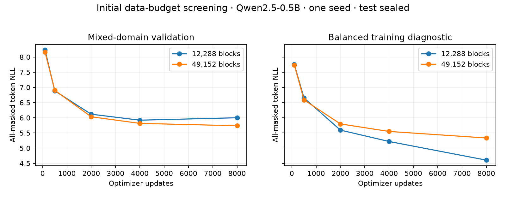

# data-repaired-02: initial data-budget study

Completed: True. sealed; no test losses or accuracy computed.

All rows use the same backbone, architecture and seed. NLL is all-masked
conditional token loss, not iterative sequence likelihood. Single-seed
screening with 64 validation windows/domain; no significance claim.


| Unique blocks | Updates | Supervised masked tokens | Train NLL | Validation NLL | Prose | Code | Translation |
| ---: | ---: | ---: | ---: | ---: | ---: | ---: | ---: |
| 12288 | 100 | 3962 | 7.757 | 8.233 | 7.922 | 8.364 | 8.412 |
| 12288 | 500 | 19850 | 6.652 | 6.886 | 6.878 | 6.695 | 7.085 |
| 12288 | 2000 | 79780 | 5.594 | 6.118 | 6.263 | 5.880 | 6.210 |
| 12288 | 4000 | 160059 | 5.220 | 5.921 | 6.178 | 5.618 | 5.968 |
| 12288 | 8000 | 319917 | 4.606 | 6.001 | 6.333 | 5.554 | 6.116 |
| 49152 | 100 | 3962 | 7.740 | 8.159 | 7.876 | 8.316 | 8.286 |
| 49152 | 500 | 19850 | 6.587 | 6.902 | 6.994 | 6.791 | 6.922 |
| 49152 | 2000 | 79780 | 5.797 | 6.033 | 6.101 | 5.907 | 6.090 |
| 49152 | 4000 | 160059 | 5.550 | 5.816 | 5.967 | 5.586 | 5.894 |
| 49152 | 8000 | 319917 | 5.335 | 5.738 | 5.834 | 5.497 | 5.882 |

## Validation continuations: 12288 windows

**prose**

```text
 the female and the fertil . and is laid . the 19 @00 00  00
```

**code**

```text
    def._(self,):
):
):
    self:
):
    self   ):
    self           = self self:

```

**translation**

```text
 Ein Rchagespoliten dieicht für um dieung den Wetticht von Wreung denenattericht
```


## Validation continuations: 49152 windows

**prose**

```text
 the female . the eggs of the first generation of the year are the hatch are laid in 10000
```

**code**

```text
    def test = import import self:
        def test = import import self:
            return            = import    '   
```

**translation**

```text
 Ein Kommissionische Strategen, daß der dermission der Obamaen, den Renenung der der der der
```


## Cleaned-data interpretation



This run uses the revised 22,999,040-parameter decoder: separate output projections
by block position and a residual readout initialized to Qwen's final state. The
train pool contains 49,152 distinct windows; all exact split-overlap counts are
zero, and validation/test tensors equal the originals byte-for-byte. See the
[window audit](data-repaired-02-window-audit.json).

At 8,000 updates, validation NLL is 6.001 for 12,288 windows and 5.738 for 49,152.
The larger-minus-smaller difference is -0.263, with an exploratory paired
source-group bootstrap interval [-0.402, -0.133]. Improvements differ by domain:
prose -0.499, code -0.057, translation -0.233. One training seed and 16 validation
source groups per domain limit interpretation; this is not confirmatory inference.

Quality is still inadequate. Mean consecutive greedy agreement with Qwen is only
0.760 versus 0.901 tokens per four-token proposal. Text samples improve beyond
constant punctuation but remain ungrammatical, and code/translation are poor.
The 12k model overfits; 49k is better but does not establish sufficient quality.
The next matched-budget size is 196,608 windows. Final-layer-only conditioning
and known-first-token inference are separate diagnostic controls.
