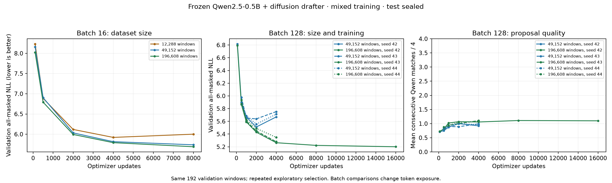

# Clean dataset-size study



Frozen Qwen2.5-0.5B, 23M-parameter diffusion head, four-token blocks, mixed
prose/code/translation training. Identical 192 validation windows; test sealed.
Separate position outputs and residual readout are enabled. These are
all-masked marginal losses, not autoregressive sequence perplexities.

| Run | Seed | Batch | Available unique windows | Best update | Best NLL | Final update | Final NLL |
| --- | ---: | ---: | ---: | ---: | ---: | ---: | ---: |
| data-repaired-02 | 42 | 16 | 12,288 | 4,000 | 5.921 | 8,000 | 6.001 |
| data-repaired-02 | 42 | 16 | 49,152 | 8,000 | 5.738 | 8,000 | 5.738 |
| data-large-01 | 42 | 16 | 196,608 | 8,000 | 5.690 | 8,000 | 5.690 |
| data-batch128-01 | 42 | 128 | 49,152 | 2,000 | 5.511 | 4,000 | 5.670 |
| data-large-batch128-01 | 42 | 128 | 196,608 | 4,000 | 5.264 | 4,000 | 5.264 |
| data-continue-01 | 42 | 128 | 196,608 | 16,000 | 5.201 | 16,000 | 5.201 |
| data-seed43-01 | 43 | 128 | 49,152 | 2,000 | 5.639 | 4,000 | 5.753 |
| data-seed43-01 | 43 | 128 | 196,608 | 4,000 | 5.280 | 4,000 | 5.280 |
| data-seed44-01 | 44 | 128 | 49,152 | 2,000 | 5.557 | 4,000 | 5.712 |
| data-seed44-01 | 44 | 128 | 196,608 | 4,000 | 5.348 | 4,000 | 5.348 |

## Paired seed comparison at the 4k-update maximum budget

- Seed 42: best observed larger-minus-smaller NLL -0.247; selected updates 4,000/2,000.
- Seed 43: best observed larger-minus-smaller NLL -0.359; selected updates 4,000/2,000.
- Seed 44: best observed larger-minus-smaller NLL -0.209; selected updates 4,000/2,000.

Mean paired difference: -0.272 across 3 completed seeds. This summarizes training-seed variation on the same held-out data; it is not a population confidence interval.

## Interpretation and limits

The 49k pool overfits with continued training. Larger data supports longer
optimization, but average loss improvements do not establish useful block
generation. Inspect consecutive Qwen agreement in the right-hand plot.
Batch comparisons change total token exposure, not only gradient noise.
Available unique windows are not necessarily all sampled during a run.

Roughly 200k windows is a diagnostic training pool, not a demonstrated
minimum for acceptable quality. Use 4k batch-128 updates for initial decoder
comparisons; extend promising changes selectively before expanding data.
Best checkpoints are selected on the same
small validation set used repeatedly for architecture and training choices.
Larger validation and near-duplicate checks remain necessary before freezing
a protocol and evaluating test. Human corpus labels are used; no target-model
distillation, deployed verifier, quality parity or speedup is demonstrated.

## Provenance

Full reports retain configurations, source hashes, corpus revisions, window
identities, training indices and per-example metrics. Large reports are
losslessly archived as `RUN.json.gz`; others use `RUN.json`.
Rebuild these figures and this summary:

```bash
uv run --with matplotlib python scripts/plot_data_scaling.py
uv run python scripts/summarize_data_scaling.py
```
