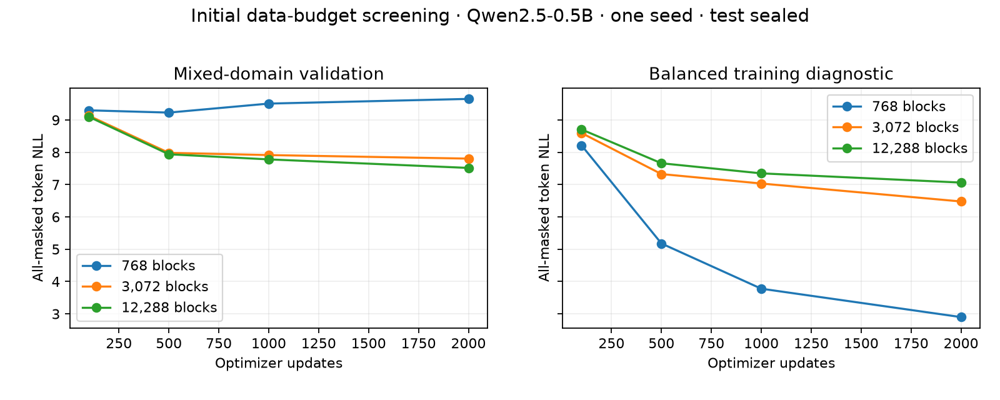
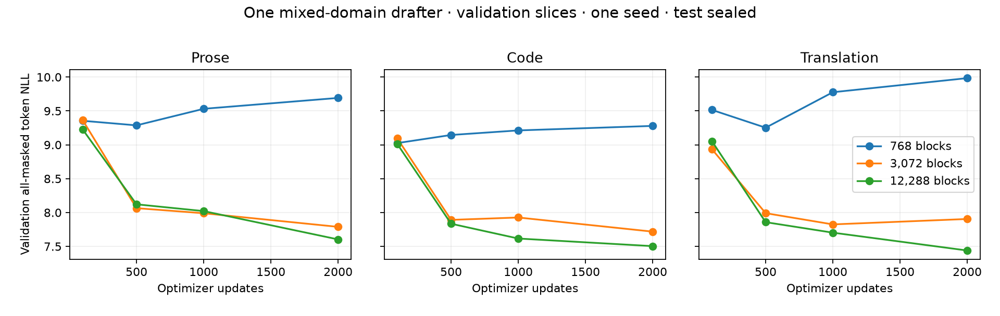

# data-study-01: initial data-budget study

> **Corpus audit correction:** the parent training pool contained 75 duplicate windows
> and one exact train/validation window overlap. These historical validation metrics
> are exploratory. The follow-up cleans training while keeping held-out tensors fixed.
> See [audit](data-study-01-window-audit.json). Tiny-set training-fit diagnostics remain
> training measurements, not evidence of held-out quality.


Completed: True. sealed; no test losses or accuracy computed.

All rows use the same backbone, architecture and seed. NLL is all-masked
conditional token loss, not iterative sequence likelihood. Single-seed
screening with 64 validation windows/domain; no significance claim.


| Unique blocks | Updates | Supervised masked tokens | Train NLL | Validation NLL | Prose | Code | Translation |
| ---: | ---: | ---: | ---: | ---: | ---: | ---: | ---: |
| 768 | 100 | 3962 | 8.214 | 9.299 | 9.355 | 9.026 | 9.515 |
| 768 | 500 | 19850 | 5.177 | 9.228 | 9.287 | 9.145 | 9.253 |
| 768 | 1000 | 39699 | 3.778 | 9.507 | 9.532 | 9.213 | 9.777 |
| 768 | 2000 | 79780 | 2.899 | 9.652 | 9.692 | 9.279 | 9.984 |
| 3072 | 100 | 3962 | 8.596 | 9.130 | 9.362 | 9.093 | 8.936 |
| 3072 | 500 | 19850 | 7.326 | 7.982 | 8.065 | 7.892 | 7.991 |
| 3072 | 1000 | 39699 | 7.033 | 7.914 | 7.990 | 7.927 | 7.825 |
| 3072 | 2000 | 79780 | 6.478 | 7.804 | 7.789 | 7.718 | 7.905 |
| 12288 | 100 | 3962 | 8.707 | 9.097 | 9.225 | 9.011 | 9.055 |
| 12288 | 500 | 19850 | 7.660 | 7.938 | 8.122 | 7.835 | 7.858 |
| 12288 | 1000 | 39699 | 7.348 | 7.780 | 8.021 | 7.616 | 7.703 |
| 12288 | 2000 | 79780 | 7.063 | 7.516 | 7.604 | 7.504 | 7.440 |

## Validation continuations: 768 windows

**prose**

```text
 to to to to by in in in in in in in ( ( (1mmm 0 00
```

**code**

```text
                             = = = = = = =
 = = = =
 = = = =
 = = = = =
```

**translation**

```text
 einen einen einen einen by by by by ' ' ' ' " " " " " " " " " " " "
```


## Validation continuations: 3072 windows

**prose**

```text
 , , , , , , , , , , , , , ( ' (1111 , , , ,
```

**code**

```text
                             = = = = = = = = =
 =
 = =
 = = = = =
 =
 =
 =

```

**translation**

```text
 der der der der der der der der    111111111111
```


## Validation continuations: 12288 windows

**prose**

```text
 , , , , , , , , , , , , , , , , , , , , , , , ,
```

**code**

```text
 self self self self(self(self(self(self(self(self(self(self(self(self(self(self(self(self(self(self(self(self(self(self
```

**translation**

```text
enenenen    2222111111111211
```


## Interpretation and next experiment





The 768-window run overfits: training diagnostic NLL falls to 2.90 while
validation reaches 9.65. At the same 2,000 updates, increasing unique windows to
3,072 and 12,288 improves validation NLL to 7.80 and 7.52. The largest subset
improves in every reported domain and continues improving between 1,000 and
2,000 updates. Its small train/validation gap (7.06 versus 7.52) leaves substantial
optimization/underfitting uncertainty. This is evidence that the smallest data
budget is inadequate, not a measured minimum sufficient budget.

Generation is still poor: all three runs have zero exact-block matches on these
192 validation windows and degenerate repetitive sample continuations. More data
improves NLL here, but does not monotonically improve greedy token accuracy.
The largest model averages about 3.3% generated token accuracy. Do not describe
this as a useful drafter or infer speculative acceptance/quality-preserving speed.

Each run saw 128,000 target-token slots, with **79,780 actual masked supervised
positions**. The largest available training subset contains 49,152 unique target
slots. End-to-end study time was 297 seconds on one L40S, excluding app startup.
All comparisons use one seed and only 64 validation windows per domain; correlated
windows, limited diversity and validation noise remain material limitations.

Recommended next bracket, not yet executed: compare 12,288 versus 49,152 mixed
training windows at 2k/4k/8k updates, retaining exactly the same held-out windows,
source revisions and group exclusions. Include a tiny-set memorization check and
an optimization-rate check before expanding further. At 8k updates and batch 16,
each run would see 512k target slots (roughly 320k masked labels). Do not launch
larger Qwen/layer sweeps until generation quality improves. Confirm the eventual
budget across seeds and a larger validation set before one frozen test evaluation.
