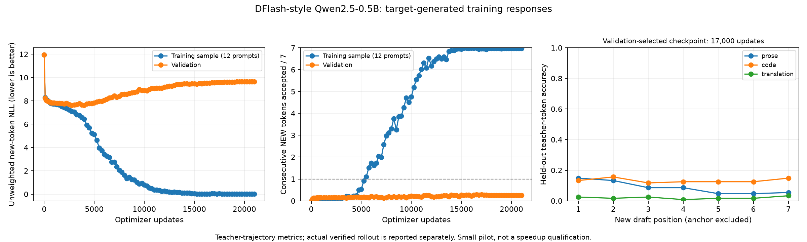

# DFlash-style baseline: fits the tiny corpus, fails to generalize

Executed on Modal L40S, 2026-10-11. This is a compact Qwen2 adaptation of classic
[DFlash](https://arxiv.org/abs/2602.06036), not a full paper reproduction or a useful fast drafter.
J-space, workspace, hidden-state prediction and layer-selection experiments remain deferred.

## What was trained

- Frozen pinned Qwen2.5-0.5B; 31,432,192 trainable draft parameters in two layers.
- One supplied anchor plus seven fully masked new tokens, predicted jointly in one pass.
- Standard fixed target features from post-block layers 2 and 22, injected as K/V.
- Shared frozen embeddings/vocabulary head; no auxiliary hidden-state prediction loss.
- Qwen-generated greedy responses across prose, Python code and English-to-German prompts.
- 380 usable training responses, 20,661 unique response-token slots; 47 fresh validation responses.
- 48 reserved test prompts: no test responses/features/metrics generated.

Initial training ran 1000 updates. The same model, AdamW state, RNG and cached teacher data
continued for another 20000 updates with an explicitly restarted warmup/cosine schedule.
Total: 504,000 sampled anchor blocks and 3,528,000 supervised new-token exposures.
Those are repeated exposures, not millions of distinct training tokens.

## Measured fitting and generalization

The table evaluates every training response, at up to eight fixed anchors per response
(2967 training blocks), and every validation response (376 blocks). It does not exhaust
every possible anchor. Means give equal weight to each domain.

| Checkpoint | Train NLL | Train consecutive new matches / 7 | Validation NLL | Validation consecutive new matches / 7 |
| --- | ---: | ---: | ---: | ---: |
| best, 17,000 updates | 0.0121 | 6.9852 | 9.5558 | 0.2844 |
| latest, 21,000 updates | 0.0052 | 6.9987 | 9.6334 | 0.2557 |

Best means maximum validation consecutive new-token acceptance, with NLL as tie-breaker.
It does not mean lowest validation loss. The initial 1000-update training diagnostic NLL
was 7.747 and validation NLL 7.820; longer training ultimately memorizes this tiny corpus.
Near-perfect training fits do not establish useful unseen-block generation.



The plotted blue curves use the same 12 training diagnostic prompts at every checkpoint;
the all-response table above is a separate final audit. The orange curve covers all 47
validation responses. The supplied anchor is excluded everywhere.

Validation-selected checkpoint by domain:

| Domain | Responses | NLL | Consecutive new matches / 7 | Full-seven match rate |
| --- | ---: | ---: | ---: | ---: |
| prose | 16 | 8.719 | 0.289 | 1.56% |
| code | 16 | 9.002 | 0.539 | 4.69% |
| translation | 15 | 10.947 | 0.025 | 0.00% |

## Actual verified rollout

Three held-out prompts, one/domain, 32-token cap; three warmed alternating-order repeats.
FP32 arithmetic on the same upcast stored BF16 target weights for both methods; timings
include prefill. The target outputs matched exactly in all measured repeats.

| Domain | AR / speculative wall time | Mean accepted new proposals per verification |
| --- | ---: | ---: |
| prose | 0.912× | 0.069 |
| code | 0.879× | 0.033 |
| translation | 0.880× | 0.033 |

All measured ratios are below 1: the drafter is slower here. These three prompts are
a pipeline timing check, not a general benchmark. Teacher-trajectory acceptance and
actual rollout acceptance differ; neither counts the known anchor as a draft success.

The original BF16 rollout failed. Fixed-input replay reproduced a shape-dependent
Qwen argmax flip (0.0625 top-two margin, 0.25 maximum logit difference). FP32 matched
all three diagnostic and final rollout prompts. This is not proof of universal numerical
parity, nor a validated BF16 speed claim. Training/cached teacher features still use BF16.

## Data interpretation and next priority

This establishes that the implementation can fit these training blocks; it does not
establish a sufficient data size or prove that scaling alone will solve generalization.
One seed, only 47 repeatedly consulted validation responses, and a deliberately tiny
training corpus limit broader conclusions. No new architecture comparison is justified.

The current sampler takes first eligible source rows and first-token prose/code prefixes.
A [qualitative spot check](dflash-corpus-spotcheck.json) found a license-header continuation
and consecutively selected parliamentary translation prompts. Qwen itself can mistranslate;
faithful speculative decoding preserves target behavior, not human translation quality.
Before a larger fit, use seeded source mixing, varied valid prose/code continuation
positions, response-length/repetition audits and more independent validation groups.
Keep architecture fixed and keep the test groups quarantined. These data changes are
follow-up work, not changes already made to this run.

## Evidence and recovery

- [Raw fitting curve and rollout results](dflash-fit-01.json).
- [All-response fitting audit](dflash-fit-audit-01.json).
- [Committed source and downloaded checkpoint identity](dflash-fit-provenance.json).
- [Initial pilot](dflash-pilot-02.json), [precision diagnosis](dflash-verify-01.json), and [prompt split audit](dflash-prompt-audit.json).
- [Protocol, pinned reference and data contract](../docs/dflash-baseline.md).
- Training source matches commit `b0b2280`; audit source matches `bb3ef32`.
- 69 local tests pass; real GPU fitting, all-response evaluation and FP32 rollout checks executed.
- Cumulative conservative reservations: $205.50 under the original authorized $500 upper cap; not a confirmed bill.

Checkpoints persist at `/runs/dflash-fit-01/{best,latest}.pt` on the dedicated Modal volume.
The selected checkpoint is downloaded and checksum-verified at `artifacts/dflash-fit-best.pt`.

```bash
uv run modal volume get latent-workspace-qwen-runs dflash-fit-01/best.pt artifacts/dflash-fit-best.pt
uv run latent-workspace draft --checkpoint artifacts/dflash-fit-best.pt --prompt 'def fibonacci(n):' --tokens 32
```

The CLI uses the FP32 correctness-reference path. This checkpoint is diagnostic, not fast.
