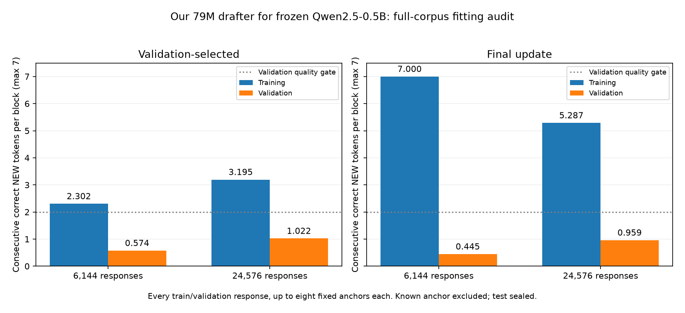
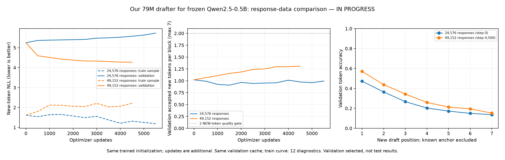
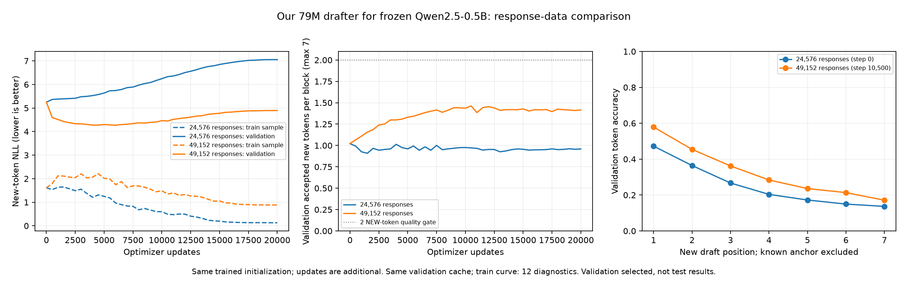

# Small-Qwen drafter improvement series — in progress

Frozen target: Qwen2.5-0.5B. The draft networks are separately trained; 0.5B is
not the drafter size. [Protocol and quality gate](../docs/dflash-improvement-series.md).
Test data remains sealed. No useful drafter is established yet.

## Completed fidelity comparisons

| Setting | Draft parameters | Updates | Supervised NEW-label exposures | Selected validation NEW / 7 |
| --- | ---: | ---: | ---: | ---: |
| Original two-layer head | 31,432,192 | 20,000 | 3,360,000 | 0.384436 |
| Add query/key RMSNorm | 31,432,448 | 20,000 | 3,360,000 | 0.484354 |
| Five draft layers, two feature depths | 76,169,984 | 20,000 | 3,360,000 | 0.519650 |
| Five draft layers, five feature depths | 78,578,432 | 20,000 | 3,360,000 | 0.530051 |

The normalization gain is 0.099918 tokens (about 26% relative), still far short
of the predeclared two-token macro gate. All 12 checked FP32 verified rollouts
match ordinary target generation. This is one seed on reused validation, not an
independent test result. Full-training audit: selected train **0.62267 NEW / 7**, validation **0.48435**;
final train **0.63507**, validation **0.48302**. Zeroing selected-checkpoint target
memory drops validation to **0.06322**. It uses conditioning, but larger-set fitting
is still weak. Both validation audits exactly reproduce the training reports.

All three fidelity studies execute source matching commit `6c772af`:
`4e7c2bd29a51db1922f2956d97b8fc13d590833f174420bfcf55ece81e9bff22`.
The ordered train/validation token hashes match the historical control. All three new fits completed the same exposure budget and pass all 12 checked
FP32 rollouts. Five-layer full-training NEW scores are 0.78314 (two feature depths)
and 0.79410 (five depths); zero-memory validation falls to 0.06271 and 0.03652.
All full-training audits reproduce their original validation metrics exactly.

The five-feature checkpoint has the highest selected score, but its incremental
gain over two feature depths is only 0.01040; conditional paired bootstrap 95%
interval [-0.02018, 0.04234] includes zero. The normalization-versus-original gain
has interval [0.06618, 0.13510]. These intervals exclude selection/seed uncertainty.
The extra feature-depth benefit is not established.

The graph's JSON sidecar preserves plotted curves and input hashes. Training loss
curves cover 12 diagnostic responses, not the full training corpus.

## Tiny-set fitting under a larger batch

A separate five-layer, two-feature, QK-normalized smoke uses batch 48, 96 training
responses and 300 updates (806400 NEW-label exposures). At the final checkpoint,
the full 96-response audit measures **6.86195 NEW / 7**, NLL **0.29685** on training,
versus **0.04109 NEW / 7**, NLL **9.48065** on validation. The selected step-100 head
has validation 0.08608, falling to 0.05086 with zero target memory.

This establishes tiny-set fitting for that architecture and budget, with severe
failure to generalize. It does not isolate batch size from exposure or establish
fitting on 6144+ responses. The 12-response diagnostic's 6.979 figure is not the
full-training score. All three smoke rollout checks match the target.

## Data and alignment

The expanded pool contains 26163 usable training responses (8700 prose, 8764 code,
8699 translation), enough for a balanced 24576 subset retaining all original 6144
training examples. All 192 validation examples and features remain unchanged.
No test responses were generated. The pool has 1,453,823 distinct response-token
positions; the selected subset's count will be measured at training launch.

The small-target teacher audit checks one train and one validation example/domain:
all sampled teacher-token argmaxes agree, feature cosine is 0.99870–0.99996, and
future-token changes have zero effect on prefix features. This reduces concern
about gross alignment/leakage faults but is not an exhaustive cache audit.

## Next work and evidence

The selected 79M checkpoint (five layers, five feature depths, step 18000) is frozen
as the initialization for the matched 6144/24576-response study, each with
**53.76M additional NEW-label exposures**. Both fits are now running on Modal.
The GPU warm-start smoke reproduces initial validation exactly and passes three
verified rollouts; training peak allocated GPU memory was 8.25 GiB.

The launch audit confirms identical initial weights, source code, validation token
hash and step-zero validation. The small arm matches the original ordered training
tokens, and the larger arm includes every original training group with unchanged
labels. Use an identical global schedule across bounded workers, preserving optimizer
and sampler RNG; do not count a time-bounded partial worker as the complete study.
Goal remains unmet. Test data is still sealed.

Raw reports: `dflash-fidelity-norm-01.json`, `dflash-batch48-smoke-01.json`,
`dflash-batch48-fit-audit-01.json`, `dflash-expanded-data-01.json`, and
`dflash-small-teacher-audit-02.json`. Original comparison:
[dflash-data-scaling.md](dflash-data-scaling.md). Paper/reference differences:
[DFlash fidelity audit](../docs/dflash-fidelity.md).

The higher-supervision [interim curves](dflash-exposure-interim.png) are a partial
snapshot, with source reports embedded in dflash-exposure-interim.json. Both workers
match committed package source `07a68c9`; continuation must retain that source until
a justified change is recorded. Latest setup checks: 82 tests, Ruff and diff checks
pass. Conservative reservations: $318.50/$500, not actual billed usage.

## Higher-supervision update, 2026-10-12

The 24576-response arm completed all 20000 additional updates / 53.76M NEW-label
exposures. Selected step 10000 scores **1.02179 NEW / 7**: prose 1.18359, code
1.13672, translation 0.74506. Final step 20000 scores 0.95882. All twelve checked
FP32 rollouts match the target. The 6144-response arm ended at its time bound at
step 19102; selected step 2000 scores 0.57378. Its remaining 898 updates are being
continued with optimizer/RNG and the original global schedule restored. Package
source is unchanged and matches both first workers. A complete comparison awaits
that continuation; full-training audits are separate from the small train diagnostic.

The larger arm's validation worsens after its selected checkpoint despite improving
training diagnostics. Additional repetition alone is not resolving the gap. Its
full training/zero-memory audit is running. The conditional next data pool completed
with 53476 usable training responses and unchanged held-out data; no new fit has
been chosen yet. Test remains sealed and the two-token gate remains unmet.

Raw reports: `dflash-exposure-6144-01.json`, `dflash-exposure-24576-01.json`,
`dflash-data-54k-01.json`. Reservations after the continuation and larger fit audit:
**$333.50/$500**, conservative allocation rather than billed cost.

## Completed matched exposure comparison

Both arms now complete 20000 additional updates and 53.76M NEW-label exposures.
The 6144 arm resumed its final 898 updates with optimizer/RNG and schedule retained;
its selected checkpoint remains step 2000. Initial weights, package source and
validation identities match across arms. Both pass all twelve FP32 rollout checks.

| Training responses | Selected step | Validation NEW / 7 | Selected validation NLL | Final validation NEW / 7 |
| --- | --- | --- | --- | --- |
| 6144 | 2000 | 0.57378 | 6.54049 | 0.44514 |
| 24576 | 10000 | 1.02179 | 5.24906 | 0.95882 |

The paired source-group bootstrap estimates a **0.44801** NEW-token gain with
conditional 95% interval **[0.37974, 0.51880]**. This is conditional on selected
checkpoints, excluding validation-selection bias and seed variation. It is not a
test result. All three domains improve; translation remains below one NEW token.

Dashed training curves are twelve fixed diagnostic responses, not the full corpus.
Both full-training audits are running before the next training choice. The
validation improvement demonstrates useful information is being learned, but it
still fails the declared two-token criterion. Longer repetition eventually harms
held-out performance; more data helps within the tested source distribution.

Evidence: `dflash-exposure-6144-02.json`, `dflash-exposure-24576-01.json`, and
`dflash-exposure-scaling.json`. All 82 tests and Ruff/format/diff checks pass.
Current conservative reservations: **$338.50/$500**; test remains sealed.

### Full smaller-corpus audit and repetition slices

The 6144-response audit completes both checkpoints and exactly reproduces the
saved validation metrics. Selected step 2000 scores training **2.30198 NEW / 7**,
NLL 2.49195, versus validation 0.57378. Final step 20000 reaches training
**6.999959 NEW / 7**, NLL **0.001396**, versus validation **0.44514**, NLL 9.58671.
This confirms near-total training memorization rather than inability to fit this
corpus. Zeroing selected-checkpoint context gives validation 0.04371; context is
used, but that intervention is a distribution shift, not layer attribution.
Sampler replay matches exactly: 53.76M NEW labels and 937,797,341 conditioning
positions. Frozen target features are reused; these are not backbone training tokens.

The gain is also present in less-repetitive teacher responses (unique response
4-gram fraction at least 0.8): prose **0.527 to 0.940** (23 prompts), code
**0.717 to 1.228** (34), and translation **0.388 to 0.743** (63). These are descriptive
slices of the same validation set, with no new held-out evidence or uncertainty
claim. The repetitive translation slice has only one prompt. Raw evidence:
`dflash-exposure-repetition-slices.json` and `dflash-exposure-6144-audit-01.json`.

Actual verified rollout acceptance on the twelve fixed prompts also improves,
but is weaker than the full offline validation proxy: pooled NEW tokens per
verification call for prose/code/translation change from **0.305/0.881/0.280** to
**0.442/1.016/0.469**. Different arithmetic (FP32) and trajectories/anchor positions
mean these are not interchangeable with cached BF16 validation scores. No speed
qualification is inferred. Both preserve checked target outputs exactly.

### Selected larger-corpus audit and next experiment

The 24576-response selected head (step 10000) scores **3.19508 NEW / 7**, NLL
**1.81112**, on its full training corpus, versus validation **1.02179**, NLL
**5.24906**. Its validation dictionary exactly matches the training report.
Zero-memory validation is 0.03785. The downloaded selected checkpoint SHA matches
the audit: `2338dba807e2c94e9bc844265f987cb8abc5eef4a7248c74f55131582e14a88f`.
The final-checkpoint audit is still running, so no final full-training score is
claimed yet. Both selected checkpoints have now been audited.

The next paired fits compare 24576 versus 49152 responses from identical selected
weights, retaining all prior training groups and labels. The complete recipe and
selection provenance were committed before launch in `dflash-expansion-selection.json`
and the improvement protocol. Both are running on Modal; no outcome is claimed.
This is further data coverage for our separate 79M drafter and frozen 0.5B target,
with no architecture or inference-speed change. Reservations: **$348.50/$500**.

### Full larger-corpus audit completed

The final 24576-response head scores training **5.28722 NEW / 7**, NLL **0.74966**,
versus validation **0.95882**, NLL **6.11885**. Both selected and final validation
dictionaries exactly reproduce the training report. Sampler replay confirms
53.76M NEW-label exposures and 937,691,189 conditioning-position exposures. Together
with the smaller audit, this establishes substantial fitting plus a large
train/validation gap. It does not prove that additional data alone is sufficient.

Evidence: `dflash-exposure-24576-audit-01.json`, `dflash-exposure-fit-summary.json`.
The summary records audit hashes; `scripts/plot_dflash_fit.py` reproduces the figure.
Both audits are now complete. The next paired data-expansion fits remain running,
and test remains sealed. No useful-drafter or speed claim is made.

Next-stage launch checks pass: identical initial draft weights and source hashes,
unchanged validation token hash, and exact step-zero validation matching the
selected 1.02179 source head. Both arms report all 24576 required training groups
after runtime label-identity validation. The control includes exactly those groups;
required-first sorting can change their historical order. Provenance:
`dflash-expansion-launch-audit.json`. Early 500-update scores (0.992 control,
1.067 larger corpus) are incomplete observations, not a selected final comparison.

### Next-stage interim curves

The image includes 5500 updates for the 24576-response control and 4500 for the
49152-response arm. Both are incomplete against the fixed 20000-update plan.
The JSON sidecar embeds both live report snapshots. Compare equal x-axis positions;
this is not a completed-budget or test comparison. The control's best checkpoint
so far remains its step-zero initialization, while added data improves validation.

Dashed train curves evaluate only twelve fixed diagnostic responses. Required-first
subset ordering places these in the previously seen training set; they do not
measure full fitting of the newly added examples. Their step-zero metrics match
exactly across arms. The full-corpus audits after completion remain necessary.

## Completed 24576/49152-response expansion

Both arms completed 20000 additional updates (53.76M NEW-label exposures),
sharing initialization, source, validation cache and optimization settings.
The separate drafter has 78,578,432 trainable parameters; Qwen2.5-0.5B stays frozen.

| Responses | Selected update | Validation NEW / 7 | Selected NLL | Final NEW | Final NLL |
| --- | ---: | ---: | ---: | ---: | ---: |
| 24576 | 0 | 1.02179 | 5.24906 | 0.95878 | 7.05541 |
| 49152 | 10500 | 1.46181 | 4.44955 | 1.41534 | 4.89406 |

The smaller-data control does not improve its starting weights. Added responses
improve held-out prediction by 0.44002 NEW tokens, paired conditional 95% interval
[0.35892, 0.52369]. This interval excludes checkpoint-selection bias and seed
variation. Larger selected domain scores are prose 1.76953, code 1.72656, and
translation 0.88933. Neither the macro two-token nor every-domain one-token gate
is met. Test remains sealed.

All twelve FP32 verification prompts match the frozen target for each head, and
neither target accumulated gradients. Cached BF16 acceptance is a proxy and
should not be equated with verified rollout acceptance. No speed claim follows.
The falling training curves concern only twelve previously seen diagnostics;
full-corpus selected/final fitting audits are running separately.

Evidence: `dflash-expansion-24576-01.json`, `dflash-expansion-49152-01.json`,
`dflash-expansion-scaling.json` (report hashes and conditional bootstrap).
