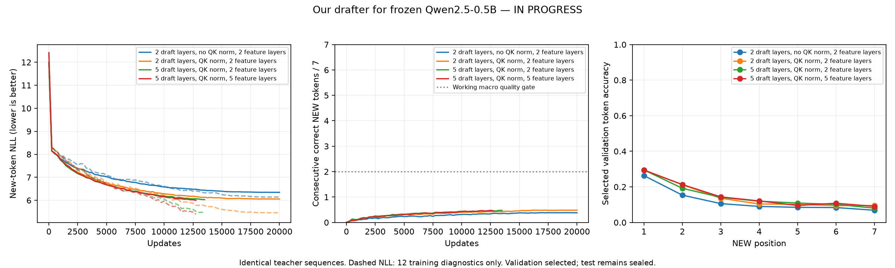

# Small-Qwen drafter improvement series — in progress

Frozen target: Qwen2.5-0.5B. The draft networks are separately trained; 0.5B is
not the drafter size. [Protocol and quality gate](../docs/dflash-improvement-series.md).
Test data remains sealed. No useful drafter is established yet.

## Completed normalization comparison

| Setting | Draft parameters | Updates | Supervised NEW-label exposures | Selected validation NEW / 7 |
| --- | ---: | ---: | ---: | ---: |
| Original two-layer head | 31,432,192 | 20,000 | 3,360,000 | 0.384436 |
| Add query/key RMSNorm | 31,432,448 | 20,000 | 3,360,000 | 0.484354 |

The normalization gain is 0.099918 tokens (about 26% relative), still far short
of the predeclared two-token macro gate. All 12 checked FP32 verified rollouts
match ordinary target generation. This is one seed on reused validation, not an
independent test result. Full-training and zero-context audits are pending.

All three fidelity studies execute source matching commit `6c772af`:
`4e7c2bd29a51db1922f2956d97b8fc13d590833f174420bfcf55ece81e9bff22`.
The ordered train/validation token hashes match the historical control. The deeper
76M head and five-feature 79M head are still running; do not compare their partial
endpoints as equal-budget final results.

The graph's JSON sidecar preserves plotted curves and input hashes. Training loss
curves cover 12 diagnostic responses, not the full training corpus.

## Tiny-set fitting under a larger batch

A separate five-layer, two-feature, QK-normalized smoke uses batch 48, 96 training
responses and 300 updates (806400 NEW-label exposures). At the final checkpoint,
the full 96-response audit measures **6.86195 NEW / 7**, NLL **0.29685** on training,
versus **0.04109 NEW / 7**, NLL **9.48065** on validation. The selected step-100 head
has validation 0.08608, falling to 0.05086 with zero target memory.

This establishes tiny-set fitting for that architecture and budget, with severe
failure to generalize. It does not isolate batch size from exposure or establish
fitting on 6144+ responses. The 12-response diagnostic's 6.979 figure is not the
full-training score. All three smoke rollout checks match the target.

## Data and alignment

The expanded pool contains 26163 usable training responses (8700 prose, 8764 code,
8699 translation), enough for a balanced 24576 subset retaining all original 6144
training examples. All 192 validation examples and features remain unchanged.
No test responses were generated. The pool has 1,453,823 distinct response-token
positions; the selected subset's count will be measured at training launch.

The small-target teacher audit checks one train and one validation example/domain:
all sampled teacher-token argmaxes agree, feature cosine is 0.99870–0.99996, and
future-token changes have zero effect on prefix features. This reduces concern
about gross alignment/leakage faults but is not an exhaustive cache audit.

## Next work and evidence

Finish the two deeper architecture fits and their fitting diagnostics. Then freeze
the selected architecture/initial checkpoint for the matched 6144/24576-response
study, each with **53.76M additional NEW-label exposures**. Use an identical global
schedule across bounded workers; preserve optimizer/RNG for resumes. This tests
substantially more supervision as well as more data. Goal remains unmet.

Raw reports: `dflash-fidelity-norm-01.json`, `dflash-batch48-smoke-01.json`,
`dflash-batch48-fit-audit-01.json`, `dflash-expanded-data-01.json`, and
`dflash-small-teacher-audit-02.json`. Original comparison:
[dflash-data-scaling.md](dflash-data-scaling.md). Paper/reference differences:
[DFlash fidelity audit](../docs/dflash-fidelity.md).
