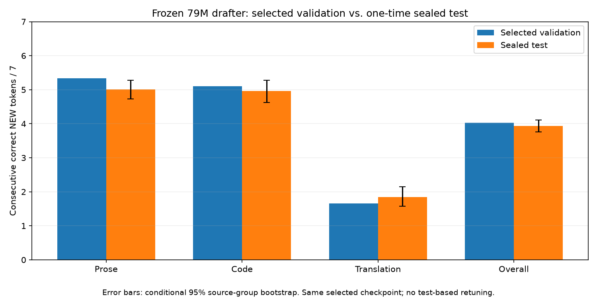

# Completed frozen-drafter qualification

Both authorized pending tasks completed for the selected long-response drafter:
24 longer verified validation rollouts and one sealed drafting-test evaluation.
The selected checkpoint passes the predeclared study criterion. No test-based
retuning or checkpoint changes occurred.

[Full report](qualification-long-196k-01.json), [summary/uncertainty](qualification-summary.json),
[frozen checkpoint/evaluator manifest](qualification-frozen.json),
[predeclared protocol](../configs/qualification-long-196k.json).

## One-time sealed test

| Metric/domain | Selected validation NEW / 7 | Test NEW / 7 | Conditional test 95% CI |
| --- | ---: | ---: | --- |
| Prose | 5.336 | 5.014 | [4.730, 5.280] |
| Code | 5.105 | 4.958 | [4.629, 5.274] |
| Translation | 1.656 | 1.843 | [1.574, 2.143] |
| Macro | 4.033 | 3.938 | [3.764, 4.106] |

Test NLL is 2.0954 (selected validation 2.1050). This passes macro>=2 NEW/7 and
all domains>=1. Per-position accuracy and full-block acceptance are in the raw
report. 189 usable prompts, exactly 63/domain, from 192 reserved. Prespecified
exclusions: one prose and one code response exactly duplicate existing teacher
responses; one translation response is shorter than a full block. All excluded
identities/reasons are recorded. Source-group/exact-prefix leakage audit passed.
Teacher generation and trajectory evaluation use the original BF16 arithmetic.

Intervals use 10000 source-group bootstrap draws, stratified by domain, blocks
weighted within domains. They are conditional on one frozen selected checkpoint;
they do not include training-seed variation or validation-selection uncertainty.
Test is now consumed. Further model/data/parameter selection must use validation
and a new held-out test for a new confirmatory evaluation, not retune on this test.

## Longer verified generation

| Domain | Prompts | Generated tokens | Correct NEW accepted per verification call | Output parity |
| --- | ---: | ---: | ---: | --- |
| Prose | 8 | 1828 | 4.514 | 8/8 exact |
| Code | 8 | 1789 | 4.300 | 8/8 exact |
| Translation | 8 | 289 | 1.195 | 8/8 exact |

All 24 outputs, 3906 tokens total, exactly match plain greedy frozen-target output.
Each uses a 256-token cap; EOS can terminate early. Verification arithmetic is
FP32 on the stored BF16 weights. Test-trajectory scores and actual verification
acceptance use different prompts/arithmetic and should not be equated. Single
measured timing runs are diagnostics, not a speed benchmark. Every token sequence,
text, acceptance length and source identity is saved in the full report.

## Frozen selection and limits

Separate 79M drafter, frozen Qwen2.5-0.5B, selected update 70585. Checkpoint:
`/runs/fresh-grid-196608-r256-11/best.pt`; SHA256
`44865d84016898f575cf009c5cd2c2acb919564f009e912170cf4ba131b4e768`.
Training package/evaluator fingerprints match the executed qualification. Selection
and evaluation protocol were recorded before test labels were generated, and test
access happened only after all longer rollouts passed parity. Target gradients
remain absent; no optimizer or training occurs in the qualifier.

This validates generalization of target-token drafting under the study's criterion.
It does not establish human answer quality or wall-clock speedup. Greedy Qwen
prose/code responses are often repetitive: mean test unique4gram fractions are
0.316/0.434, versus0.978 for translation. Original J-space/future-representation,
layer-selection and native-pretraining hypotheses remain deferred and unproven.
Only the selected long-response head was qualified, not the short-response arm.

Modal input `qualification-long-196k-01` completed in 240s. One bounded $5 GPU
reservation brings the current user-reset epoch to $167.125/$500; this is
conservative allocation accounting, not the actual bill. No additional training
or evaluation was launched after these frozen test results.
