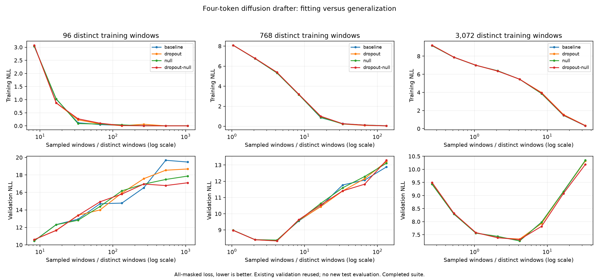

# Small-data layer-control results

Launch source: commit `255a6b5`; report source hashes verified against that tree.
Modal job: [small-layer-controls-01](https://modal.com/apps/radiantai/main/ap-UP6RCX2phjsurjzbFIYumb).

Suite completed: **True**. Frozen Qwen2.5-0.5B, seed 42, all 24 residual layers,
four-token diffusion blocks, batch 32, learning rate 0.0003. Three nested balanced
training subsets, all training rows measured. Existing 192-window validation reused;
no new test evaluation. One seed and a small adaptive validation slice: exploratory only.

| Windows | Control | Final update | Final train NLL | Train token accuracy | Best recorded validation NLL | At update |
| ---: | --- | ---: | ---: | ---: | ---: | ---: |
| 96 | baseline | 3200 | 1.41e-05 | 100.0% | 10.4632 | 25 |
| 96 | dropout | 3200 | 1.08e-05 | 100.0% | 10.6059 | 25 |
| 96 | null | 3200 | 8.94e-06 | 100.0% | 10.4538 | 25 |
| 96 | dropout-null | 3200 | 9.85e-06 | 100.0% | 10.6020 | 25 |
| 768 | baseline | 3200 | 0.0532 | 98.9% | 8.3677 | 100 |
| 768 | dropout | 3200 | 0.0534 | 98.8% | 8.3270 | 100 |
| 768 | null | 3200 | 0.0463 | 99.0% | 8.3765 | 100 |
| 768 | dropout-null | 3200 | 0.0435 | 99.2% | 8.3264 | 100 |
| 3072 | baseline | 3200 | 0.308 | 94.3% | 7.2641 | 400 |
| 3072 | dropout | 3200 | 0.336 | 93.9% | 7.3332 | 400 |
| 3072 | null | 3200 | 0.32 | 93.6% | 7.2625 | 400 |
| 3072 | dropout-null | 3200 | 0.323 | 93.8% | 7.3135 | 400 |

## Largest subset: domains at each control's selected checkpoint

| Control | Prose NLL | Code NLL | Translation NLL | Qwen consecutive agreement / 4 |
| --- | ---: | ---: | ---: | ---: |
| baseline | 7.5548 | 7.1207 | 7.1168 | 0.526 |
| dropout | 7.6284 | 7.2219 | 7.1493 | 0.458 |
| null | 7.5481 | 7.1135 | 7.1257 | 0.516 |
| dropout-null | 7.6160 | 7.1808 | 7.1438 | 0.438 |

The x-axis is sampled windows divided by distinct windows; sampling uses replacement.
Reporting starts at update 25, so best recorded loss is not a guarantee that an earlier
optimum was captured. Training NLL and accuracy use fully masked four-token prediction.
The final-state readout shortcut stays present even when workspace layers are dropped.
Dropout is off at evaluation; zero-content attention remains enabled in null controls.
Matching initialization, sampling, target corruption, source windows and update budgets
is a control, not a replacement for replication. Low train loss demonstrates fitting,
not generalizable future information or useful generation speed.

[Protocol](../docs/small-data-controls.md) · [Raw report](small-layer-controls-01.json.gz)
