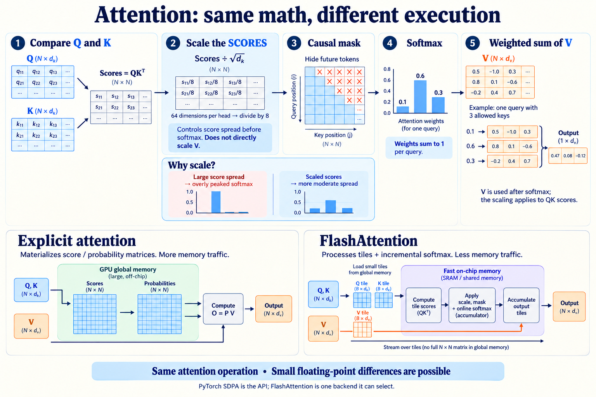

# Updated 100M-family architecture

## Experimental sequential multi-token prediction

[`GPTWithMTP`](../10m/mtp.py) adds one auxiliary causal transformer block to
predict token `t+2` from backbone state `h_t` and the embedding of known token
`t+1`. Both branches share the existing tied vocabulary projection. This is a
small DeepSeek-V3-inspired prototype, not a full reproduction or measured gain.
At width 768 it adds 8,269,312 parameters, without duplicating the vocabulary.

```python
from model_100m.model import ModelConfig
from model_10m.mtp import GPTWithMTP

model = GPTWithMTP(ModelConfig(vocab_size=32768))
# sequence: [batch, T+1] token IDs; lengths: actual document lengths, including
# the final target. One document per row, right padding only; no packed documents.
losses = model.training_losses(sequence, lengths)
loss = (
    losses["ntp_sum"] / losses["ntp_count"].clamp_min(1)
    + 0.1 * losses["mtp_sum"] / losses["mtp_count"].clamp_min(1)
)
loss.backward()
logits = model(sequence[:, :-1])  # ordinary next-token inference
```

The weight `0.1` is an experimental starting point. Losses use independently
counted valid targets; padding contributes to neither objective. Documents with
fewer than three tokens contribute no MTP targets. Training uses ground-truth
intervening tokens; it does not expose the auxiliary target to its prediction.
This also works on teacher-generated text without sharing the teacher tokenizer.
There is no teacher-logit KL implementation here.

This class is **not integrated into the recipe/distributed trainer**, whose
existing forward path would train only next-token prediction. A distributed
integration must aggregate each objective's target counts over all ranks and
microbatches, then scale its summed loss separately. The prototype materializes
both vocabulary-logit tensors; it does not yet implement chunked projection loss.
Inherited inference does not run the MTP block or provide speculative decoding.
No GPU training or quality comparison has been performed.

Local correctness checks: `python -m unittest discover -s tests -p 'test_mtp.py' -v`
from `training/` with the training package installed.

## Base architecture

A subsequent [bounded subword pilot](PILOT.md) trained this architecture for
4.08M tokens on Modal. See its [measured report](https://huggingface.co/datasets/jfrick/lm-exploration-results/blob/main/training/results/simple-llm-124m-pilot-20261016-01.md);
the architecture-merge verification described below remains separate.

`model.py` uses **RMSNorm, RoPE, SwiGLU and tied input/output embeddings** by
default. There is one `100m` model choice, keeping 14 layers, width 768, 12 ordinary
attention heads (head dimension 64) and context 256. The implementation is shared
with the consolidated [10M model](../10m/README.md); only the default dimensions differ.

| Component | Current default |
| --- | --- |
| Normalization | Pre-RMSNorm and final RMSNorm, epsilon 1e-5 |
| Positions | RoPE on Q/K in every layer, theta 10,000 |
| Feedforward | SwiGLU, hidden width 2,048 |
| Projection biases | Present |
| Attention kernel | PyTorch causal scaled-dot-product attention (SDPA) |
| Initialization | Normal std 0.02 |
| Input/output weights | One shared Parameter |

## Attention, scaling and FlashAttention



The scale applies to `QKᵀ` scores before softmax, not directly to `V`. Each head
has 64 dimensions, so scores are divided by `sqrt(64) = 8`. The causal mask
forbids query–key pairs involving future tokens; masking a key at projection time
would incorrectly hide it from every query. Optimized kernels can skip fully
masked tiles instead of computing scores that will be discarded.

PyTorch SDPA selects an attention backend, including FlashAttention when
supported. FlashAttention uses tiled computation and incremental softmax to avoid
materializing the full score/probability matrices in GPU global memory. It computes
the same attention operation, with small floating-point differences possible.
The diagram is explanatory, not a measured GPU memory trace.

## Mechanisms and references

- **RMSNorm:** `gamma * x / sqrt(mean(x**2) + epsilon)` omits mean centering and
  normalization offsets. Epsilon matches historical LayerNorm; low-precision
  statistics accumulate in FP32. [Zhang & Sennrich (2019)](https://arxiv.org/abs/1910.07467)
  motivate simpler normalization. Actual speed depends on kernels.
- **RoPE:** rotates adjacent query/key feature pairs; values stay unchanged.
  The positional dependence of Q/K dot products is relative.
  [RoFormer, Su et al. (2021)](https://arxiv.org/abs/2104.09864) gives the construction.
  Context remains capped by `block_size`: no GQA, KV cache or long-context scaling.
- **SwiGLU:** `down(SiLU(gate(x)) * up(x))` provides input-dependent feature
  modulation. Hidden width `ceil(8 * width / 3)` exactly matches the old MLP's
  matrix-parameter budget at width 768. Projections keep biases.
  [Shazeer (2020)](https://arxiv.org/abs/2002.05202) reports matched-budget T5 gains;
  that motivates a causal-GPT experiment, not a claimed improvement here.
- **Tied embeddings:** `self.lm_head.weight = self.token_embedding.weight`.
  The shared table `E[vocabulary, width]` supplies input rows and output logits
  `hidden @ E.T`. Gradients from both uses accumulate into the same Parameter,
  which appears once in the optimizer's parameter list.
  [Press & Wolf (2017)](https://arxiv.org/abs/1608.05859) study the parameter/quality
  tradeoff. Sharing saves parameters but constrains the representations.

[LLaMA §2.2](https://arxiv.org/abs/2302.13971) adopts RMSNorm, RoPE and SwiGLU.
This update combines the requested choices; it cannot establish each component's
quality contribution. The former single-factor 10M ablations are retained in Git
history, not maintained model choices; they were not trained. No quality
gain has been measured for this combined model.

## Frozen tokenizer and parameter count

Use merged `structured-code-v1`: **32,768 entries**, unchanged tokenizer hash
`add5b2c7542e4efded329735825ecdcb94df1432617c3d3e4b7508aa459432f9`.
At context 256 and the unchanged 14×768 shape, the model has **124,389,632 unique
parameters**. Tying saves **25,165,824** (`32,768 × 768`) versus separate matrices
on the same modern backbone. There is no maintained untied modern variant,
separate package or recipe key for tying.

The historical vanilla 100M had 149,760,000 parameters at this vocabulary.
Besides tying, the modern blocks remove 196,608 position parameters and 22,272
normalization offsets, and add 14,336 FFN bias parameters. FFN matrix parameters
match. The `100m` label is historical: a 32K vocabulary changes the total relative
to the character model. No saving is reinvested in extra layers.

## Usage and compatibility

```python
from model_100m.model import GPT, ModelConfig

model = GPT(ModelConfig(vocab_size=32768))
assert model.lm_head.weight is model.token_embedding.weight
```

Recipes continue to select `model="100m"`; no tying flag is needed. Historical
vanilla 100M checkpoints (LayerNorm, learned positions, GELU, untied embeddings) are
not loadable by the current code; the last revision that could load them is `1e06fb8`.

The general recipe trainer and generation CLI remain character-only. The separate
[subword pilot](PILOT.md) integrates the frozen BPE tokenizer and mixture loader.
The [GPU comparison](https://huggingface.co/datasets/jfrick/lm-exploration-results/blob/main/training/results/simple-llm-124m-gpu-comparison-20261017.md) measures
SDPA and fused AdamW on the full model, including two- and three-H100 DDP.
The historical pilot used explicit attention; its original source is archived
with its run. SDPA preserves the model shape and checkpoint keys, with output
and gradient agreement checked against the explicit implementation.

## Verification

From `training/`:

```sh
uv sync --locked --extra corpus --extra research
uv run --extra corpus --extra research python -m unittest discover -s tests -v
```

Checks cover independent block output/gradient references, causality, finite
gradients, counts, config bounds and old checkpoint loading/resume. Tying checks
cover shared identity, summed gradients against a test-only reference, optimizer
deduplication, dtype conversion, checkpoint roundtrip and tokenizer ID bounds.
