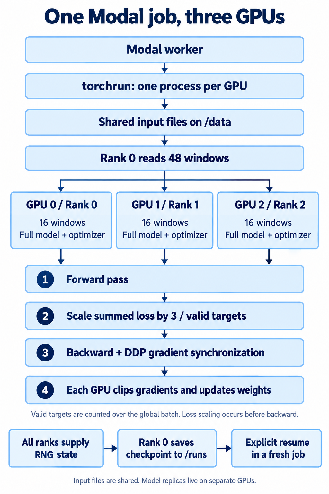

# Simple LLM — training from scratch

## Naming and artifact compatibility

The project uses **Simple LLM** in source filenames, module names, commands and
documentation. Corpus preparation is `lm-prepare-simple-llm`, implemented in
`training_data.prepare_simple_llm`; the data pipeline is `training_data.simple_llm`.
See the [streaming guide](data/SIMPLE_LLM_STREAMING.md) and
[pretraining plan](plans/SIMPLE_LLM_PRETRAINING.md).

Historical result files and the original tokenizer asset directory have been
renamed locally, but their machine-readable contents, frozen bytes, hashes,
recorded run IDs, split-policy IDs and checkpoint-format IDs are unchanged.
Published resource URLs and existing Modal data paths retain their actual
identifiers: a source rename does not rename remote artifacts or authorize new
jobs. Human-readable reports use the new labels; consult their accompanying JSON
for exact original artifact locations and provenance. Example version/run labels
are illustrative; use the actual prepared snapshot version when launching a job.

The **Simple LLM 124M / 8K / 5B experiment is complete**: 4,999,981,176 nonpadding
training exposures, 64,227 updates, and 7.67 recorded worker-hours on eight H100s.
The [published final model](https://huggingface.co/jfrick/scholarly-code-modern-gpt-124m-step2)
includes weights, code, tokenizer, training curves and raw metrics. Final fixed-window
diagnostic validation loss is 1.8708; broader quality and long-context evaluation remain
pending. Its run, publication and repetition records are [archived on HF](publication/README.md#pr-16).

A [one-pass ECB/EMA continuation](trainer/EU_CONTINUATION.md) of that checkpoint
trained all 878,610,362 EU targets. The [matched validation](analysis/eu-validation/README.md)
shows ECB/EMA loss falling and all 12 original categories worsening (Python
1.559 to 3.994); its outputs are on HF under `pr-25/`.

The [Simple LLM 9.85M / 5B-token experiment](publication/README.md#pr-13)
is complete and [published on Hugging Face](https://huggingface.co/jfrick/scholarly-code-modern-gpt-10m-5b).
It processed 4,999,934,057 targets over 72,805 updates. Broader exploratory
validation loss is 2.6926 nats/token; generated samples remain repetitive and
factually weak. The model card includes all examples, per-source evaluation,
training curve, code/tokenizer and provenance. Generated reports and cards added by
PR #13 are stored in the HF **dataset** `jfrick/lm-exploration-results`
([details](publication/README.md#historical-evidence)), not in this repository.
The remaining sections retain
historical plans and earlier experiment state.

The model family is named **Simple LLM**. Published variants are **Simple LLM 10M (5B tokens)**
and **Simple LLM 124M (two-step smoke checkpoint)**. Historical `scholarly-*` run IDs,
checkpoint formats, data paths and Hugging Face URLs remain stable for reproducibility;
“scholarly/code” describes the data mixture, not the model name.

The [eight-H100 / 8K / 5B workflow](distributed/SIMPLE_LLM_8K.md) implements the authorized
124M experiment with periodic Hugging Face inference checkpoints and automatic
optimizer-boundary continuation. See its run record for actual launch/qualification state.

The [long-context and eight-H100 plan](plans/SIMPLE_LLM_LONG_CONTEXT.md) records
the proposed 8K/16K progression, benchmark requirements and unverified timing ranges.

## Current handoff — 2026-10-16

Start with the [Simple LLM pretraining plan](plans/SIMPLE_LLM_PRETRAINING.md).
It records the latest agreed dataset proportions, approximately 150M-parameter
goal, 20B-token target with a conditional 50B extension, frozen code-focused 32K tokenizer,
and next-agent checklist. It supersedes older undecided mixture/tokenizer
notes and illustrative token budgets below for this experiment.

The [streaming preparation guide](data/SIMPLE_LLM_STREAMING.md) now provides
bounded upstream ingestion, immutable token snapshots, a Modal CPU entrypoint,
and a resumable token-mixture loader. Its snapshots remain pending corpus audits. A [bounded 124.4M subword pilot](https://huggingface.co/datasets/jfrick/lm-exploration-results/blob/main/training/results/simple-llm-124m-pilot-20261016-01.md)
has now completed 600 updates / 4.08M tokens on Modal; substantial pretraining
has not been launched. The [measured GPU comparison](https://huggingface.co/datasets/jfrick/lm-exploration-results/blob/main/training/results/simple-llm-124m-gpu-comparison-20261017.md)
compares one, two and three A10, L40S and H100 GPUs with matched global batches.
Those measurements used the SDPA implementation now used by the modern model.
Three H100s are the recommended configuration when elapsed time is the priority.
[Distributed subword training](distributed/README.md) now exposes one/two/three-GPU
training and explicit checkpoint/resume across Modal jobs. Full corpus readiness
and substantial pretraining remain separate.

The [tokenizer learning-curve experiment](tokenizer/research/README.md) compares
64 MiB through 2 GiB at 16K, 32K and 50K vocabularies on Modal, with a shared
held-out corpus and a generated research report.

A personal learning project: train small language models from random initialization,
understand how architecture and data affect them, then add instruction tuning,
reasoning and reinforcement learning. Use Modal for training and local Apple
hardware for development and eventual inference.

[Training references](references/README.md) collect source-backed research notes
and proposed experiments, starting with Mirendil, Recursive and Flapping Airplanes.

## Direction and scope

The user's goals are:

- Learn model architecture and its evolution through small, measurable experiments.
- Study useful ideas from Qwen, GLM, Kimi and other open research; do not lock the
  framework to one model family.
- Use general web text, appropriately licensed code and other licensed documents,
  with multilingual coverage.
- Start small and progress toward roughly 1B parameters using several thousand
  dollars' worth of available Modal credits. An exact spending allocation is not set.
- Eventually pursue GPT-4-level performance on a narrow, objectively testable task.
  The task and reference model/version remain to be chosen; broad parity is not a
  promised outcome.
- Run a model we trained ourselves on our own Apple hardware using the custom
  kernels in [phone inference](../inference/phone/).

Use standard kernels and established designs initially. Custom training kernels
are optional later work. The frozen-Qwen drafter in
[exploration/latent-workspace](../exploration/latent-workspace/) is a separate
research effort, with its own resources and budget.

## Shakespeare 10M publication

The [10M model](10m/README.md) defaults to RMSNorm,
RoPE, SwiGLU and tied embeddings. Its historical vanilla architecture has a [trained public model](https://huggingface.co/jfrick/shakespeare-vanilla-gpt-10m) with its complete definition and tokenizer.
The selected update is 1,800 (validation loss 1.54483 nats/character); the later
4,000-update head overfit and was not published.
Its L4 jobs, dedicated volume and bounded allocation are separate from latent-workspace.
See the owning guide; executed results are in the HF dataset `jfrick/lm-exploration-results` under `training/results/`.

## Training runs on Modal



The diagram shows the three-GPU subword trainer. The Modal API starts the worker;
inside it, a supervised `torchrun` subprocess launches one Python process per GPU.
Rank zero reads the shared corpus on `/data`; corpus files are not copied per run
or per GPU. Each GPU holds a full model and optimizer replica. At checkpoint
boundaries, rank zero saves to `/runs`; resuming requires an explicit new job.
See the [distributed training guide](distributed/README.md) for launch commands,
microbatch accumulation and checkpoint details.

The [historical bounded Simple LLM pilot](100m/PILOT.md) connected the modern
124.4M model to the frozen 32K tokenizer and token-mixture loader. Its duplicate
single-GPU implementation has been removed. All current subword training uses
[`trainer/loop.py`](trainer/loop.py), including one GPU.
[`distributed/`](distributed/README.md) supplies launch support and configuration;
the older character loop has been removed.

All training runs on Modal GPU workers; there is no CPU or MPS training path.
[`workflows/`](workflows/README.md) owns model configs, dataset selections and execution settings.
Historical character configs are retained under `workflows/model_configs/historical/`. Use
`modal run -m workflows.modal_train --workflow workflows/<name>.json --run-id <id>`
for subword training. [`workflows/`](workflows/README.md) owns preparation,
qualification and continuation across sessions. Historical character recipes remain for provenance; their loop and launcher have
been removed.
Local commands validate recipes and sample from downloaded checkpoints only.

## Current state

For a minimal NumPy example of forward passes, handwritten backpropagation and
gradient descent, start with [the XOR example](examples/README.md).

- [`100m/model.py`](100m/model.py): **architecture only**. The [updated model](100m/README.md)
  uses RMSNorm, RoPE and SwiGLU at 14 layers, width 768, 12 attention heads and
  context 256. Version 1 preserves the historical vanilla blocks for old
  checkpoints. New 100M models tie input/output embeddings by default and have
  124,389,632 parameters with the frozen 32K tokenizer. The consolidated
  [`10m/model.py`](10m/model.py) owns the shared implementation at 6 layers,
  width 384 and 6 heads; historical vanilla checkpoints use a legacy-only path.
- [`modal_scripts/`](modal_scripts/README.md): corpus, tokenizer and benchmark
  launchers. Training launch support and runtime configuration live in
  [`distributed/`](distributed/README.md); settings live in [`workflows/`](workflows/README.md).
- [`generate.py`](generate.py): model-agnostic `lm-generate`; takes a checkpoint and a
  prompt, and reads the architecture, configuration and tokenizer from the checkpoint.
- [`trainer/`](trainer/README.md): the active training loop, evaluation,
  checkpoint loading/saving, run provenance and shared sampling. Historical
  character-recipe schemas and checkpoint loading remain for compatibility.
- [`workflows/`](workflows/README.md): preparation and continuation controllers,
  workflow configuration and compatibility/progress checks.
- [`data/loading.py`](data/loading.py): character tokenization, text loading,
  deterministic splits and batching.
- [`data/`](data/README.md): curated dataset definitions, fetching and preparation
  scripts; `lm-prepare-simple-llm` runs `training_data.prepare_simple_llm`.
- [`tokenizer/`](tokenizer/README.md): frozen tokenizer assets plus research,
  evaluation, reporting and publication tools. Invoke tools as
  `uv run python -m tokenizer.<module>` from `training/`.
  Tiny Shakespeare is a learning benchmark, not a selected research corpus.
- Run artifacts live on the `lm-exploration-training` Modal volume under `<run-id>/`.
  Each save writes a new `checkpoints/step-NNNNNN.pt`; nothing is overwritten.
  Reports are copied to the ignored `artifacts/results/<run-id>.json`.

`training/` is a uv-managed project with `pyproject.toml`, `uv.lock` and a Python
3.12 pin. It has its own ignored `.venv`; the latent-workspace environment is
separate. uv installs the model folders as `model_10m`/`model_100m` and the data
folder as `training_data`, so imports work without manual `PYTHONPATH` settings.

Run from `training/`:

```sh
uv sync --locked

# Download a run's selected checkpoint, then sample from it locally.
uv run --with 'modal[api-proxy-support]==1.6.1' modal volume get \
  lm-exploration-training <run-id>/best.pt runs/<run-id>-best.pt
uv run lm-generate --checkpoint runs/<run-id>-best.pt --prompt 'ROMEO:' --max-new-tokens 300
```

`lm-generate` reads the architecture, model configuration and tokenizer from the
checkpoint and prints each character as it is sampled. It runs on CPU by default
(`--device mps` is optional) and seeds from the training seed unless `--seed` is
given. It samples from the full softmax; temperature and top-k are not implemented.

The subword pilot measured actual-model throughput; broad model quality and
production-corpus throughput remain unverified. Shakespeare is
a learning corpus, not evidence of broad language capability. The active trainer
uses prepared mixture snapshots and exposes explicit cross-job resume; the legacy
character loop has been removed.

The local Run Board (`ui.py`), `lm-train` CLI and `lm-checks` CPU test suite were
removed when training moved to Modal only; they remain in Git history before
that change.

The historical [Run Board](designs/run-board-web.html) and
[earlier training studies](designs/train-design-studies.html), imported from
[web-inference PR #1](https://github.com/koogle/web-inference/pull/1), remain
interactive mockups with illustrative runs and metrics. Open those HTML files
locally to inspect the original designs. A web UI with GitHub integration and Modal job controls, custom kernels and the larger
experiment framework are not implemented; recipe-based CLI training
runs on Modal.

## Staged research plan

The stages and numerical ranges below synthesize proposals from the supplied
conversation. They are starting hypotheses, not approved run budgets, measured
results or thresholds that guarantee model quality.

| Stage | Proposed scale | Work | Evidence before advancing |
| --- | --- | --- | --- |
| 0. Fundamentals | 1–10M parameters; a 10M pilot | Minimal decoder-only GPT: embeddings, learned positions, causal attention, MLP, LayerNorm and next-token prediction. Establish data loading, checkpointing, resume and sampling. | Correctness against a reference, tiny-set fitting, reproducible resume and measured Modal throughput. |
| 1. Architecture | Around 30–50M | Introduce RoPE, RMSNorm, SwiGLU, GQA and QK normalization one at a time. Begin with a standard dense baseline. | Controlled changes improve loss, stability, memory or time to a fixed quality target. |
| 2. Data and language foundation | 150–300M | Compare tokenizer choices, language balance, code/text mixtures, filtering and optional fill-in-the-middle training. | Held-out loss and task scores improve across the intended languages and domains, not just training loss. |
| 3. Instruction and reasoning SFT | Reuse the selected 150–300M base | Separate instruction-following fine-tuning from reasoning/worked-solution fine-tuning. | Improvements on fixed instruction, coding and mathematics evaluations relative to the same base. |
| 4. Verifiable-reward RL | Reuse that checkpoint lineage | Start with arithmetic; progress to executable code and formal constraints. Compare an appropriate GRPO- or PPO-style approach with supervised controls. | Better held-out solution accuracy at comparable compute, with reward hacking and response-length effects checked. |
| 5. Scale the winners | 600M to roughly 1B | Combine only supported improvements, then repeat pretraining and post-training for the chosen specialization. | Pilot throughput supports the budget, and smaller experiments justify the recipe. |
| 6. Own-model inference | Selected trained checkpoint | Export tokenizer, architecture and weights to the Apple inference project. | Reference-output agreement before device-specific kernel optimization. |

The transcript also suggested 1.7B and larger models. Those remain possible later
extensions, beyond the current roughly-1B consolidation scope.

For architecture comparisons, train fresh models under matched data and evaluation
conditions. For post-training comparisons, fork the same base checkpoint so gains
cannot be attributed to different pretraining. Recheck promising results across
seeds before spending heavily on a larger run.

## Architecture experiments

Keep the implementation small and auditable, with explicit configuration for
attention, feedforward layers, residual/normalization choices and training objective.
Modularity should support comparisons; it does not imply every combination is valid.

1. **Baseline:** causal dense attention, then a Qwen-inspired decoder with RoPE,
   RMSNorm, SwiGLU, GQA and QK normalization. Randomly initialize model weights.
2. **Optimization:** compare AdamW with Muon as a separate experiment.
3. **Information flow and attention:** investigate Attention Residuals and hybrid
   linear/full attention, including Gated DeltaNet/KDA-style candidates.
4. **Later experiments:** small MoE, sparse long-context attention, alternative
   residual schemes and auxiliary multi-token prediction.
5. **Post-training:** test how much improvement is possible from the identical
   pretrained base using SFT and verifiable rewards.

These are candidate research directions from the conversation. Verify the relevant
papers, official implementations and prerequisites before choosing a specific
variant. The transcript's release dates, version labels and claimed improvements
for “latest” Qwen/GLM/Kimi systems have not been independently verified here.

Use PyTorch and standard supported attention/optimizer kernels first. The transcript
proposed BF16, SDPA/FlashAttention where supported, activation checkpointing when
needed, and DDP/FSDP only when scale requires them. Initial 2K–4K context is a
proposal to benchmark, not a fixed requirement for the smallest toy model.

## Data and tokenizer

Build a reproducible corpus before committing to a large run. Candidate sources
from the transcript are:

| Source | Intended role | Selection work still needed |
| --- | --- | --- |
| FineWeb / FineWeb-Edu | General and educational text | Pin revisions, select quality filters and review underlying content eligibility. |
| FineWeb2 | Multilingual text | Choose target languages, balance the sample and check tokenizer efficiency. |
| CodeParrot GitHub Code | A manageable first code subset | Check current loading/access support and verify language/license metadata against source repositories. |
| The Stack v2 | A possible larger code corpus | Confirm access arrangements, upstream licenses, provenance and removal requirements. |
| OpenCoder / RefineCode | Code curation research and possible data | Inspect the processing recipe, access conditions and source provenance. |
| Wikipedia, Wikisource and licensed technical/math documents | Reference, multilingual and reasoning material | Review source-specific terms and preserve attribution. |

These are a shortlist, not an approved corpus or a claim that every record is
eligible. Public availability and a dataset-level license are not sufficient
evidence about each underlying document.

For each retained record, preserve source URL/repository, revision, license,
language, content hash, filtering decisions and training eligibility. Candidate
code licenses discussed were MIT, Apache-2.0, BSD-2-Clause, BSD-3-Clause and ISC;
the final allowlist and any obligations still need to be settled.

Remove generated, vendored, minified and duplicate code where appropriate; retain
useful documentation and test relationships. Apply exact and near-duplicate checks,
exclude benchmark solutions, and split code by repository before creating windows.
Check for credentials and personal information during corpus preparation.
Deduplicate across dataset categories as well as within each source.

Train or explicitly choose the tokenizer before the larger experiments. A balanced
multilingual/code BPE sample and 16K–32K vocabulary were proposed for small models;
compare 32K and 64K only if the larger model and languages justify it. Measure
bytes/characters per token by language and code, rather than judging only English.
Reusing an existing tokenizer is a valid explicit choice; model weights still start
from random initialization.

Mixture weights and target languages are not decided. The pasted transcript refers
to a mixture visualization but does not contain its numerical proportions, so no
ratios are inferred from it. Keep unique corpus size separate from total training
token exposures, including repeated epochs.

## Token and compute planning

There is no single token count that makes a model “great.” Use validation curves,
task performance and measured throughput to decide whether more data, more
optimization or a different recipe is justified.

Selected starting ranges proposed in the conversation:

| Model scale | Total pretraining-token exposures |
| --- | --- |
| 1–10M | Begin with 10–50M tokens. |
| 30–50M | 100M–1B; consider 1–3B only after the pilot. |
| 100–150M | 1–3B initially; 3–10B as a larger experiment. |
| 300–500M | 5–15B initially; 15–50B as an ambitious experiment. |
| 600M–1B | 10–30B initially; 30–100B as an ambitious experiment. |

The conversation's 300M/20B run was illustrative. Code-specific token ranges were
also suggestions for the code portion of a mixture, not extra tokens to add on
top of a total budget.

Before a substantial run, measure sustained tokens/second, peak memory,
checkpoint/evaluation overhead and cost on the actual Modal configuration.
The rough dense-model estimate `6 × parameters × training tokens` is a planning
approximation, not a runtime or price quote. Budget CPU, storage, preprocessing,
evaluation, failed runs and reserves as well as GPU time.

The transcript's $5,000 allocation and GPU-hour prices were assistant examples,
not a confirmed budget or current pricing. Choose explicit per-run and overall
bounds using measured throughput and current rates. Do not borrow the
latent-workspace research ledger or treat this plan as authorization to launch jobs.

## Post-training and evaluation

Keep three experiments distinct:

- **Instruction SFT:** conversation formatting and instruction following.
- **Reasoning SFT:** worked solutions and structured problem solving. The transcript
  suggested OpenR1-Math-220k as a candidate; inspect provenance and terms before use.
- **Verifiable-reward RL:** sampled rollouts scored by reliable outcomes, beginning
  with exact-answer arithmetic, then Python functions with hidden tests and
  algorithmic tasks with randomized cases.

The proposed SFT volumes were 10–100M instruction tokens and 10–200M reasoning
tokens. These are exploratory ranges, not requirements. RL is budgeted through
rollout generation and optimization compute, not a fixed static corpus size.
Start RL when the model already generates some successful solutions.

Compare base, instruction-SFT, reasoning-SFT and SFT-plus-RL checkpoints. Include
an additional-SFT control with comparable compute. Track pass@1/correctness,
reward, response length and generalization to unseen task families. Treat a
change in style or longer answers separately from a gain in accuracy.

Freeze evaluation definitions early:

- Held-out language-model loss by language and domain.
- Multilingual QA/translation/reasoning for the selected languages.
- Executable coding tests and exact-answer mathematics.
- Instruction formatting and constraint compliance.
- Tokens/second, peak memory, wall-clock convergence and quality per compute cost.

Use validation for choices and keep test evaluation for frozen decisions. For
the narrow parity goal, select a specific reference model/version, use matched
prompts and tools, report uncertainty, and audit contamination.

## Run Board on Modal

Use [the latest Run Board design](designs/run-board-web.html) as the UI starting
point. The intended application is a Modal-hosted web interface backed by bounded
training jobs and persistent run artifacts.

1. Select a GitHub branch or PR and resolve its immutable commit before starting.
2. Choose architecture, tokenizer, dataset mixture, seed, optimization settings,
   token budget and compute limit.
3. Start, observe, stop and explicitly resume runs; inspect curves, throughput,
   checkpoints and sample generations.
4. Choose a baseline and compare code/config/data differences beside measured
   results. Compare at equal token exposure and also report compute differences.

When several factors change, show that confounding rather than implying a
single-factor experiment. Retain each run's code/config snapshot, dependencies,
dataset revisions and splits, mixture weights, tokenizer, seed, hardware,
token/update counts, checkpoint lineage, metrics and outputs independently of
the UI.

## Next concrete milestone

Training is Modal-only and recipe-driven. Earlier bounded CPU checks (since
removed) covered reference attention/gradients, causality, tiny-set fitting,
reproducible resume and cooperative stop/checkpoint continuation. They
demonstrated mechanics, not useful language capability.

Next: choose the first research data/tokenizer recipe and an explicit GPU/budget
bound, then implement and measure one bounded Modal throughput pilot before
scaling the experiment matrix. The separate 10M Shakespeare workflow has now launched bounded Modal jobs; larger research training remains unexecuted.

Still to decide:

- The narrow target task and reference-model evaluation protocol.
- Target languages, initial data sources, license policy and mixture weights.
- Tokenizer choice, exact first model configuration and context length.
- First Modal GPU configuration and explicit experiment/overall budget.
- Which architecture ablation follows the verified baseline.

## Source and status

Extracted on 2026-10-12 from the user-supplied transcript of
[“GPT 3.5 Size Explained”](https://chatgpt.com/share/6accc26c-fd60-83ea-9f52-34cc038c7857),
together with the repository-consolidation instructions. The transcript was read
from the supplied text, not from the inaccessible shared-page body. This README
separates stated goals from assistant-proposed recipes and unverified external
claims. No training runs, data ingestion or deployment were performed for that
original documentation update. The later local fundamentals/UI implementation
was exercised with bounded CPU demonstration runs before training moved to Modal
only; the 10M Shakespeare model is the only completed GPU training run.

## Linting

Ruff is a dev dependency configured in `pyproject.toml`. From `training/`, run
`uv run ruff check --fix .` and `uv run ruff format .`. The repository pre-commit
hook in `../.githooks/` checks staged Python files across the whole repository.

The [fresh-data 5B continuation](trainer/CODE_HEAVY_CONTINUATION.md) doubles coding
to 60%, excludes all earlier document hashes, and queues eight-H100 training after
fresh-source capacity checks. It completed 5B targets; Python validation loss
reached 1.421 (original 5B: 1.559), while ECB/EMA lost most EU gains. Outputs are on HF under `pr-26/`.
