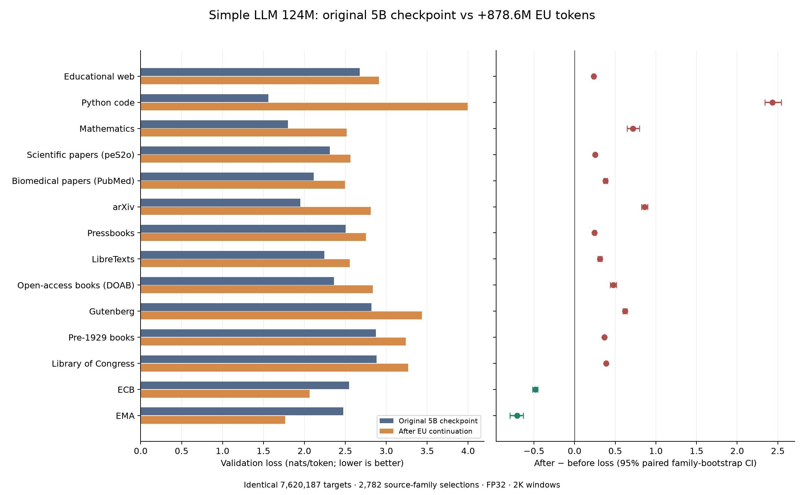

# Expanded EU continuation validation

Both checkpoints scored the same **7,620,187 targets**, **4,615 windows** and **2,782 distinct source-family selections** across 14 categories. Full FP32; TF32 disabled; 2K context.

**12 of 12 original categories have a positive after-minus-before loss difference with a category-wise 95% paired family-bootstrap interval above zero.**

| Category | Before | After | Difference [95% CI] | Families | Targets |
|---|---:|---:|---:|---:|---:|
| Educational web | 2.675 | 2.911 | +0.236 [+0.224, +0.249] | 256 | 308,280 |
| Python code | 1.559 | 3.994 | +2.435 [+2.340, +2.541] | 256 | 346,847 |
| Mathematics | 1.799 | 2.518 | +0.719 [+0.646, +0.796] | 256 | 324,946 |
| Scientific papers (peS2o) | 2.313 | 2.565 | +0.252 [+0.243, +0.261] | 256 | 905,439 |
| Biomedical papers (PubMed) | 2.115 | 2.495 | +0.379 [+0.357, +0.403] | 256 | 828,727 |
| arXiv | 1.950 | 2.809 | +0.859 [+0.823, +0.899] | 256 | 955,479 |
| Pressbooks | 2.505 | 2.751 | +0.246 [+0.232, +0.261] | 142 | 256,223 |
| LibreTexts | 2.244 | 2.555 | +0.311 [+0.288, +0.337] | 84 | 145,786 |
| Open-access books (DOAB) | 2.362 | 2.837 | +0.475 [+0.437, +0.516] | 71 | 207,612 |
| Gutenberg | 2.819 | 3.437 | +0.619 [+0.595, +0.644] | 211 | 829,715 |
| Pre-1929 books | 2.873 | 3.240 | +0.367 [+0.357, +0.377] | 208 | 817,106 |
| Library of Congress | 2.881 | 3.269 | +0.388 [+0.379, +0.398] | 162 | 620,382 |
| ECB | 2.548 | 2.065 | -0.483 [-0.517, -0.453] | 256 | 712,043 |
| EMA | 2.475 | 1.766 | -0.708 [-0.796, -0.631] | 112 | 361,602 |

Losses are nats per token; lower is better. Differences are paired on identical windows. Intervals use 2,000 family-level resamples.

## Sampling and limits

Uniform document-family sample, one document per family, up to two uniform nonoverlapping 2K blocks per document. Token-weighted loss on this sample is not a whole-corpus token-uniform estimate.

- Validation split only; no test-set tuning or scoring.
- Family-balanced sample, not corpus-token-uniform perplexity.
- CIs are conditional on selected families and are not simultaneous across categories.
- Source split/near-duplicate/contamination audits remain pending.
- 2K window loss does not establish 8K long-context quality or generation correctness.

Books with fewer than 256 validation families use all available families, with one sampled document per family. Original-category family identities come from the existing frozen split. The EU sample uses the continuation's document-family split; residual cross-language reconciliation remains pending.

Absolute losses differ from the earlier small prefix diagnostic because this protocol changes document coverage, passage positions and precision.

## Provenance

Original checkpoint: `simple-llm-124m-8k-5b-20261018-s03/step-000064227.pt`.

EU checkpoint: `simple-llm-124m-eu-onepass-20261018-s02/step-000003838.pt`.

Original checkpoint SHA256: `ce26b11aed843008fb89893a5e90219b1a5c96e44ef32d42eb9188e427df1876`.

EU checkpoint SHA256: `a9b4ff39352fae4aa163433df7130dbede1437657bee7c44fc26a6eb020af565`.

Shared sample SHA256: `579fe4fb51b9165328c1e0be0959307245555df08d8b63f285c81456951bb1db`.

Private source text, sampled token IDs and per-window losses remain on Modal. This folder contains aggregate evidence only. No training or HF writes.
