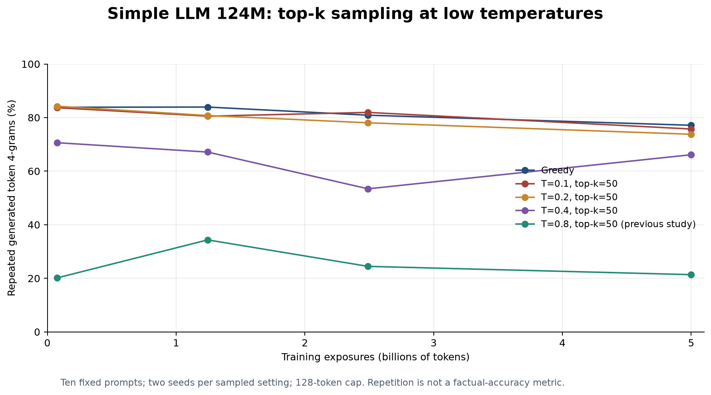

# Simple LLM 124M: repetition and low-temperature sampling

This standalone study tests published checkpoints without training updates. It loads the exact model definition and weights from pinned Hugging Face revisions rather than the current repository architecture.

## Results

Repeated token four-gram fraction (1 minus unique token four-grams / all token four-grams), averaged over the same ten prompts. Sampled settings use two seeds per prompt. Lower repetition does not establish factual correctness.

| Trained tokens | Held-out loss¹ | Greedy | T=0.1 | T=0.2 | T=0.4 | T=0.8¹ |
|---|---:|---:|---:|---:|---:|---:|
| 0.077B | 3.9120 | 83.8% | 83.7% | 84.2% | 70.6% | 20.2% |
| 1.245B | 2.2869 | 83.9% | 80.5% | 80.8% | 67.1% | 34.3% |
| 2.491B | 2.1151 | 80.9% | 81.9% | 78.0% | 53.4% | 24.4% |
| 5.000B | 1.9635 | 77.1% | 75.7% | 73.8% | 66.1% | 21.4% |

¹ Held-out loss and T=0.8 results are retained from the previous matched-checkpoint study. That study used 1,798,432 identical targets from 384 validation parents, at most four 2K windows per parent. Pending corpus audits mean this is exploratory evaluation, not a sealed benchmark. Its final loss of 1.9635 differs from the training-time 1.8708 diagnostic because the samples differ.



Very low temperature did not resolve repetition: T=0.1 and T=0.2 stayed close to greedy decoding across all checkpoints. T=0.4 reduced repetition but remained substantially more repetitive than the previous T=0.8 setting.

Top-k is fixed at 50 for all sampled settings. Temperatures rescale logits before sampling; lower temperatures concentrate probability on the highest-scoring candidates. No repetition penalty or n-gram ban is used in this study. All 280 completions are retained.

Greedy reproducibility: **40/40** completions match the prior study token for token. Both experiments used PyTorch 2.6, H100, BF16 autocast with FP32 weights and the same ten prompts.

## Training checks retained from the earlier study

280 real training windows passed exact next-token alignment, EOS, document-boundary and padding-label checks, including 21 long-document continuations. Cursor replay reproduced the next batch. Twelve raw-loader, prefetch/resume and independent architecture-reference tests passed. A two-rank FP32 CPU/Gloo reference checked the production accumulation gradients and AdamW update. These checks found no simple implementation error; they do not prove the entire training/data pipeline is free of bugs.

The previous study, including source audits, was produced at source commit `64ecf8ef56a649cc04a500eced3d03a052807799`. See [previous comparison](previous-comparison-20261018.json), [data audit](data-audit-20261018.json), and [implementation checks](implementation-checks-20261018.json).

## Reproduce

Run from this directory with Modal credentials and access to the project output volume:

```sh
modal run --detach modal_low_temperature.py
python build_report.py
```

The remote job uses one H100 and a 30-minute hard timeout with no automatic function retry. Checkpoint downloads have four bounded retry attempts, and reruns reuse matching completed checkpoint results from the output volume. It verifies checkpoint weight hashes, model source identity, parameter count and finite parameters. Published checkpoint code is used only from our own pinned revisions. Deploying/importing this file does not launch training. The report builder additionally needs matplotlib.

## Files

[Raw low-temperature results](low-temperature-20261018.json) · [All completions](all-completions.md) · [Summary](summary.json) · [PDF plot](low-temperature.pdf)
