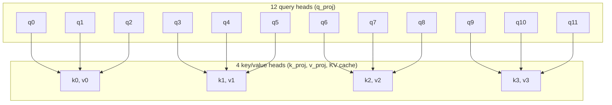

# Hybrid model family

`hybrid/` (installed as `model_hybrid`) holds the decoder for the
[~720M hybrid pretraining plan](../plans/HYBRID_720M.md). It is separate from
`10m/` and `100m/`, so the 124M Simple LLM runs use unchanged code.

## Backbone

[`model.py`](model.py) defines `HybridConfig` and `HybridLM`:

- Pre-norm blocks with `RMSNorm` (statistics in fp32) and a `SwiGLU`
  feed-forward layer, both the shared classes from [`10m/model.py`](../10m/model.py);
  the hybrid family builds `SwiGLU` without biases at a configurable hidden width.
- Tied input/output embeddings; no bias parameters anywhere.
- Full-attention layers use grouped-query attention (`n_head` query heads,
  `n_kv_head` key/value heads, head dimension 128), RMSNorm on each query and key
  head (QK-norm), and RoPE with a configurable base (default 1,000,000).
- Initialization: Normal(0, 0.02) for embeddings and projections; residual
  output projections (attention `o_proj`, SwiGLU `down`) use
  `0.02 / sqrt(2 * n_layer)`. Norm scales start at 1.
- `forward(tokens)` returns logits. `forward(tokens, labels)` returns summed
  cross-entropy `ce`, summed squared log-normalizer `z`, `loss = ce + 1e-4 * z` and
  the valid-target `count`. Logits are computed in chunks of `loss_chunk_size`
  rows and recomputed in backward, so the full `[tokens, vocab]` logit tensor is
  never stored. Labels of `-100` are ignored.

### Grouped-query attention

With the default 12 query heads and 4 key/value heads, each key/value head
serves a group of 3 consecutive query heads: query head `h` reads key/value
head `h // (n_head // n_kv_head)`. Every query head still has its own attention
pattern; the groups share only the keys and values they attend over, so
`k_proj`/`v_proj` and the KV cache are a third the size of multi-head attention.



Multi-head attention is the case `n_kv_head == n_head` (one query per group);
multi-query attention is `n_kv_head == 1` (all queries in one group).

The defaults (width 1536, 16 layers, 12 query / 4 KV heads, SwiGLU 4096) are
placeholders until the 720M configuration is fixed in PR 8.

## Tests

From `training/`:

```sh
uv run python -m unittest tests.test_hybrid_backbone -v
```

They cover output shapes, tied weights and absent biases, initialization scales,
fp32 RMSNorm statistics, causality (changing future tokens leaves earlier logits
bit-identical), attention against an explicit softmax, GQA against MHA with
duplicated key/value heads, the RoPE base and the chunked loss against
`F.cross_entropy` plus an explicit z-loss.
