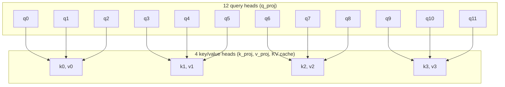

# Hybrid model family

`hybrid/` (installed as `model_hybrid`) holds the decoder for the
[~720M hybrid pretraining plan](../plans/HYBRID_720M.md). It is separate from
`10m/` and `100m/`, so the 124M Simple LLM runs use unchanged code.

## Backbone

[`model.py`](model.py) defines `HybridConfig` and `HybridLM`:

- Pre-norm blocks with `RMSNorm` (statistics in fp32) and a `SwiGLU`
  feed-forward layer, both the shared classes from [`10m/model.py`](../10m/model.py);
  the hybrid family builds `SwiGLU` without biases at a configurable hidden width.
- Tied input/output embeddings; no bias parameters except the attention output
  gate's (below).
- Full-attention layers use grouped-query attention (`n_head` query heads,
  `n_kv_head` key/value heads, head dimension 128), RMSNorm on each query and key
  head (QK-norm), and RoPE with a configurable base (default 1,000,000).
- Initialization: Normal(0, 0.02) for embeddings and projections; residual
  output projections (attention `o_proj`, SwiGLU `down`) use
  `0.02 / sqrt(2 * n_layer)`. Norm scales start at 1.
- `forward(tokens)` returns logits. `forward(tokens, labels)` returns summed
  cross-entropy `ce`, summed squared log-normalizer `z`, `loss = ce + 1e-4 * z` and
  the valid-target `count`. Logits are computed in chunks of `loss_chunk_size`
  rows and recomputed in backward, so the full `[tokens, vocab]` logit tensor is
  never stored. Labels of `-100` are ignored.

### Grouped-query attention

With the default 12 query heads and 4 key/value heads, each key/value head
serves a group of 3 consecutive query heads: query head `h` reads key/value
head `h // (n_head // n_kv_head)`. Every query head still has its own attention
pattern; the groups share only the keys and values they attend over, so
`k_proj`/`v_proj` and the KV cache are a third the size of multi-head attention.



Multi-head attention is the case `n_kv_head == n_head` (one query per group);
multi-query attention is `n_kv_head == 1` (all queries in one group).

## Document masking

Loaders pack documents back to back, each ending in EOS. Every forward pass is
document-masked: the model derives per-row document ids from the EOS tokens in
its input (`HybridConfig.eos_id`, [`documents.py`](documents.py)
`document_ids`), so a token sees earlier tokens of its own document only and RoPE
positions restart after each EOS. Training, evaluation and sampling all call
`forward(tokens[, labels])` with no separate mask. `cu_seqlens` converts the
ids to flattened document offsets for varlen kernels.

## Attention

On CUDA, full attention is FlexAttention (`torch.nn.attention.flex_attention`,
compiled once, tensor cores) with a block mask built from the document ids: query
`q` may see key `k` when `k <= q` and both are in the same document. Blocks outside
every document are skipped. It returns the output and the fp32 log-sum-exp, whose
gradient flows back (the attention sink uses it). On CPU, `model.reference_attention`
(an explicit masked softmax, fp32 or fp64) is the model's attention.

## Attention sink and output gate

Each full-attention layer has a learned sink: one logit per head, initialized to
0, acting as an extra key with a zero value. Softmax over the scores plus the sink
equals the plain attention output times `sigmoid(lse - sink)`, where `lse` is the
log-sum-exp of the scores, so the layer applies that factor to FlexAttention's (or
the reference's) output; gradients flow through the log-sum-exp. A head can then
attend to "nothing" without spending probability on a real token.

After the sink, an elementwise sigmoid gate multiplies the merged heads before
`o_proj`: `sigmoid(gate_proj(x) + gate_bias)`, with `x` the layer's normalized
input. `gate_bias` (per channel) starts at `gate_bias_init = 3.0`, so the gate
starts about 95% open. With the gate fully open and the sink at -inf the layer
reduces exactly to plain document-causal attention.

## Kimi Delta Attention and the hybrid layout

[`kda.py`](kda.py) implements KDA layers following flash-linear-attention's
`KimiDeltaAttention` ([Kimi Linear](https://arxiv.org/abs/2510.26692)), without
biases:

- q/k/v projections to `n_kda_head` heads of width `head_dim`, each followed by a
  causal depthwise convolution (kernel `kda_conv_size = 4`) and SiLU.
- L2-normalized q and k (q further scaled by `1/sqrt(head_dim)`), sigmoid beta
  from `b_proj`, and a per-channel decay `-exp(A_log) * softplus(f_proj(x) + dt_bias)`
  with a low-rank `f_proj`.
- Per-head output RMSNorm, a sigmoid gate from a low-rank `g_proj`, and `o_proj`
  (a residual output projection for initialization).
- No positional encoding; the recurrent state is fp32.

Document boundaries reset both the convolutions (they never read a previous
document's tokens) and the recurrent state. On CUDA the recurrence is fla's
`chunk_kda`, run over the flattened batch with `cu_seqlens` from the document ids;
gate, beta and L2 normalization run inside the kernel. On CPU, `kda_reference`
is an explicit per-token recurrence with fp32 (or fp64) state.
[KDA, step by step](../references/kda.md) walks through the recurrence on a toy head.

`torch.compile` traces through the fla call. On one H100, a small compiled hybrid
model (4 layers, width 512, 4 x 1024 tokens, bf16) took 18.7–19.1 ms per training
step that way and 19.0–19.5 ms with fla excluded by `torch.compiler.disable`
(three alternating rounds after warming up both), so the graph stays unbroken.

`HybridConfig.layer_pattern` lists `"kda"` and `"full"` layers and repeats to
`n_layer`; the default `("kda", "kda", "kda", "full")` puts full attention at
layers 3, 7, 11 and 15 of 16. Full-attention layers keep RoPE, the sink and the
output gate.

## Multi-token prediction

`MultiTokenPrediction` is one DeepSeek-V3/GLM-style module (`mtp=True` by
default). At position `t` it concatenates RMSNorm of the trunk's last residual
state `h_t` with RMSNorm of the embedding of `x_(t+1)`, projects back to the
model width, runs one hybrid block (`mtp_layer_kind`, full attention by
default, sharing the trunk's document mask and RoPE) and an output RMSNorm, and
predicts `x_(t+2)` through the shared tied output layer. Its loss uses the same
chunked cross-entropy and z-loss.

`documents.mtp_labels(inputs, labels, eos_id)` builds the `t+2` targets:
`labels[t + 1]`, ignored when `x_t` or `x_(t+1)` is EOS (the target would be in
the next document) and at the last position. `forward(tokens, labels, mtp_labels)` adds `mtp_loss`, `mtp_ce`,
`mtp_z` and `mtp_count`. The trainer combines the means as
`loss / count + mtp_weight(config, progress) * mtp_loss / mtp_count`, where the
weight decays linearly from 0.3 to 0.1 over training progress.

Inference does not run the module: `forward(tokens)` returns trunk logits, and
a model built with `mtp=False` loads the trunk weights (all keys outside `mtp.`)
and produces identical logits.

## Optimizer grouping

Each module declares the optimizer role of the parameters it creates, next to its
`__init__`: `optimizer()` in [`model.py`](model.py) and [`kda.py`](kda.py)
yields `(parameter, role)` pairs (helper `declare` in
[`trainer/roles.py`](../trainer/roles.py)). `trainer.optimizers.RoleOptimizer`
collects them by parameter identity:

| Role | Optimizer | Parameters |
| --- | --- | --- |
| `muon` | Muon, LR 0.02, momentum 0.95, weight decay 0.1 | 2D hidden matrices in blocks and MTP: q/k/v/o, attention `gate_proj`, KDA `f_proj`/`g_proj`, SwiGLU, MTP `fuse` |
| `adamw_decay` | AdamW, LR 3e-4, betas (0.9, 0.95), weight decay 0.1 | tied embedding/output table, KDA beta projection `b_proj` |
| `adamw_no_decay` | AdamW, LR 3e-4, betas (0.9, 0.95), no weight decay | norm scales, attention sinks, gate biases, KDA `A_log`, `dt_bias`, convolution kernels |

Muon is `trainer.optimizers.Muon` (five-step Newton–Schulz with the original
aspect-ratio scaling); its weight decay is decoupled, `p *= 1 - lr * 0.1`.
The learning rates are the 124M comparison's
([MUON_COMPARISON.md](../distributed/MUON_COMPARISON.md)), starting values for
the 720M pilot rather than tuned at this scale. Every group keeps its base rate
and `trainer.optimizers.set_learning_rate` applies one schedule factor to all of
them. A parameter that no module declares, one declared twice, or a non-matrix
declared for Muon raises.

## Tokenizer and data recipe

[`tokenizer.py`](tokenizer.py) pins zai-org/GLM-4.7-Flash's `tokenizer.json`
(revision `7dd20894`, SHA-256 `19e77364…a82d`). On 2026-10-25 it was
byte-identical to zai-org/GLM-5.3-Flash's (revision `46a050be`). It has 154,856
entries; the model pads its embedding to 154,880. Documents end with
`<|endoftext|>` (154820); GLM's chat (`<|system|>`, `<|user|>`, `<|assistant|>`,
`<|observation|>`), reasoning (`<think>`) and tool (`<tool_call>`, `<arg_key>`, …)
tokens keep their GLM ids, which `load()` verifies.

[`recipes/hybrid-40b-v1.json`](recipes/hybrid-40b-v1.json) targets 40B tokens,
each source read once (`max_passes: 1`):

| Source | Share | Pinned input | Shards |
| --- | ---: | --- | ---: |
| ClimbMix | 70% | `karpathy/climbmix-400b-shuffle` | 600 |
| Permissive code | 20% | `codeparrot/github-code-clean`, licenses MIT, Apache-2.0, BSD-2/3, ISC, CC0, Unlicense | 80 |
| Math | 10% | `HuggingFaceTB/finemath` `finemath-4plus` | 38 |

The last shard of each source is held out for evaluation. Preparation drops any
document sharing a 13-token n-gram with the test sets of GSM8K, MATH, HumanEval,
MBPP, MMLU, ARC and HellaSwag (validation), all pinned by revision.

[`data.py`](data.py) turns each upstream parquet file into a shard of uint32 GLM
ids (documents shuffled within the shard, each ending in EOS) plus per-document
token and byte counts. `PreparedMixture` reads each source's shards in a seeded
order and packs 4,097-token windows (consecutive windows share one token), each
from the source furthest below its weight; it is resumable and waits for shards
that are still being prepared, so training can start while preparation runs.

[`modal_data.py`](modal_data.py) prepares shards on Modal CPUs (8 cores, one call
per shard, up to 48 in parallel), held-out shards first and then in the order
training reads them, onto the `lm-exploration-hybrid-data` volume:

```sh
uv run modal run --detach -m model_hybrid.modal_data::main --run-id <id>
```

The launch fixes a deadline 24 hours ahead; an independent supervisor cancels
every recorded call then, and each call has `retries=0` and a timeout bounded by
the deadline. Finished shards are skipped, so another launch continues. The
coordinator writes `capacity.json` (train/held-out tokens, documents and drops
per source) and the screen writes `screen.json`.

Measured on the held-out shards (2026-10-25): ClimbMix 52.6M tokens per shard
(103 of 84,992 documents screened out), code 139M (43,776 of 126,925 files outside
the license allowlist, 740 screened out), FineMath-4+ 125M (8,281 of 104,680
screened out). The screen holds 3,225,682 unique 13-grams. At those sizes the
training shards hold about 31B ClimbMix, 11B code and 4.6B math tokens, above
the 28B/8B/4B shares.

## 720M configuration and training

[`configs/hybrid-720m-40b.json`](configs/hybrid-720m-40b.json): width 1536, 16
layers as 4 x [KDA, KDA, KDA, full] (full attention at 3, 7, 11, 15), 12 query /
4 KV heads, 12 KDA heads, head dimension 128, SwiGLU 4,224, GLM vocabulary
154,880, context 4,096, one MTP module. The trunk used for inference has
707,129,536 parameters; with the MTP module 739,972,556 (`test_hybrid_720m`
asserts both). Training: 256 x 4,096 = 1,048,576 tokens per step, warmup over
500M tokens, then constant, then linear decay to 0 over the last 15%; Muon/AdamW
as above with weight decay 0.1, gradient clipping 1.0, bf16 autocast with fp32
parameters, `torch.compile`, z-loss 1e-4, MTP weight 0.3 to 0.1.

Full attention trains with FlexAttention (above).
[`fused_loss.py`](fused_loss.py) computes the output layer, cross-entropy, z-loss
and their gradients in one chunked pass, without storing or recomputing the
[tokens, 154,880] logits, for the next-token and MTP heads.

Custom kernels in this family: the fused output-layer loss (+15% training
throughput on one H100) and, inside it, a CUDA kernel
([`kernels/softmax_gradient.cu`](kernels/softmax_gradient.cu)) that turns each bf16 logit row
into its cross-entropy/z-loss gradient in place in two passes, instead of several
fp32 copies of the [rows, 154,880] block. FlexAttention and fla supply the
tensor-core attention and KDA kernels.

[`train.py`](train.py) is the hybrid family for the common loop
([`trainer/loop.py`](../trainer/loop.py), see [trainer/README.md](../trainer/README.md)),
run as `torchrun -m model_hybrid.train`: rank 0 reads the recipe's
`PreparedMixture` and scatters each batch; every rank derives MTP targets (the
model derives its own document ids from `eos_id`, which must be the GLM EOS), and
DDP averages gradients. Each loss is normalized by its global target count. Rank 0
writes `metrics.jsonl` (loss, z, MTP loss, learning-rate factor, gradient norm,
tokens/s, MFU, rows per source, peak memory per rank), and at start, every
`eval_every_steps` and at the end `validation.jsonl`: held-out loss, bits per byte
and MTP loss per source with per-layer gate openness and sink weight, sink,
gate-bias and KDA-decay parameters, and (every `sample_every_steps` and at the end)
greedy continuations of fixed prompts. Checkpoints (`step-<step>.pt`: model,
optimizer, data cursor, every rank's RNG; the last `keep_checkpoints` kept) are
written every `checkpoint_seconds` and at stop, and a run directory resumes from
its `latest.json` with the same config, GPU count and source files. `report.json`
closes each session. With `hf_repo` set, bf16 trunk weights and config (under
`export/`) and the logs go to that private HF model repo every `hf_every_tokens`
and at the end.

Training runs through the workflows like every model family
([workflows/README.md](../workflows/README.md)); `model_config` selects the run
config:

```sh
uv run modal run --detach -m workflows.modal_train --workflow workflows/hybrid-h100x8.json \
    --run-id <id> [--model-config hybrid/configs/<config>.json] [--resume <run>-sNN/step-N.pt]
uv run modal run -m workflows.modal_train::stop --run-id <id>    # checkpoint and exit
uv run modal run -m model_hybrid.modal_tools::bench --gpus 1     # 30-minute benchmark
```

Each session trains in `lm-exploration-hybrid-runs/<run id>-sNN/` and resumes the
previous session's final checkpoint; a later launch continues a run with
`--resume`. MFU counts 6 x (matmul weights, including both output-layer uses) plus
attention FLOPs over the mean attended keys, against 989 TFLOPS per H100.

## Tests

From `training/`:

```sh
uv run python -m unittest tests.test_hybrid_backbone tests.test_hybrid_documents \
  tests.test_hybrid_sink_gate tests.test_hybrid_kda \
  tests.test_hybrid_mtp tests.test_hybrid_optim \
  tests.test_hybrid_tokenizer tests.test_hybrid_data tests.test_hybrid_720m \
  tests.test_hybrid_fused_loss -v
```

On one H100 (30-minute timeout, no retries, refuses work 24 hours after launch):

```sh
uv run modal run -m model_hybrid.modal_checks
```

The Modal image uses the CUDA 13.0 devel base with torch 2.14.1.
[`check_hybrid_cuda.py`](../tests/check_hybrid_cuda.py) compares FlexAttention's
output, log-sum-exp and gradients (including through the log-sum-exp) with fp64
softmax attention (fp32 and bf16, GQA, packed documents, a one-token document,
lengths that are not block multiples, head dimensions 64 and 128), checks document
isolation in a compiled bf16 model, and times FlexAttention against causal SDPA.

The same check compares fla's `chunk_kda` with `cu_seqlens` against
`kda_reference` (output and all input gradients, within TF32 tolerance) and times
bf16 training steps of a small compiled hybrid model with the fla call outside the
compiled graph (`torch.compiler.disable`) and inside it, after warming up both.
The CUDA path needs the `hybrid` extra (`fla-core`); the Modal image installs it.

`test_hybrid_720m` checks the configuration, parameter count, schedule, FLOP
accounting and gate/sink statistics;
`test_hybrid_fused_loss` checks the fused loss and its gradients against autograd.
`test_hybrid_data` prepares shards from small parquet files (license filter,
empty documents, contamination drops, EOS layout, byte counts) and checks the
mixture's weights, contiguity across shards, resume and the held-out windows;
`test_hybrid_tokenizer` checks the pinned constants and the recipe, and the GLM
file itself when downloaded. `test_hybrid_optim` checks that every parameter lands in exactly one group, the
role of each parameter kind, the learning rates and decay per group, and a step
plus state round trip. `test_hybrid_mtp` checks target alignment and boundary masking, the loss
against an explicit computation, that the module never sees its own target,
the weight schedule and inference without MTP. `test_hybrid_kda` compares the KDA recurrence with an independent matrix form
`S_t = (I - b k k^T) diag(a) S_(t-1) + b k v^T`, the short convolution with
`F.conv1d`, checks state and convolution resets at document boundaries, the
layout, document isolation and causality through mixed KDA/full stacks, and that
every parameter receives a gradient. `test_hybrid_sink_gate` compares the sink with an explicit softmax that has an
extra zero-value key, checks that an open gate and a -inf sink reproduce plain
attention exactly, and that the gate starts mostly open and receives gradients.
`test_hybrid_documents` checks document ids, positions and `cu_seqlens`, and that
document B's logits are identical whether it follows a different document A, or
none. The backbone tests cover output shapes, tied weights and absent biases, initialization scales,
fp32 RMSNorm statistics, causality (changing future tokens leaves earlier logits
bit-identical), attention against an explicit softmax, GQA against MHA with
duplicated key/value heads, the RoPE base and the chunked loss against
`F.cross_entropy` plus an explicit z-loss.
