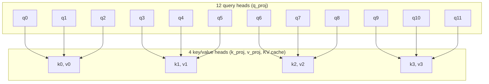

# Hybrid model family

`hybrid/` (installed as `model_hybrid`) holds the decoder for the
[~720M hybrid pretraining plan](../plans/HYBRID_720M.md). It is separate from
`10m/` and `100m/`, so the 124M Simple LLM runs use unchanged code.

## Backbone

[`model.py`](model.py) defines `HybridConfig` and `HybridLM`:

- Pre-norm blocks with `RMSNorm` (statistics in fp32) and a `SwiGLU`
  feed-forward layer, both the shared classes from [`10m/model.py`](../10m/model.py);
  the hybrid family builds `SwiGLU` without biases at a configurable hidden width.
- Tied input/output embeddings; no bias parameters except the attention output
  gate's (below).
- Full-attention layers use grouped-query attention (`n_head` query heads,
  `n_kv_head` key/value heads, head dimension 128), RMSNorm on each query and key
  head (QK-norm), and RoPE with a configurable base (default 1,000,000).
- Initialization: Normal(0, 0.02) for embeddings and projections; residual
  output projections (attention `o_proj`, SwiGLU `down`) use
  `0.02 / sqrt(2 * n_layer)`. Norm scales start at 1.
- `forward(tokens)` returns logits. `forward(tokens, labels)` returns summed
  cross-entropy `ce`, summed squared log-normalizer `z`, `loss = ce + 1e-4 * z` and
  the valid-target `count`. Logits are computed in chunks of `loss_chunk_size`
  rows and recomputed in backward, so the full `[tokens, vocab]` logit tensor is
  never stored. Labels of `-100` are ignored.

### Grouped-query attention

With the default 12 query heads and 4 key/value heads, each key/value head
serves a group of 3 consecutive query heads: query head `h` reads key/value
head `h // (n_head // n_kv_head)`. Every query head still has its own attention
pattern; the groups share only the keys and values they attend over, so
`k_proj`/`v_proj` and the KV cache are a third the size of multi-head attention.



Multi-head attention is the case `n_kv_head == n_head` (one query per group);
multi-query attention is `n_kv_head == 1` (all queries in one group).

## Document masking

Loaders pack documents back to back, each ending in EOS. Every forward pass is
document-masked: the model derives per-row document ids from the EOS tokens in
its input (`HybridConfig.eos_id`, [`documents.py`](documents.py)
`document_ids`), so a token sees earlier tokens of its own document only and RoPE
positions restart after each EOS. Training, evaluation and sampling all call
`forward(tokens[, labels])` with no separate mask. `cu_seqlens` converts the
ids to flattened document offsets for varlen kernels.

## Attention

On CUDA, full attention is FlexAttention (`torch.nn.attention.flex_attention`,
compiled once, tensor cores) with a block mask built from the document ids: query
`q` may see key `k` when `k <= q` and both are in the same document. Blocks outside
every document are skipped. It returns the output and the fp32 log-sum-exp, whose
gradient flows back (the attention sink uses it). On CPU, `model.reference_attention`
(an explicit masked softmax, fp32 or fp64) is the model's attention.

## Attention sink and output gate

Each full-attention layer has a learned sink: one logit per head, initialized to
0, acting as an extra key with a zero value. Softmax over the scores plus the sink
equals the plain attention output times `sigmoid(lse - sink)`, where `lse` is the
log-sum-exp of the scores, so the layer applies that factor to FlexAttention's (or
the reference's) output; gradients flow through the log-sum-exp. A head can then
attend to "nothing" without spending probability on a real token.

After the sink, an elementwise sigmoid gate multiplies the merged heads before
`o_proj`: `sigmoid(gate_proj(x) + gate_bias)`, with `x` the layer's normalized
input. `gate_bias` (per channel) starts at `gate_bias_init = 3.0`, so the gate
starts about 95% open. With the gate fully open and the sink at -inf the layer
reduces exactly to plain document-causal attention.

## Kimi Delta Attention and the hybrid layout

[`kda.py`](kda.py) implements KDA layers following flash-linear-attention's
`KimiDeltaAttention` ([Kimi Linear](https://arxiv.org/abs/2510.26692)), without
biases:

- q/k/v projections to `n_kda_head` heads of width `head_dim`, each followed by a
  causal depthwise convolution (kernel `kda_conv_size = 4`) and SiLU.
- L2-normalized q and k (q further scaled by `1/sqrt(head_dim)`), sigmoid beta
  from `b_proj`, and a per-channel decay `-exp(A_log) * softplus(f_proj(x) + dt_bias)`
  with a low-rank `f_proj`.
- Per-head output RMSNorm, a sigmoid gate from a low-rank `g_proj`, and `o_proj`
  (a residual output projection for initialization).
- No positional encoding; the recurrent state is fp32.

Document boundaries reset both the convolutions (they never read a previous
document's tokens) and the recurrent state. On CUDA the recurrence is fla's
`chunk_kda`, run over the flattened batch with `cu_seqlens` from the document ids;
gate, beta and L2 normalization run inside the kernel. On CPU, `kda_reference`
is an explicit per-token recurrence with fp32 (or fp64) state.
[KDA, step by step](../references/kda.md) walks through the recurrence on a toy head.

`torch.compile` traces through the fla call. On one H100, a small compiled hybrid
model (4 layers, width 512, 4 x 1024 tokens, bf16) took 18.7–19.1 ms per training
step that way and 19.0–19.5 ms with fla excluded by `torch.compiler.disable`
(three alternating rounds after warming up both), so the graph stays unbroken.

`HybridConfig.layer_pattern` lists `"kda"` and `"full"` layers and repeats to
`n_layer`; the default `("kda", "kda", "kda", "full")` puts full attention at
layers 3, 7, 11 and 15 of 16. Full-attention layers keep RoPE, the sink and the
output gate.

## Multi-token prediction

`MultiTokenPrediction` is one DeepSeek-V3/GLM-style module (`mtp=True` by
default). At position `t` it concatenates RMSNorm of the trunk's last residual
state `h_t` with RMSNorm of the embedding of `x_(t+1)`, projects back to the
model width, runs one hybrid block (`mtp_layer_kind`, full attention by
default, sharing the trunk's document mask and RoPE) and an output RMSNorm, and
predicts `x_(t+2)` through the shared tied output layer. Its loss uses the same
chunked cross-entropy and z-loss.

`documents.mtp_labels(inputs, labels, eos_id)` builds the `t+2` targets:
`labels[t + 1]`, ignored when `x_t` or `x_(t+1)` is EOS (the target would be in
the next document) and at the last position. `forward(tokens, labels, mtp_labels)` adds `mtp_loss`, `mtp_ce`,
`mtp_z` and `mtp_count`. The trainer combines the means as
`loss / count + mtp_weight(config, progress) * mtp_loss / mtp_count`, where the
weight decays linearly from 0.3 to 0.1 over training progress.

Inference does not run the module: `forward(tokens)` returns trunk logits, and
a model built with `mtp=False` loads the trunk weights (all keys outside `mtp.`)
and produces identical logits.

## Optimizer grouping

Each module declares the optimizer role of the parameters it creates, next to its
`__init__`: `optimizer()` in [`model.py`](model.py) and [`kda.py`](kda.py)
yields `(parameter, role)` pairs (helper `declare` in [`roles.py`](roles.py)).
[`optim.py`](optim.py) collects them by parameter identity:

| Role | Optimizer | Parameters |
| --- | --- | --- |
| `muon` | Muon, LR 0.02, momentum 0.95, weight decay 0.1 | 2D hidden matrices in blocks and MTP: q/k/v/o, attention `gate_proj`, KDA `f_proj`/`g_proj`, SwiGLU, MTP `fuse` |
| `adamw_decay` | AdamW, LR 3e-4, betas (0.9, 0.95), weight decay 0.1 | tied embedding/output table, KDA beta projection `b_proj` |
| `adamw_no_decay` | AdamW, LR 3e-4, betas (0.9, 0.95), no weight decay | norm scales, attention sinks, gate biases, KDA `A_log`, `dt_bias`, convolution kernels, hint cell embeddings |
| `adamw_fast` | AdamW, LR 3e-3, betas (0.9, 0.95), no weight decay | n-gram hint scales (models built with `hints=True`) |

Muon is `trainer.optimizers.Muon` (five-step Newton–Schulz with the original
aspect-ratio scaling); its weight decay is decoupled, `p *= 1 - lr * 0.1`.
The learning rates are the 124M comparison's
([MUON_COMPARISON.md](../distributed/MUON_COMPARISON.md)), starting values for
the 720M pilot rather than tuned at this scale. `HybridOptimizer` keeps Muon
groups at `lr_scale = muon_lr / adamw_lr`, so `trainer.optimizers.set_learning_rate`
applies one schedule factor to both. A parameter that no module declares, one
declared twice, or a non-matrix declared for Muon raises.

The defaults (width 1536, 16 layers, 12 query / 4 KV heads, SwiGLU 4096) are
placeholders until the 720M configuration is fixed in PR 8.

## N-gram hints

[`hints.py`](hints.py) implements the n-gram hints of the NanoGPT speedrun record
([write-up](https://brunborg.com/n-gram-hinted-lm),
[KellerJordan/modded-nanogpt PR 367](https://github.com/KellerJordan/modded-nanogpt/pull/367)).
A position's contexts are its last 6, 10 and 20 input tokens within its document
and row. A hint lists the tokens that followed the deepest matching context in an
indexed corpus, with their counts. The deepest length, the total count (7 bins) and
the top token's share (6 bins) form one of 168 cells (cell 0: no match).

Keys are 48-bit context hashes with the 16-bit next token below them, held in
sorted uint64 arrays with counts; a context's candidates form one range.
`HintIndex` indexes training rows after their optimizer step, in background
log-structured merges. It answers a step only from strictly earlier steps
(typically lagging by up to `flush_steps`) and raises otherwise. A lookup reads a
row's inputs up to the hinted position, never its labels, so a hint cannot carry a
target. Evaluation tables come from training-split text only; `Table.filtered`
keeps the contexts of a fixed validation set, so prefixes of billions of tokens fit
in memory.

`HybridConfig(hints=True)` adds `HintInjection`: the count-weighted mean of the
candidates' (detached) embeddings times a per-cell scale, plus a per-cell
embedding. The result joins the residual stream after the embedding, after the
middle block and before the final norm, each with a learned scale. The scales use the
record's warm starting values (4.0; 0.1, 8.0, 8.0) and the `adamw_fast` optimizer
role at 10x the AdamW learning rate. Without hints, or where nothing matched, the
model computes exactly what the same weights compute without the hint module.

[`hint_pilot.py`](hint_pilot.py) trains two arms of the default configuration, one
with hints from its own earlier steps, on the `climbmix-code-v6` snapshot (32K
tokenizer). It then evaluates fixed validation rows without hints, with hints from
the training rows, and with hints from longer training-split prefixes. With the
32K vocabulary the default configuration has about 0.53B parameters; the 720M
total in the plan assumes the GLM tokenizer's larger embedding table. From
`training/` (one CPU supervisor, a CPU corpus job and two H100s):

```sh
uv run modal run --detach -m model_hybrid.modal_hint_pilot --run-id hint-pilot-01
```

### Pilot `hint-pilot-01` (2026-10-29)

Both arms trained for 1900 steps (248,697,079 target tokens), seed 1234. Mean
validation cross-entropy over the first 512 validation rows (1,047,109 targets):

| Model | Hints at evaluation | Hinted targets | Validation loss |
| --- | --- | --- | --- |
| Baseline | none | — | 3.1401 |
| Hinted | none | — | 3.1470 |
| Hinted | its training rows (249M tokens) | 10.9% | 3.0614 |
| Hinted | first 500M training-split tokens | 12.9% | 3.0473 |
| Hinted | first 1B | 15.4% | 3.0269 |
| Hinted | first 2B | 18.4% | 3.0038 |

The training-row table rebuilt offline reproduced the online index's validation
hints exactly. With hints from its own training rows the hinted arm is 0.079 nats
below the baseline. Each doubling of the hint corpus took off another 0.014–0.023,
reaching −0.136 at 2B tokens. Without hints, the hinted arm is 0.007 worse than the
baseline, as the record also reports. Throughput was the same (about 47k tokens/s
on one H100 per arm, about 88 minutes per arm). The learned site scales stayed near
their starting values (0.062, 8.2, 7.4 at the end).

#### Where the gain comes from

`overlap_study` scores every validation target with both arms. It groups targets
by segment, one document's span within a row. A segment's overlap is the share of
its targets whose 20-token context occurs verbatim in the 2B-token table:

| Segment overlap | Targets | Baseline | Hinted, own rows | Hinted, 2B | Share of the 2B gain |
| --- | --- | --- | --- | --- | --- |
| none | 76.0% | 3.2355 | 3.2262 | 3.2174 | 10% |
| up to 10% | 16.6% | 2.8099 | 2.6915 | 2.5970 | 26% |
| 10–50% | 5.8% | 2.9640 | 2.3743 | 2.0637 | 38% |
| over 50% | 1.7% | 2.6837 | 1.6180 | 0.5843 | 26% |

On the three quarters of validation text with no verbatim 20-token overlap, hints
gain 0.009 (own rows) to 0.018 nats (2B). Most of the 0.136 total comes from the
7.5% of targets in segments that substantially recur in the training split. There,
hints mostly retrieve the continuation. Per position, the 2B table gives 20-token
matches on 2.8% of targets: their loss falls from 2.87 to 0.31. Targets with no
match at all move from 3.230 to 3.227. Without hints the hinted arm is no better on
any group. This is exact-repeat retrieval, and the clean-text gain is small.
Downstream evaluation has not been run.

`model_hybrid.modal_hint_pilot::overlap_main --run-id <run>` reruns the study (one
H100) and writes `overlap/overlap.json` and per-target `overlap/overlap-tokens.npz`. Metrics, logs, both checkpoints (safetensors with their configuration) and
the hint tables are in the HF dataset `jfrick/lm-exploration-results` under
`pr-109/hint-pilot-01/`. [`publish_hint_pilot.py`](publish_hint_pilot.py) copies a
run there from the Modal volume:

```sh
uv run modal run -m model_hybrid.publish_hint_pilot --run-id hint-pilot-01
```

The supervisor records the call ids and deadline in
`/runs/hint-pilot/<run>/supervisor.json` on the `lm-exploration-training` volume
and cancels outstanding calls 24 hours after launch. Every function refuses to
start unless its timeout ends before that deadline.

## Tests

From `training/`:

```sh
uv run python -m unittest tests.test_hybrid_backbone tests.test_hybrid_documents \
  tests.test_hybrid_sink_gate tests.test_hybrid_kda \
  tests.test_hybrid_mtp tests.test_hybrid_optim tests.test_hybrid_hints -v
```

On one H100 (30-minute timeout, no retries, refuses work 24 hours after launch):

```sh
uv run modal run -m model_hybrid.modal_checks
```

The Modal image uses the CUDA 13.0 devel base with torch 2.14.1.
[`check_hybrid_cuda.py`](../tests/check_hybrid_cuda.py) compares FlexAttention's
output, log-sum-exp and gradients (including through the log-sum-exp) with fp64
softmax attention (fp32 and bf16, GQA, packed documents, a one-token document,
lengths that are not block multiples, head dimensions 64 and 128), checks document
isolation in a compiled bf16 model, and times FlexAttention against causal SDPA.

The same check compares fla's `chunk_kda` with `cu_seqlens` against
`kda_reference` (output and all input gradients, within TF32 tolerance) and times
bf16 training steps of a small compiled hybrid model with the fla call outside the
compiled graph (`torch.compiler.disable`) and inside it, after warming up both.
The CUDA path needs the `hybrid` extra (`fla-core`); the Modal image installs it.

`test_hybrid_hints` compares lookups with a brute-force count over packed
documents (all three lengths, cells and candidate weights). It checks that hints
at positions up to t do not change when later tokens change, that contexts stop at
document and row starts, and that the index refuses steps it holds. Filtered and
saved tables must give identical hints. An all-unmatched batch must reproduce the
model without hints exactly.
`test_hybrid_optim` checks that every parameter lands in exactly one group, the
role of each parameter kind, the learning rates and decay per group, and a step
plus state round trip. `test_hybrid_mtp` checks target alignment and boundary masking, the loss
against an explicit computation, that the module never sees its own target,
the weight schedule and inference without MTP. `test_hybrid_kda` compares the KDA recurrence with an independent matrix form
`S_t = (I - b k k^T) diag(a) S_(t-1) + b k v^T`, the short convolution with
`F.conv1d`, checks state and convolution resets at document boundaries, the
layout, document isolation and causality through mixed KDA/full stacks, and that
every parameter receives a gradient. `test_hybrid_sink_gate` compares the sink with an explicit softmax that has an
extra zero-value key, checks that an open gate and a -inf sink reproduce plain
attention exactly, and that the gate starts mostly open and receives gradients.
`test_hybrid_documents` checks document ids, positions and `cu_seqlens`, and that
document B's logits are identical whether it follows a different document A, or
none. The backbone tests cover output shapes, tied weights and absent biases, initialization scales,
fp32 RMSNorm statistics, causality (changing future tokens leaves earlier logits
bit-identical), attention against an explicit softmax, GQA against MHA with
duplicated key/value heads, the RoPE base and the chunked loss against
`F.cross_entropy` plus an explicit z-loss.
