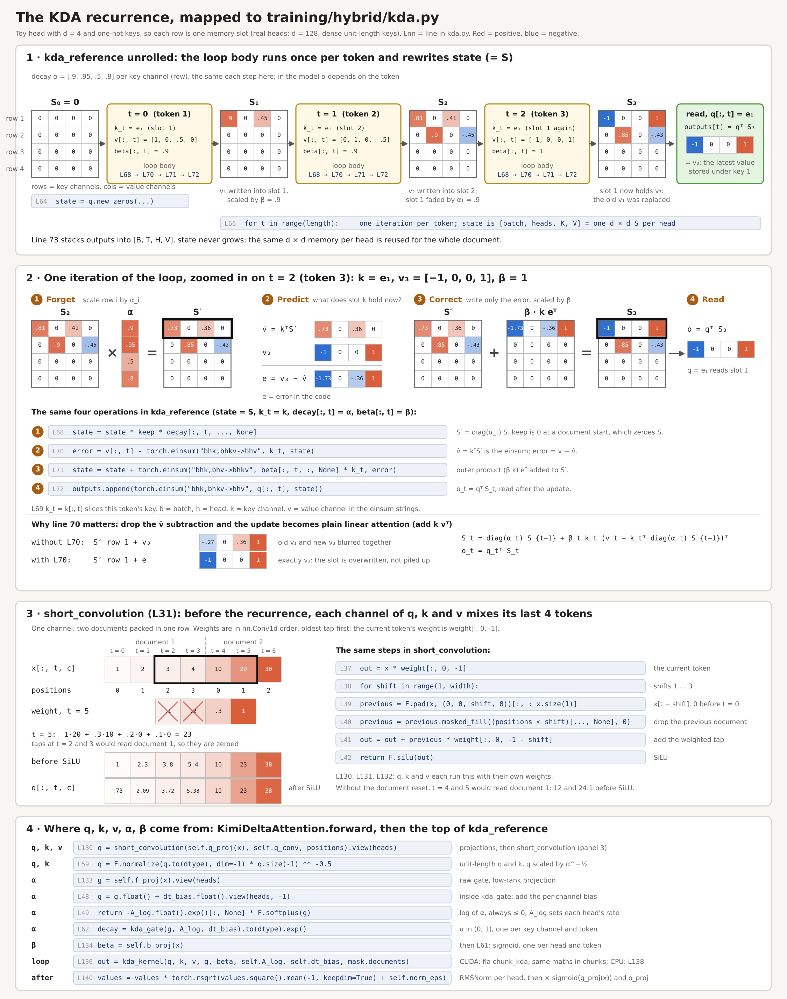

# Kimi Delta Attention, step by step

A worked example of the KDA recurrence in [`hybrid/kda.py`](../hybrid/kda.py), the
linear-attention layer of the hybrid model. One head is shrunk to width 4 with
one-hot keys, so every row of the state is one memory slot. Three tokens write
into it: token 1 and token 3 share a key with different values. α and β are set
directly through the raw gate inputs (`A_log = 0`, `dt_bias = 0`).
The figure shows the states that the loop body of `kda_reference` computes for
these tokens, next to the lines of `kda.py` that produce them.



## The recurrence

Each KDA head keeps one d × d matrix `state` (S): rows are key channels, columns
are value channels. `kda_reference` updates it once per token:

```python
for t in range(length):
    keep = (positions[:, t] > 0).to(dtype)[:, None, None, None]
    state = state * keep * decay[:, t, ..., None]                                  # forget
    k_t = k[:, t]
    error = v[:, t] - torch.einsum("bhk,bhkv->bhv", k_t, state)                   # predict
    state = state + torch.einsum("bhk,bhv->bhkv", beta[:, t, :, None] * k_t, error)  # correct
    outputs.append(torch.einsum("bhk,bhkv->bhv", q[:, t], state))                 # read
```

- **Forget:** every row of S is scaled by its own decay α in (0, 1), computed per
  token from `-exp(A_log) * softplus(f_proj(x) + dt_bias)`. `keep` is 0 at a
  document start and zeroes the state there.
- **Predict:** `kᵀS` is what the memory currently returns for this key; `error`
  is the gap to the token's value.
- **Correct:** the outer product `β k errorᵀ` moves the slot toward the value.
  β = sigmoid(`b_proj(x)`) sets how far: at β = 1 the slot holds exactly the new
  value.
- **Read:** the output is `qᵀS` after the update.

Together: `S_t = diag(α_t) S_(t−1) + β_t k_t (v_t − k_tᵀ diag(α_t) S_(t−1))ᵀ`,
`o_t = q_tᵀ S_t`. Without the predict step, the update adds `β k vᵀ` (plain
linear attention): in the example, slot 1 would hold a blend of the old and new
values (`[−.27, 0, .36, 1]`) instead of the new value (`[−1, 0, 0, 1]`).

The state has the same size for every sequence length. On CUDA, fla's
`chunk_kda` computes the same recurrence in parallel chunks, with gate, β and
L2 normalization inside the kernel and document starts from `cu_seqlens`.

## Relation to Mamba and state space models

A selective state space model updates a hidden state per token,
`h_t = Ā_t h_(t−1) + B̄_t x_t`, `y_t = C_t h_t`, with `Ā = exp(Δ A)` (zero-order
hold) and `Δ = softplus(Parameter + s_Δ(x))` ([Mamba][mamba], §2 eq. 4 and §3.2).
Mamba-2 restricts `A` to a scalar times the identity per head and shows that the
resulting SSM is linear attention with decay: `C`, `B` and `X` take the roles of
`Q`, `K` and `V` ([Mamba-2][mamba2], §2.4, §5.3 Figure 4, §7.1). KDA's `state` is that
SSM state, with `q`, `k`, `v` in the roles of `C`, `B`, `x`.

The transition is what changes along the line of models:

| Model | Transition applied to the state each token |
|---|---|
| Mamba-2 | `α_t I`, one data-dependent scalar per head |
| Gated DeltaNet | `α_t (I − β_t k_t k_tᵀ)`, Mamba-2's α combined with the delta rule |
| KDA | `(I − β_t k_t k_tᵀ) Diag(α_t)`, one decay per key channel |

[Gated DeltaNet][gdn] (§3.1, eq. 10) uses Mamba-2's parameterization for α (§3.4,
footnote 4) and the delta rule's generalized Householder transition
`I − β_t k_t k_tᵀ` (§2.2): gating erases memory quickly, the delta rule makes
targeted updates. [Kimi Linear][kimi] (§1, §3 eq. 1) extends Gated DeltaNet with a
channel-wise decay, "akin to Gated Linear Attention (GLA)", and describes KDA as a
constrained diagonal-plus-low-rank (DPLR) transition, the structure S4 used with a
static matrix (§6.2). Mamba's transition only scales the state; the delta-rule
factor `I − β k kᵀ` replaces the value stored under `k` (the "why line 70 matters"
row of the figure).

Parts of `kda.py` follow Mamba's code directly
([`mamba_simple.py`][mamba-simple], [`mamba2.py`][mamba2-code]):

- Decay: `A = −exp(A_log)` and `softplus(… + dt_bias)` are Mamba's `A` and `Δ`;
  `kda_gate` returns `Δ·A`, the log of `Ā`.
- `A_log` initialization: uniform in [1, 16] per head, Mamba-2's `A_init_range`.
  Mamba-1 uses `A = 1 … N` (S4D-real) per state dimension.
- `dt_bias` initialization: `dt` log-uniform in [0.001, 0.1], floored at 1e-4,
  stored through the inverse softplus `dt + log(−expm1(−dt))`. Mamba-2 keeps one
  `dt` per head, Mamba-1 one per channel; KDA keeps one per key channel and head.
- Gated output norm: Mamba-2 normalizes right before the output projection
  (`RMSNormGated`, §7.1); KDA uses an RMSNorm with a sigmoid gate, as fla's
  `FusedRMSNormGated`.
- Chunked kernel: Mamba-2's SSD algorithm uses attention-style matmuls within
  chunks and a recurrence over states between chunks (§6); fla's `chunk_kda`
  computes KDA the same way.

The hybrid layout follows Kimi Linear's uniform 3:1 ratio of KDA to full-attention
layers, the best validation perplexity among the ratios they tested (§4, §5.2).

## The short convolution

`short_convolution` (q, k and v each have their own weights) is a causal
depthwise convolution with kernel 4 followed by SiLU:

```
out[t, c] = SiLU(w₃ x[t, c] + w₂ x[t−1, c] + w₁ x[t−2, c] + w₀ x[t−3, c])
```

- Depthwise: 4 weights per channel, no mixing across channels (the projections
  before it mix channels).
- Causal: shift `s` reads `x[t − s]` through `F.pad` on the time axis. Taps with
  `positions < s` would read the previous document and are zeroed.
- Equivalent to `F.conv1d(..., groups=C)` with 3 positions of left padding, which
  `test_short_convolution_matches_conv1d_and_resets` checks.
- Weights start uniform in ±1/√4, `nn.Conv1d`'s default.

Panel 3 of the figure draws this example: one channel, weights `[0.1, 0.2, 0.3, 1.0]`
(oldest to current) and a second document starting at token 4, before SiLU:

```
x              [1,   2,   3,   4,   | 10,   20,   30  ]
one document   [1.0, 2.3, 3.8, 5.4,   12.0, 24.1, 38.4]
two documents  [1.0, 2.3, 3.8, 5.4,   10.0, 23.0, 38.0]
```

The recurrence writes one (k, v) pair and reads one q per token; the convolution
lets each of them depend on the three tokens before it, such as a key for "the
token after X". The same layer sits before the scan in Mamba (`d_conv = 4`,
depthwise `nn.Conv1d`, SiLU; the block replaces H3's first multiplicative gate
with an activation, §3.4 Figure 3). Mamba-2 convolves x, B and C together
(`conv_dim = d_ssm + 2·ngroups·d_state`), which correspond to v, k and q. Gated
DeltaNet generates q, k and v by "linear projection, short convolution and SiLU"
(§3.4), and Kimi Linear applies a ShortConv with a Swish activation and kernel
size 4 to q, k and v (§4). fla's `KimiDeltaAttention` uses three `ShortConvolution`s
(`conv_size = 4`, SiLU) and none on the decay, β or output gate. In attention,
[Primer][primer] adds "a depthwise convolution layer after each Q, K, and V
projection".

Kimi Linear's ablation (Table 1, §5.2, their 3:1 hybrid) reports validation
perplexity 5.65 with the convolution and 5.70 without it, and calls the
convolution's role in hybrid models "non-negligible".

[mamba]: https://arxiv.org/abs/2312.00752
[mamba2]: https://arxiv.org/abs/2405.21060
[gdn]: https://arxiv.org/abs/2412.06464
[kimi]: https://arxiv.org/abs/2510.26692
[primer]: https://arxiv.org/abs/2109.08668
[mamba-simple]: https://github.com/state-spaces/mamba/blob/main/mamba_ssm/modules/mamba_simple.py
[mamba2-code]: https://github.com/state-spaces/mamba/blob/main/mamba_ssm/modules/mamba2.py

## How the code is checked

`tests/test_hybrid_kda.py` (CPU) checks the decay and the reset:

- `test_reference_matches_matrix_form` compares `kda_reference` in float64 with
  `S_t = (I − β k kᵀ) diag(α) S_(t−1) + β k vᵀ` written with explicit `diag`,
  `outer` and the gate formula. It pins the gate formula, that α scales key
  channels, and that the decay comes before the delta update.
- `test_reference_resets_state_at_documents` requires a document to give
  bit-identical outputs packed after another document and alone.
  `test_hybrid_model_isolates_documents` repeats this through a mixed KDA/full stack.

Each of these edits to `kda.py` fails at least one of these tests: dropping `keep`,
decaying value channels, removing or moving the decay, dropping `dt_bias`, flipping
the gate sign, and resetting at `positions > 1`. The CUDA check
(`tests/check_hybrid_cuda.py`, `kda_against_reference`) compares fla's kernel with
`kda_reference` on packed documents, including a one-token document, for the output
and all input gradients.
