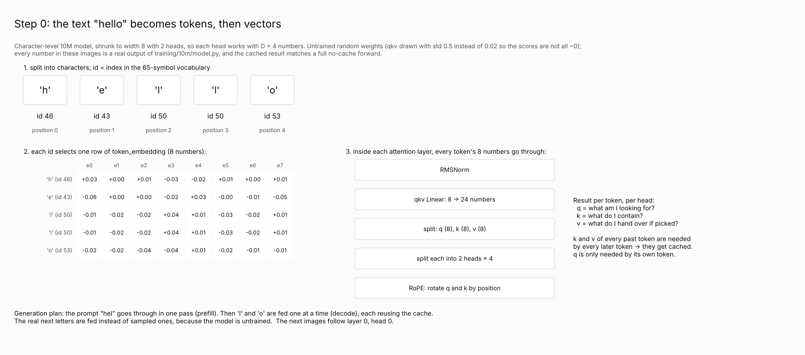
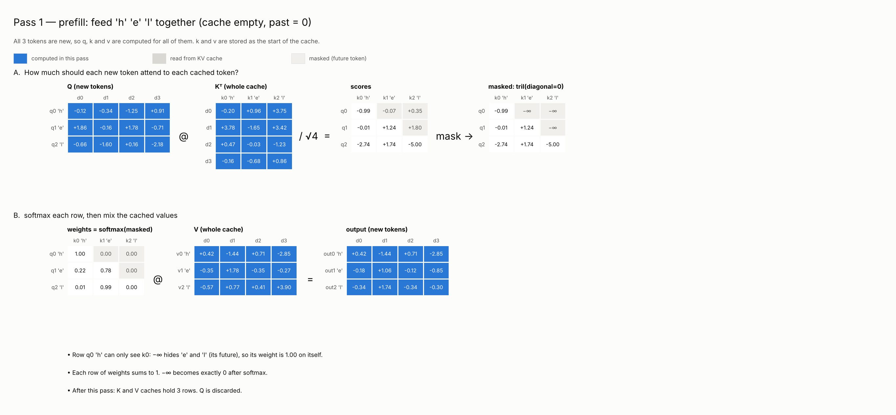
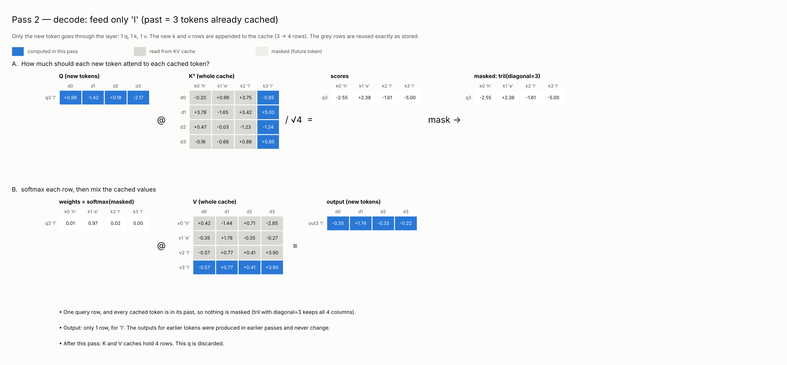
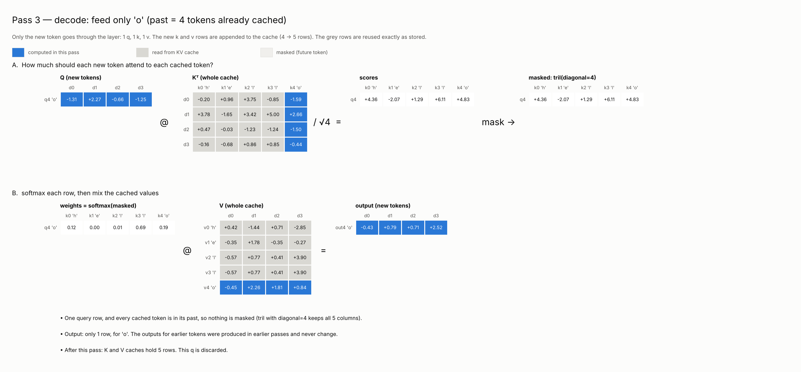

# KV cache, step by step

A worked example of causal attention with a KV cache in the
[10M model](../10m/model.py). The model is shrunk to width 8 with 2 heads (D = 4
per head) and has random, untrained weights. The qkv weights are drawn with std 0.5
instead of 0.02 so the attention scores are visibly different from 0. The figures
follow layer 0, head 0. Every number is a real model output, and the cached result
matches a full forward pass without the cache. [`kv-cache/figures.py`](kv-cache/figures.py)
computes and draws them:

```sh
cd training
uv run --with matplotlib python references/kv-cache/figures.py references/kv-cache
```

The text "hello" is split into characters and fed through the model. The prompt
"hel" goes through in one pass (prefill). Then 'l' and 'o' are fed one at a time
(decode). The real next letters are fed rather than sampled, because the model is
untrained.

## Attention with a cache

```python
def causal_attention_with_past(query, key, value):
    # query: [B,H,T_new,D]; key/value: [B,H,T_past+T_new,D]
    past = key.size(-2) - query.size(-2)
    scores = query @ key.transpose(-2, -1) / math.sqrt(query.size(-1))
    mask = torch.ones(query.size(-2), key.size(-2), dtype=torch.bool).tril(diagonal=past)
    return scores.masked_fill(~mask, float("-inf")).softmax(-1) @ value
```

- `past` is the number of cached tokens. New query `i` sits at absolute position `past + i`.
- `scores[i, j]` is `q_i · k_j / √D`: one score per (new query, key) pair.
- `tril(diagonal=past)` keeps key `j` only when `j ≤ past + i`. For a single
  decode query, every key is in its past, so the mask keeps everything.
- `masked_fill` writes −∞ into future positions, which softmax turns into weight 0.
- `@ value` mixes the cached value rows, producing one output per new token.

Each layer appends the new k and v rows to its cache and drops q after use.
RoPE uses the absolute position, `rotary(x, offset=past)`. With
`F.scaled_dot_product_attention`, `is_causal=True` aligns the mask top-left when
there are fewer queries than keys. Decode therefore needs `is_causal=False` for a
single new token, or an explicit `tril(diagonal=past)` mask for a chunk of new tokens.

## Figures

**Text to tokens.** Each character gets an id from the 65-symbol Tiny Shakespeare
vocabulary. The id selects one embedding row. The layer then computes q, k and v
per head.



**Pass 1, prefill "hel".** All of q, k and v is computed (blue). The causal mask
hides the future, so 'h' puts weight 1.00 on itself. The cache now holds 3 rows.



**Pass 2, decode 'l'.** Only the new token is computed: one q, one k column and one v
row. The grey cache rows are read back unchanged. Nothing is masked, and one output
row comes out. v2 and v3 are identical because both are 'l' with the same layer input,
but k2 and k3 differ because RoPE rotates keys by position.



**Pass 3, decode 'o'.** The cache grows from 4 to 5 rows. Earlier outputs were
produced in earlier passes and never change, so their queries are not needed again.


