# Open-model size frontier — 2026-11-01

Published benchmark scores of open-weight models released from January 2025 to
October 2026 (plus 2024 small-model references), against parameter count, to place
our 150M, 720M and up-to-2B models. Collected from model cards, tech reports, papers
and leaderboards; nothing here is measured by us.

- Data and page: HF dataset `jfrick/lm-exploration-results`, folder
  `training/references/open-model-frontier/` (`sources/` as collected,
  `models.json`, `pairs.json`, `open-model-frontier.html`).
- Charts: [`open-model-frontier/images/`](open-model-frontier/images/), rendered from the page.
- Code: [`open-model-frontier/build.py`](open-model-frontier/build.py) builds
  `models.json`, `pairs.json` and the page from the source files;
  [`page.html`](open-model-frontier/page.html) is the page template (Pareto frontier
  per benchmark, size ranges, best score at or below each size, knowledge against
  agentic scores, before/after agentic training).

## Coverage

579 entries: 242 model variants from cards (base, instruct and reasoning separately,
each with its source URL) and 337 more from agentic results, 147 of them research
fine-tunes (SWE-Gym, SWE-smith, SWE-Hero, SWE-Lego, mini-coder, TMax and others).
Benchmarks: LiveCodeBench, SWE-bench Verified/Pro/Multilingual, Terminal-Bench
1.0/2.0/2.1 and Artificial Analysis's hard subset, MMLU-Pro, GPQA Diamond, AIME 2025,
MATH-500, GSM8K, IFEval, HumanEval(+), MBPP(+), MMLU, HellaSwag and ARC-Challenge.

Agentic scores keep their harness and attempts. Where Artificial Analysis ran a model
independently, that run is used over the vendor's; best-of-N, verifier-reranked,
subset and expert-assisted results are left out of the chart. `pairs.json` holds 92
same-paper scores of a base model before and after agentic SFT or RL.

## Charts

Rendered from the page; the step line is the Pareto frontier (no smaller model scores
higher), dashed lines mark our 150M, 720M, 1B and 2B sizes, and hollow markers are
research agent fine-tunes. Zoomed views rescale the score axis.

**Agentic**

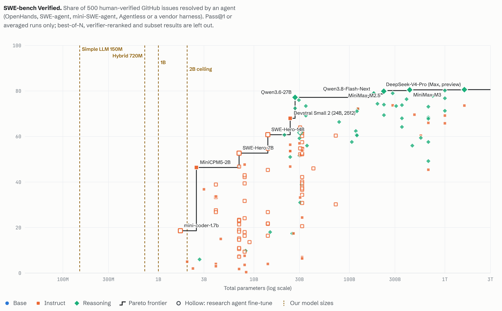
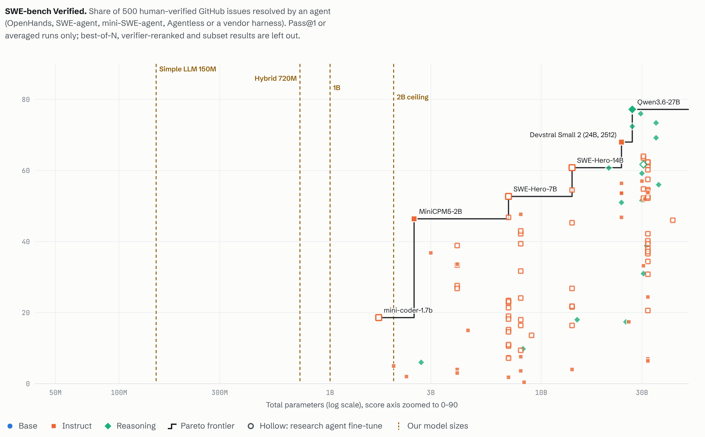
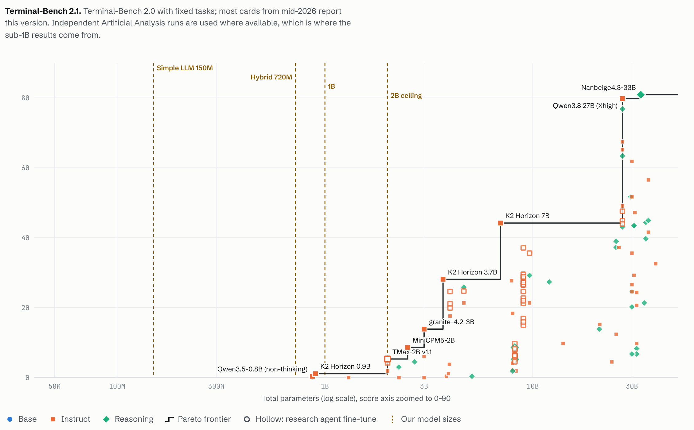
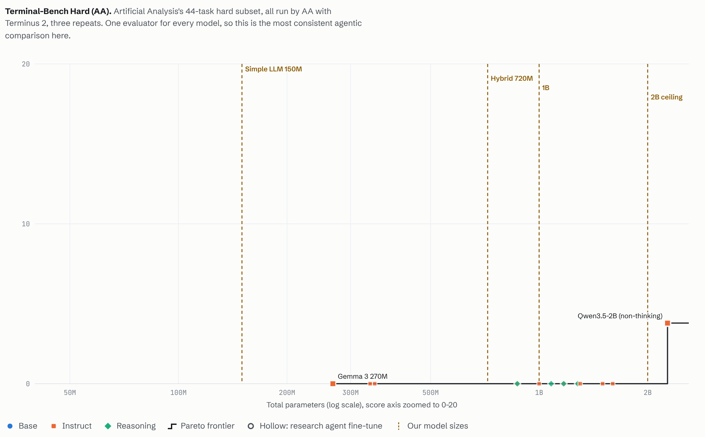

**Coding, knowledge and math**

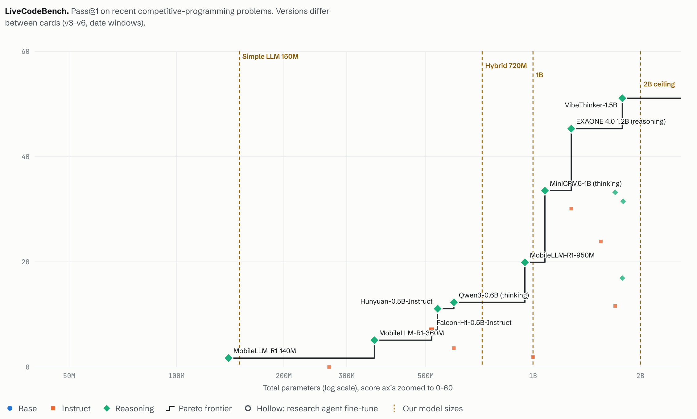
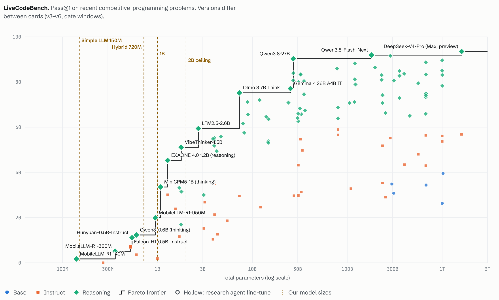
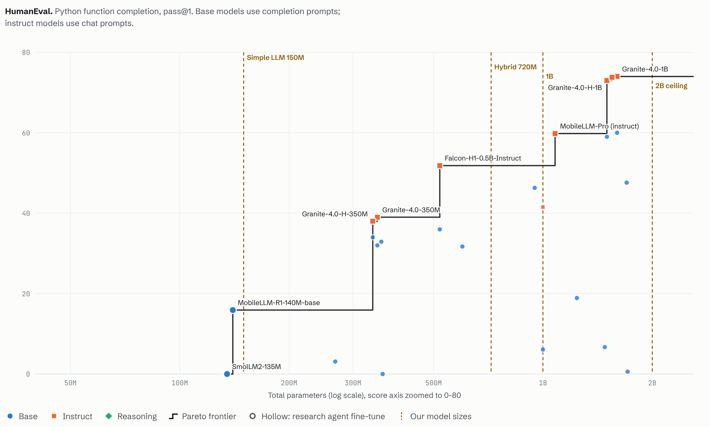
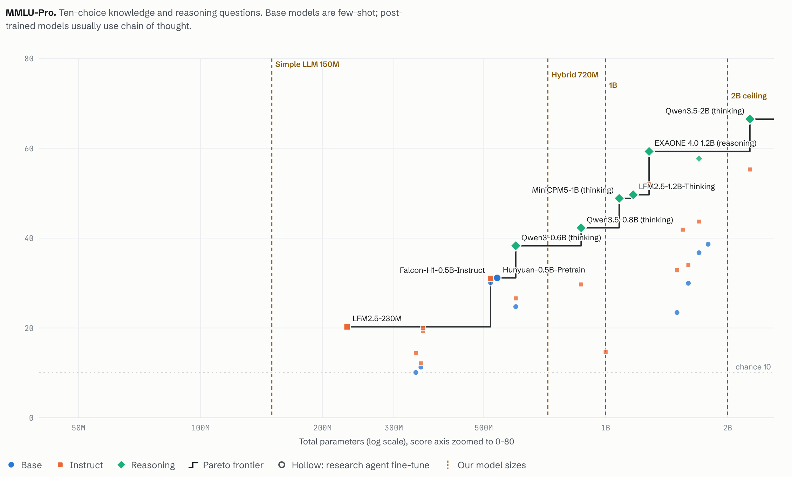
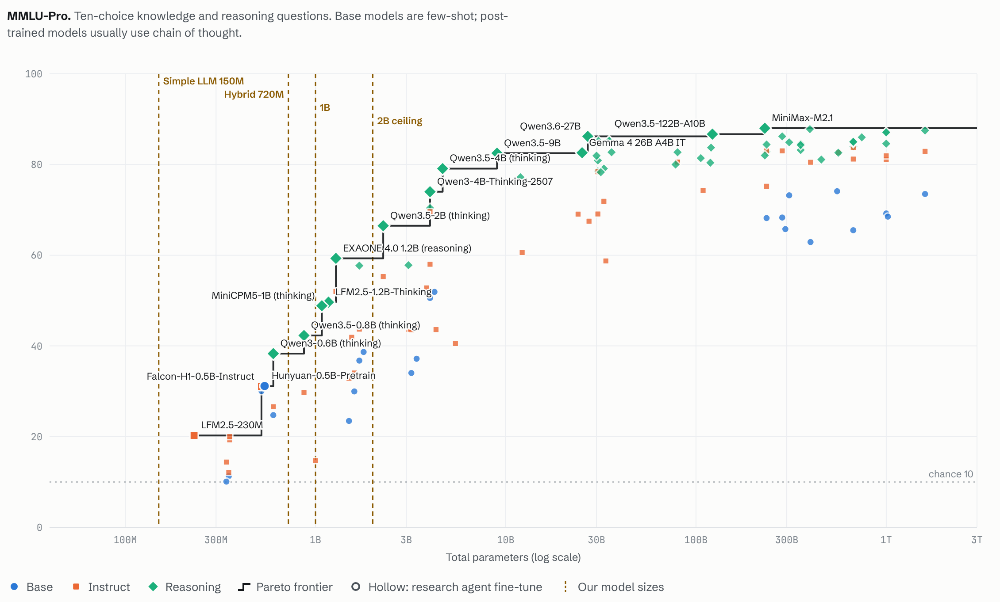
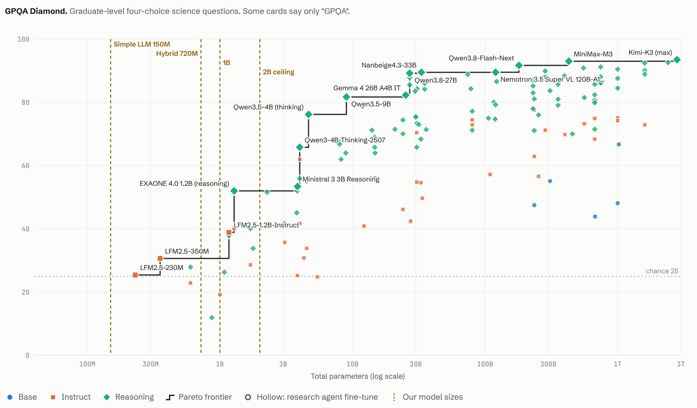
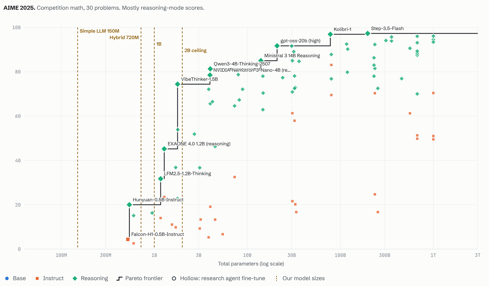

**Knowledge against agentic score, and before/after agentic training**

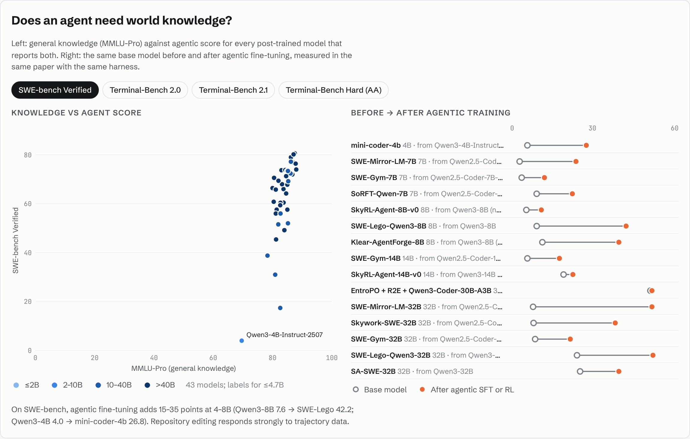
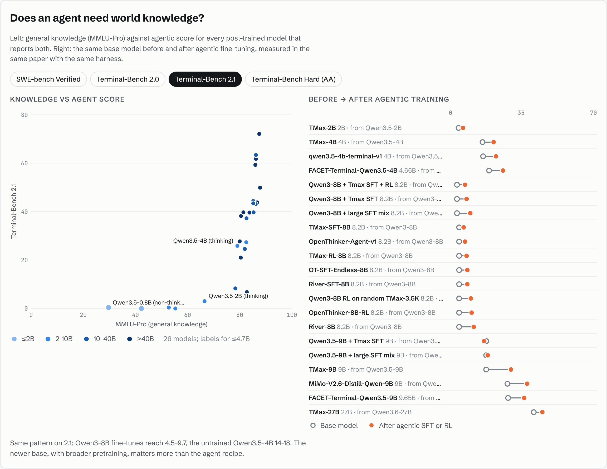

## Findings

- **Below 1B, a narrow data mix sets the frontier.** MobileLLM-R1-140M base
  (pretrained mostly on code and math) reports HumanEval 15.9 and GSM8K 16.3;
  SmolLM2-135M reports 0.0 and 1.4. Best base scores at ≤750M (Falcon-H1-0.5B):
  HumanEval 36.0, MBPP 52.1, GSM8K 60.2, MMLU 55.0.
- **Knowledge benchmarks sit near chance under 1B.** Best GPQA Diamond under 750M
  is 30.6 (chance 25); base MMLU-Pro tops out at 31 (chance 10).
- **No agentic result at or below 1B.** Every model of 1.6B or less on Artificial
  Analysis's Terminal-Bench hard subset scores 0 (Gemma 3 270M, Granite 4.0 350M,
  Qwen3.5-0.8B, LFM2.5-1.2B, EXAONE 4.0 1.2B, MiniCPM5-1B). On Terminal-Bench 2.1
  the best sub-1B result is K2 Horizon 0.9B, 3 solves in 267 trials. No SWE-bench
  result exists for any model at or below 1B.
- **The smallest working SWE agent is 1.7B.** mini-coder-1.7b (Qwen3-1.7B trained on
  about 400k SWE-smith trajectories from Qwen3-Coder-30B-A3B) resolves 18.6% of
  SWE-bench Verified with bash-only mini-SWE-agent; the untrained model scores 0%
  under three scaffolds on the 50-task Verified Mini set.
- **Trajectories move SWE-bench; the base model moves Terminal-Bench.** Qwen3-8B goes
  from 7.6 to 42.2 on SWE-bench Verified (SWE-Lego) and Qwen3-4B from 4.0 to 26.8
  (mini-coder-4b). On Terminal-Bench 2.0, every Qwen3-8B fine-tune stays at or below
  13.5 while the untrained Qwen3.5-4B scores 16.6, and RL moves Qwen3.5-2B only from
  2.3 to 2.9 (TMax).
- **Knowledge is not sufficient.** EXAONE 4.0 1.2B (MMLU-Pro 59) and LFM2.5-1.2B (50)
  both score 0 on the Terminal-Bench hard subset. Every working small agent starts
  from a base pretrained on trillions of broad tokens.

## Caveats

Scores are mostly self-reported and use different harnesses, shot counts and
benchmark versions (LiveCodeBench v3–v6, SWE-bench scaffolds, Terminal-Bench
harnesses). Late-2026 cards often report agentic benchmarks only. Some numbers were
read from card images or another lab's comparison table; each entry's notes say so.
Treat the frontier as an envelope of claims, not a controlled comparison.

Our own agentic result so far, the 720M student at 0 of 179 held-out PR tasks, is in
[HYBRID_V2.md](../plans/HYBRID_V2.md#agentic-sft-pilot-agentic-sft-v1-2026-10-29).
