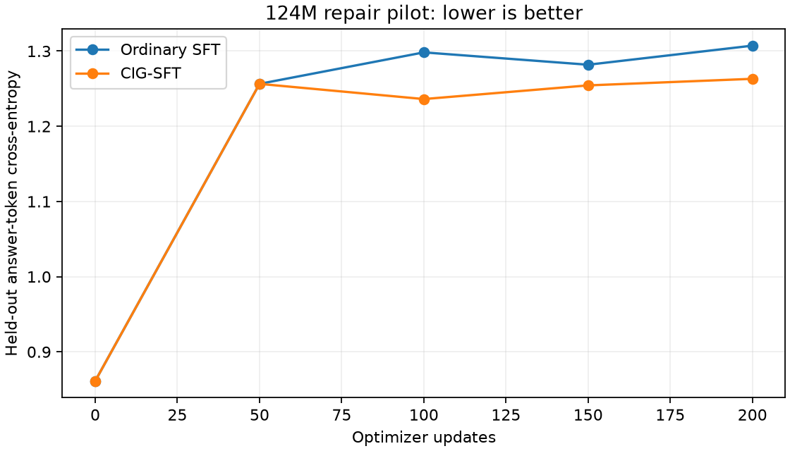

# CIG-SFT on Simple LLM 124M

Paper: [What Should SFT Learn? Conditional Information Gain for Generalizable
Post-Training](https://arxiv.org/abs/2610.12995v1), Gu et al., submitted October 9,
2026. This is a recent preprint, not an established result at our model scale.

## Selection and hypothesis

CIG-SFT estimates how much knowing the task helps predict each demonstrated answer
token, using the frozen starting model. It uses that information to weight SFT
updates. The hypothesis here is that concentrating on task-dependent repair choices
helps generalization beyond the training families. The paper reports experiments
with 1.5B/7B math models and a 3B code model; applying it to 124M is an extrapolation.

I chose this over an external small-model comparison because it changes the training
method in the current code. Attention Residuals would require a more invasive
architecture experiment and matched fresh pretraining. This loss modification can
be evaluated from the same existing checkpoint with unchanged architecture,
tokenizer and examples.

## Branch and protocol

Base: newest-created open training PR [#28](https://github.com/koogle/lm-exploration/pull/28),
`training/coding-sft`, head `c221312e02702d624e6ead89308524280e35a457`.
Experimental branch: `research/cig-sft-repair`.

Both arms start from the same completed PR #26 checkpoint:
`simple-llm-code60-fresh-5b-20261019-r02-s02/step-000066065.pt`.
The parent SHA256, tokenizer, dataset and executed source hashes are in
`training.json`. Checkpoints and source snapshots stay on the private
`lm-exploration-training` Modal volume.

- 576 training and 36 validation records from the inherited original CC0 curriculum.
- Nine languages; absolute-difference and maximum families held out across languages.
- Both arms: 200 updates, batch 4, seed 42, LR 1e-5, AdamW, clipping 1,
  context cap 1024, answer-only loss including EOS, FP32 weights/BF16 autocast.
- One L40S per arm, sequential execution; 1,200-second loop and 3,600-second worker limits.
- CIG uses lambda 0.3 from the paper, with no hyperparameter search.
- Task-free input empties instruction and broken-code fields but retains the language
  and identical prompt scaffolding. This is the explicit adaptation to repair prompts.
- Cached reference information uses training examples only and the untouched parent.
- Ordinary unweighted validation cross-entropy is measured for both arms.
- Greedy generation: 128-token cap, inherited PAD/BOS/UNK suppression; two held-out
  families per language (18 tasks). Candidate code runs in separate network-blocked
  Modal sandboxes; fixed/broken calibration checks the grader in each language.

The loss follows equations 7 and 19–20. Its current-model weights are detached and
its denominator is the number of answer tokens, not the sum of weights. A unit test
compares its logit gradient to the independently constructed full projected target.

## Execution notes

The control trained successfully in
[initial app](https://modal.com/apps/radiantai/main/ap-ItV8rUocMMTSErsyOw5WyF).
A missing module in the report collector image failed collection after the control
checkpoint was committed. The image was fixed; the control was recovered without
retraining in [continuation app](https://modal.com/apps/radiantai/main/ap-nFIqValGWga0KZTAvygNLI).

The earlier external SmolLM2 proposal was withdrawn after the user clarified the
research goal. Its app `ap-u1Rtqen3j0uv3JUegkr6fb` was stopped during image building;
no model-training result was produced and that implementation is not in this branch.

## Measured result

| Metric | Ordinary SFT | CIG-SFT |
| --- | ---: | ---: |
| Updates | 200 | 200 |
| Supervised answer tokens | 21,531 | 21,531 |
| Initial held-out cross-entropy | 0.861365 | 0.861365 |
| Final held-out cross-entropy | 1.307223 | 1.263123 |
| Executable repair correctness | 0/18 | 0/18 |
| EOS termination | 18/18 | 18/18 |
| Runnable completions reaching output comparison | 18/18 | 18/18 |

CIG's final held-out loss is 3.37% lower than ordinary SFT, but both worsen from
the starting checkpoint and neither solves a held-out repair. This pilot therefore
**does not demonstrate useful repair generalization** from CIG. Keep ordinary SFT
as the default. These results do not disprove the paper's larger-model findings.



The cache assigns positive information to 14,141/15,288 unique training answer
tokens (92.50%); mean information among positive tokens is 0.82766. Because the
prompt includes broken code, information gain can reward copying unchanged code,
not only the repair. The intended emphasis on actual fixes is a hypothesis, not
established by these scores.

Raw [training metrics and identities](training.json), [all generated outputs and
grades](evaluation.json), and [Python examples](examples.md) are retained.
The [evaluation app](https://modal.com/apps/radiantai/main/ap-IPTwrXKr7Qoe7cwusXKBjW)
calibrated fixed/broken answers in all nine languages before scoring candidates.

Validation: 3 CIG math/stability/masking tests and 13 inherited repair tests passed;
Ruff and whitespace checks passed. Parent, dataset, tokenizer and executed source
hashes matched between arms, as did every logged step/answer-token count. The
ordinary-SFT final loss exactly reproduced the inherited pilot's result.

## Limits

This is a single-seed, short synthetic pilot, not a reproduction of the paper's
benchmark results or evidence about real repository repairs. Tiny templated data
may not expose the method's benefit. Matched updates/token exposure do not imply
matched wall time: CIG needs two frozen-reference passes per example. Weighted
training-loss values cannot be compared numerically with ordinary SFT loss.
Resume identity is preserved, but fresh-process CIG GPU resume equivalence has not
been tested. The baseline remains the default pending broader evidence.

## Reproduction

From `training/`, install corpus/research extras, use the system CA setup in
`100m/PILOT.md`, and run:

```sh
modal run modal_cig_pilot.py --run-prefix cig-repair-UNIQUE --output /tmp/cig-results
modal run modal_cig_eval.py::evaluate_cig --folder /tmp/cig-results
uv run --extra corpus python -m unittest discover -s tests -p 'test_cig.py' -v
uv run --extra corpus python -m unittest discover -s tests -p 'test_repair*.py' -v
```

The generated `repairs.jsonl` is reconstructible from the committed generator;
it is retained locally for evaluation, rather than duplicated in Git.
