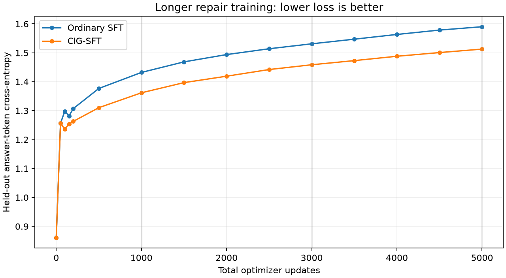

# Longer CIG-SFT repair continuation

The user requested substantially longer training, aiming for at least one correct
repair on the existing 18-task diagnostic. This continues the matched
[200-update pilot](../cig-sft-20261020/README.md), on the same PR #29 branch.

## Measured outcome: target not reached

Both runs completed **5,000 total updates / 530,091 supervised answer tokens**,
adding 4,800 updates / 508,560 answer tokens to each saved pilot. The requested
at-least-one-correct target was not reached.

| Total updates | Ordinary SFT | CIG-SFT |
| --- | ---: | ---: |
| 1,000 | 0/18 | 0/18 |
| 3,000 | 0/18 | 0/18 |
| 5,000 | 0/18 | 0/18 |

Every checkpoint produced 18 terminating, runnable responses, but none satisfied
all grading cases. **All 18 generated code strings in both arms were identical
to the corresponding step-200 outputs at every evaluated checkpoint.** IDs and
grading cases matched the original diagnostic. No scoring rule or training data
was changed to obtain a pass.

| Held-out ordinary cross-entropy (lower is better) | Ordinary SFT | CIG-SFT |
| --- | ---: | ---: |
| Restored step 200 | 1.307223 | 1.263123 |
| Final step 5,000 | 1.590171 | 1.512819 |



Each arm's own training objective approached zero: median of the final 100 updates
was 2.32e-7 for SFT and 1.79e-7 for CIG. These objectives are differently weighted
and should not be compared against each other. Near-zero training loss, worsening
held-out CE and unchanged wrong repairs are consistent with overfitting the tiny
training curriculum. This experiment does not support simply repeating it longer.
A follow-up aimed at 1/18 should investigate broader training repairs and transfer
to unseen task families while preserving these held-out examples; no such data
change was made in this run.

[Summary and consistency checks](summary.json), [full training metrics, identities
and continuation lineage](training.json), and executable grading records at
[1,000](evaluation-step-000001000.json), [3,000](evaluation-step-000003000.json), and
[5,000](evaluation-step-000005000.json) retain the negative result. The unchanged
code examples are visible in the [original pilot](../cig-sft-20261020/examples.md).

[Training app](https://modal.com/apps/radiantai/main/ap-Y8LmsWj9PoZLEG6VopicnE);
evaluation apps for [1,000](https://modal.com/apps/radiantai/main/ap-LEfD3fzJXM5kgNOaOuDXMQ),
[3,000](https://modal.com/apps/radiantai/main/ap-ZIUbdnHAl5gR4X4rQptUcD), and
[5,000](https://modal.com/apps/radiantai/main/ap-kYLVNxMrfeCz3BDxpHle5s).
Sandbox startup/source-upload latency slowed evaluation; calibration passed for
all nine languages at every checkpoint. All training and evaluation apps completed.

## Fixed protocol

- Continue each objective's own step-200 checkpoint to **5,000 total updates**
  (25 times the original length; 4,800 additional updates per arm).
- Preserve model weights, Adam state, random-example sampler, CPU/CUDA RNG,
  answer-token accounting, tokenizer, learning rate, and all 576 training records.
- Keep CIG's reference fixed at the original pretraining parent. Reference scores
  are recomputed from that parent before restoring the trainable checkpoint.
- Retain batch 4, LR 1e-5, seed 42, AdamW weight decay 0.01, BF16 autocast,
  context cap 1024, clipping at 1, and CIG lambda 0.3.
- Save each 1,000 updates; report ordinary validation CE each 500 updates.
- Evaluate the same 18 held-out repair prompts at steps 1,000, 3,000 and 5,000,
  with unchanged greedy decoding, 128-token cap and sandbox grading cases.
- Two L40S training workers maximum, one per arm. Checkpoint generation uses one
  separate short-lived L40S worker; grading uses CPU sandboxes. Each has a 3,000-second training-loop
  limit and a 3,600-second worker timeout, with no automatic retries/continuations.

Repeated checks make this a monitored validation diagnostic, not an untouched test
set. No held-out solution enters training. Passing one task would be encouraging,
but would not establish broad code-repair capability.

## Safe continuation

`extend=True` is explicit. It permits increasing the target steps and changing only
checkpoint/evaluation cadence and the runtime cap. Data, parent, tokenizer,
objective, optimizer settings, model and CIG implementation hashes must match.
The completed pilot's exact trainer hash is an explicitly reviewed predecessor;
arbitrary source changes are rejected. Ordinary resume retains strict equality.
Every continuation records the source checkpoint SHA256, prior identity and
restored counters in `continuation.json` on the run volume.

The GPU qualification starts from the actual CIG step-200 checkpoint. It compares
steps 201–202 uninterrupted against step 201 followed by a fresh-container restore
and step 202. Model, optimizer, sampler, RNG and token counters must match exactly.
The [qualification](qualification.json) passed: every compared state matched
exactly at step 202 / 21,763 answer tokens. It ran in
[Modal](https://modal.com/apps/radiantai/main/ap-0NrkWutuLUtEtGJ7pgp6wx).
Fifteen local repair/extension tests also passed, including rejection of changed
learning settings and unreviewed source identities.

## Reproduction

From `training/`, with corpus/research extras and the documented system CA setup:

```sh
modal run modal_cig_long.py::qualify_extension
modal run modal_cig_long.py::main
modal run modal_cig_eval.py::evaluate_cig --folder results/cig-sft-long-20261020 --step 1000
modal run modal_cig_eval.py::evaluate_cig --folder results/cig-sft-long-20261020 --step 3000
modal run modal_cig_eval.py::evaluate_cig --folder results/cig-sft-long-20261020 --step 5000
```

The committed launcher uses fixed unique run IDs for this recorded experiment;
choose new IDs in the launcher before rerunning. The raw synthetic JSONL is
reconstructible from the original pilot's generator and stays ignored locally.
Checkpoints remain private on the existing Modal run volume.
