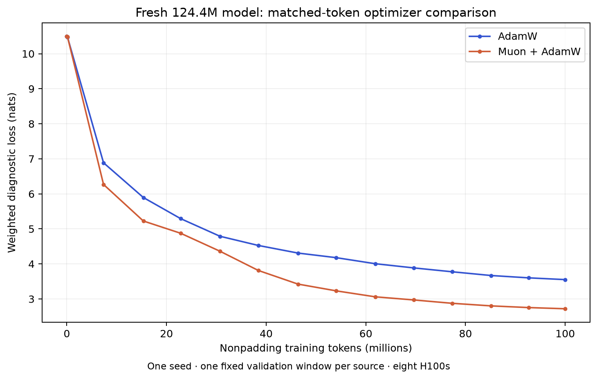

# Fresh Muon versus AdamW: measured 124.4M comparison

Both runs completed on October 19, 2026, at **99,988,281 nonpadding tokens / 1,296
updates** each. Muon plus an AdamW companion achieved **2.7204 diagnostic validation
loss**, versus **3.5525 for all-AdamW**: 0.8322 nats lower (23.4%). Its measured
steady throughput was **9.8% lower** and peak allocated memory **2.6% lower**.

This supports investigating Muon further for sample efficiency. It does not
establish long-run quality or a universally better optimizer: one seed, untuned
hyperparameters and one fixed validation window per source were used.

| Measurement | AdamW | Muon + AdamW |
| --- | ---: | ---: |
| Final weighted diagnostic loss (nats; lower is better) | 3.5525 | 2.7204 |
| Steady nonpadding tokens/sec | 275,395 | 248,500 |
| Peak allocated GiB, maximum across ranks | 14.364 | 13.993 |
| Initial two-update process, seconds | 214.24 | 116.81 |
| Continuation process, seconds | 519.94 | 525.58 |
| Combined training processes, seconds | 734.18 | 642.39 |
| Fresh-process restore validation | exact | exact |

## What changed and what was held fixed

Both use the same 124,389,632-parameter 14×768 model, seed 42, frozen 32K tokenizer,
scholarly/code raw snapshot, 8K context and global batch 32. Both use eight H100s,
microbatch 2, cropping, cached RoPE, dynamic model compilation and prefetch depth 4.
Chunked loss is disabled. The launcher verified identical initial validation,
manifest/tokenizer identity, total token exposure and per-source token exposure.
Neither starts from an existing trained model.

The Muon arm applies five-step BF16 Newton–Schulz updates to hidden matrices,
with momentum 0.95 and peak LR 0.02. Tied embeddings, biases and norms retain fused
AdamW at peak LR 0.0003, betas 0.9/0.95. The baseline uses that fused AdamW setup for
all parameters. Both schedules warm up over 20M tokens then cosine-decay to 10%;
both use weight decay 0.1 and gradient clipping 1.0. Equal decay coefficients with
different LRs imply different absolute decay. This compares those recipes, not
tuned optimizer optima. The model is compiled; the Python Muon optimizer is not.

## Timing interpretation

Steady throughput is total nonpadding tokens divided by summed step durations,
excluding the first ten continuation steps; it includes loader, communication,
forward/backward, clipping and optimizer work. Evaluation/checkpoint intervals are
outside step timing. Compilation that occurs later is included. The AdamW result
reproduces the earlier 275,631 tokens/sec benchmark within 0.1%.

The two-process elapsed totals include model initialization, compilation,
evaluation and checkpointing, but exclude container provisioning and separate
qualification checks. **Do not interpret Muon's shorter total as a speed win.**
AdamW ran first, and the sequential arms could reuse compiler caches. The first
process took 214 seconds for AdamW versus 117 for Muon; startup was not a controlled
cold-cache comparison. In the measured steady training region, Muon is slower.
No optimizer-specific kernel or communication profiling was performed.

## Per-source final diagnostics

Every source's fixed diagnostic window had lower loss with this Muon recipe.
These are tiny diagnostics, not representative corpus-wide evaluation.

| Source | AdamW | Muon + AdamW |
| --- | ---: | ---: |
| fineweb_edu | 4.5927 | 3.9616 |
| code_python | 3.5364 | 2.4095 |
| finemath_4plus | 1.9915 | 1.5337 |
| pes2o | 3.9602 | 2.9432 |
| pubmed | 4.0027 | 2.9793 |
| arxiv | 3.8749 | 2.9299 |
| pressbooks | 4.5179 | 4.0654 |
| libretexts | 4.1367 | 3.3017 |
| doab | 3.7083 | 2.0926 |
| gutenberg | 4.3037 | 3.6125 |
| pre_1929_books | 4.2140 | 3.7338 |
| library_of_congress | 4.0768 | 3.5205 |

## Validation and provenance

- Local targeted suite: 14 tests passed; Ruff and whitespace checks passed.
- Four optimizer unit tests passed inside each pinned PyTorch 2.6.0 GPU worker.
- Eight-rank compiled BF16 Muon qualification passed, including a fully masked
  rank, exact agreement of rank parameters and exact optimizer next-update restore.
- Both full-model runs restored the two-step checkpoint in a new process and
  passed exact diagnostic validation agreement. Final accounting was recomputed
  from the retained metrics and matched the returned summaries.
- Source commit: `ebc5464dfac46566e72450021cac46a3794e6178` (the original PR implementation).
- [Modal application](https://modal.com/apps/radiantai/main/ap-Pqtzos5cN2U8xxPqAj5UKc),
  run prefix `muon-124m-100mt-20261019-b`.
- [Combined measured summary](muon-124m-100mt-20261019-b.json). Per-step metrics,
  validation history and reports for both initial and continuation processes are
  retained beside it; the plot script regenerates the figure.
- Checkpoints, complete source snapshots, manifest and logs remain on the
  `lm-exploration-training` volume under the run prefix. No model was published.

The initial October 18 attempt failed before confirmed submission. On October 19,
client debug logs identified proxy CA trust failures. Loading the system trust
store with `truststore.inject_into_ssl()` resolved them without disabling TLS
verification. The original failed-attempt record is preserved.

Next: use a larger fixed held-out set and repeat seeds/LR choices before deciding
on a long Muon run. Profile or compile/batch the Muon matrix updates to investigate
the observed steady-throughput cost; benchmark that change separately.
