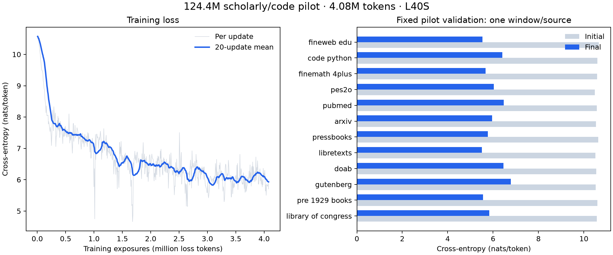

# Scholarly/code 124.4M pilot — 2026-10-16

Completed GPU training: **600 updates, 4,078,340 loss-bearing tokens**.
The planned 20B-token run has not started. This pilot establishes functioning
subword training and learning, not a useful or coherent pretrained model.

- [Modal training app](https://modal.com/apps/radiantai/main/ap-kNTO2wU7UHUfRXuvo7cQJm)
- [Preparation app](https://modal.com/apps/radiantai/main/ap-zqBbbmPj2YH3x0rD8lZO2F)
- [Full worker report](scholarly-124m-pilot-20261016-01.json), [metrics](scholarly-124m-pilot-20261016-01-metrics.jsonl),
  [selected runtime dependencies](scholarly-124m-pilot-20261016-01-environment.json)
- [Configuration and launch guide](../100m/PILOT.md)

## Measured results

| Metric | Result |
| --- | ---: |
| Unique model parameters | 124,389,632 |
| Context / GPU / computation | 1,024 / L40S / BF16 autocast |
| Initial / final weighted pilot validation loss | 10.5811 / 6.0272 |
| Measured loop, checkpoint, final evaluation and sampling time | 230.1 s |
| Training compute time | 166.4 s |
| Checkpoint save and commit time | 56.3 s |
| Compute throughput | 24,509 loss tokens/s |
| Throughput including recorded overhead | 17,724 loss tokens/s |
| Peak CUDA allocated memory | 6.74 GiB |
| GPU tiny-set fitting loss, first / last | 10.4261 / 0.0768 |
| CPU qualification | 23 tests passed |
| Actual checkpoint/data reload | Identical next-batch inputs, labels and logits |
| Stop reason | Configured 600-update limit |

Validation is only one fixed window per source under the provisional split.
All twelve losses improved, but no uncertainty estimate, audited benchmark result
or coherent language capability is established. Generated samples remain incoherent;
the arithmetic prompt continued `2 + 2 = 48`. Full samples are retained in the JSON.

## Data and repetition

Preparation scanned 1,000 records from each pinned source and exported
283,937,393 training loss tokens. These are bounded sample counts after the
implemented filtering/exact deduplication, not globally audited corpus capacity.
The agreed weights were honored by actual loss tokens. Python code reached
1.0083 effective passes; all other sources remained below one pass.

| Source | Prepared train tokens | Trained exposures | Effective passes | Actual / target share | Final pilot loss |
| --- | ---: | ---: | ---: | ---: | ---: |
| fineweb_edu | 1,140,067 | 407,273 | 0.3572 | 9.99% / 10% | 5.536 |
| code_python | 1,211,460 | 1,221,486 | 1.0083 | 29.95% / 30% | 6.408 |
| finemath_4plus | 1,314,325 | 814,756 | 0.6199 | 19.98% / 20% | 5.675 |
| pes2o | 6,581,508 | 407,384 | 0.0619 | 9.99% / 10% | 6.036 |
| pubmed | 6,419,964 | 122,755 | 0.0191 | 3.01% / 3% | 6.469 |
| arxiv | 13,475,716 | 82,117 | 0.0061 | 2.01% / 2% | 5.957 |
| pressbooks | 581,804 | 123,071 | 0.2115 | 3.02% / 3% | 5.765 |
| libretexts | 3,054,332 | 123,159 | 0.0403 | 3.02% / 3% | 5.512 |
| doab | 6,147,782 | 163,742 | 0.0266 | 4.01% / 4% | 6.456 |
| gutenberg | 89,338,421 | 203,882 | 0.0023 | 5.00% / 5% | 6.784 |
| pre_1929_books | 88,325,358 | 285,973 | 0.0032 | 7.01% / 7% | 5.553 |
| library_of_congress | 66,346,656 | 122,742 | 0.0019 | 3.01% / 3% | 5.835 |

At these weights, code limits this snapshot to approximately **8.08M
mixed exposures** under the two-pass rule. The plentiful sampled books do not
remove that bottleneck. Do not cycle this snapshot to billions of tokens.

## Artifacts and provenance

Volume: `lm-exploration-training`, directory: `scholarly-124m-pilot-20261016-01/`.
Final checkpoint: `step-000600.pt`; intermediate immutable checkpoints:
10, 100, 200, 300, 400 and 500. Each checkpoint contains model, optimizer,
CPU/CUDA RNG and data cursor state. The directory also retains the tokenizer,
manifest, model/trainer/data source snapshot, configuration, metrics and report.

Merged model commit: `eb4e6d612a4e99af1e93bb5645def93d381012db`.
The worker report records exact hashes for the additional pilot code actually run.
The report uses a separate checkpoint format; the character-generation CLI does
not load it. Cross-job resume still needs a launcher and validation before the
substantial run. The step-10 test verified an actual serialized reload in one job.

Training and final Volume commits completed successfully. The local launcher then
failed to unpickle PyTorch's `TorchVersion` string subclass without local torch.
The report and metrics were recovered from the Volume; training was not repeated.
The current launcher converts returns to JSON primitives and records a plain
version string. These post-run fixes intentionally differ from the retained run
source hashes; they were linted/compiled but no second GPU job was launched.

## Cost and next stage

Modal's [pricing page](https://modal.com/pricing), checked 2026-10-16, listed L40S
at $0.000542/second ($1.9512/hour). The measured 230.1-second
interval corresponds to about **$0.125 GPU-only**.
This excludes GPU startup/qualification before the timed loop, CPU preparation,
CPU/memory, storage and other charges; it is not an invoice. The worker's
30-minute hard timeout bounded GPU runtime charges at approximately $0.98.

A purely linear 20B-token extrapolation at the recorded end-to-end rate is
313 GPU-hours (about $612 GPU-only). This is a
pilot sizing estimate, not a launch budget or a production throughput guarantee.
Frequent checkpointing consumed 24.5% of the measured interval.

Before substantial training: finish corpus eligibility/provenance, global near
deduplication, parent/split reconciliation and benchmark contamination audits;
expand the smaller sources; implement production shuffling/indexing and cross-job
resume; profile 2K context and a verified SDPA kernel; choose the full schedule,
validation protocol, stopping threshold and compute bound. Preserve the merged
architecture and frozen tokenizer while making those changes explicit.
