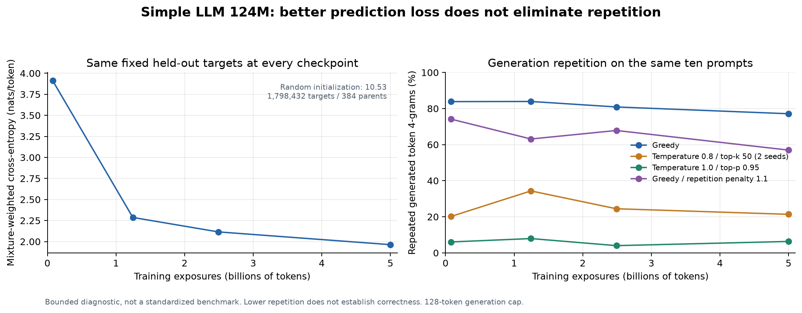

# Simple LLM 124M — checkpoint and repetition validation

Four checkpoint revisions were verified against their weight hashes and trained-model source. Each used the same held-out targets, prompts and decoding settings.

Evaluation: 384 validation parents, 1,798,432 nonpadding targets, at most four 2K windows per parent. This is a bounded exploratory evaluation with pending corpus audits, not a sealed benchmark. The final loss of 1.9635 here differs from the training-time 1.8708 diagnostic because this evaluation uses a much larger fixed sample.

| Trained tokens | Held-out loss | Greedy repeat-4 | Sampled 0.8 repeat-4 | Sampled 1.0 repeat-4 | Greedy penalty 1.1 repeat-4 |
|---|---:|---:|---:|---:|---:|
| 0.077B | 3.9120 | 83.8% | 20.2% | 6.0% | 74.2% |
| 1.245B | 2.2869 | 83.9% | 34.3% | 7.9% | 63.1% |
| 2.491B | 2.1151 | 80.9% | 24.4% | 4.0% | 67.8% |
| 5.000B | 1.9635 | 77.1% | 21.4% | 6.3% | 57.0% |

Repeat-4 = 1 − unique token 4-grams / all generated token 4-grams. This is a loop diagnostic, not a measure of factual or programming correctness. Temperature 0.8 averages two seeds per prompt; each other setting uses one seed per prompt. No completions were selected or omitted.

## Implementation and data checks

- 280 real training windows passed exact next-token alignment, EOS, document-boundary and right-padding checks, including 21 windows continuing a long document.
- Restoring the real loader cursor reproduced the next 32-window batch exactly.
- Raw loader, prefetch/resume, and independent RMSNorm/RoPE/SDPA/causality reference tests passed (12 tests).
- The production accumulation function matched full-batch gradients and an AdamW step in an FP32 two-rank CPU/Gloo adaptation of the existing CUDA reference test. This was not a new CUDA/BF16 test.
- A bounded 64-document/source repetition audit was retained; repeated code/math structure is not automatically bad data, and this does not replace global near-deduplication or a full corpus audit.

## Interpretation

Held-out loss and free-running generation measure different behavior. Greedy repetition is present at the earliest checkpoint and persists through training. Sampling changes repetition substantially at a fixed checkpoint; this establishes a decoding contribution, while erroneous or incoherent continuations remain. The tests did not find a simple shift, EOS, right-padding, resume or attention-reference bug. They do not prove every aspect of the training pipeline is correct, identify a single root cause, or show that further training could not help.

Next steps: use less restrictive sampling for exploration, and run a controlled data-quality/training ablation before spending on another large run. Repetition penalties reduce loops but are not evidence of improved knowledge. Compare a cleaned, more diverse text mixture against the current mixture at matched architecture and token budget.

## All completions

All 200 completions and reference-continuation scores are in the archived comparison JSON. The human-readable file contains every completion.

The full comparison, real-data audit and implementation-check JSONs are archived on HF and indexed in [`pr16-artifacts.json`](../publication/pr16-artifacts.json) as `results/simple-llm-repetition-{comparison,data-audit,implementation-checks}-20261018.json`.
