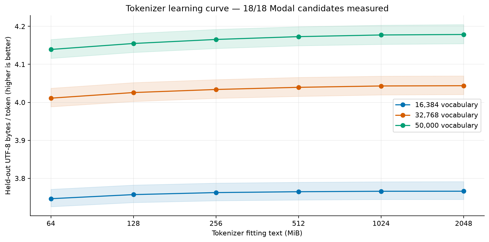
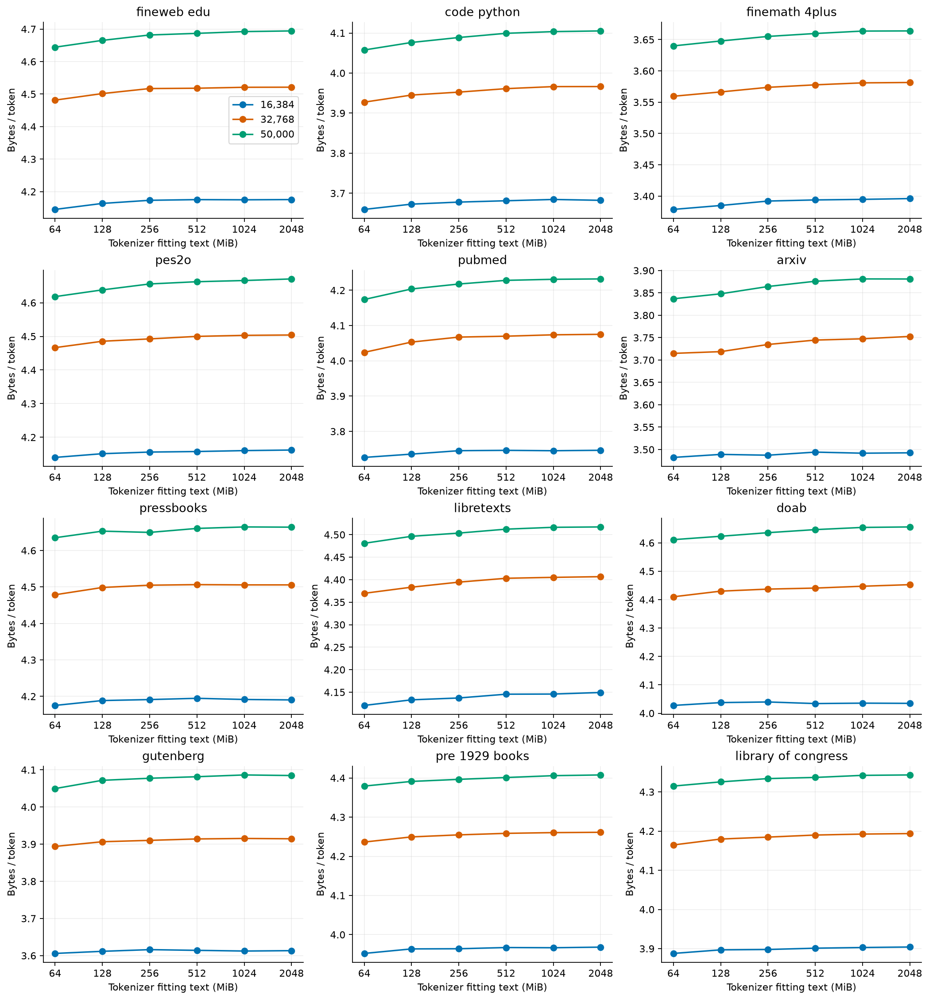
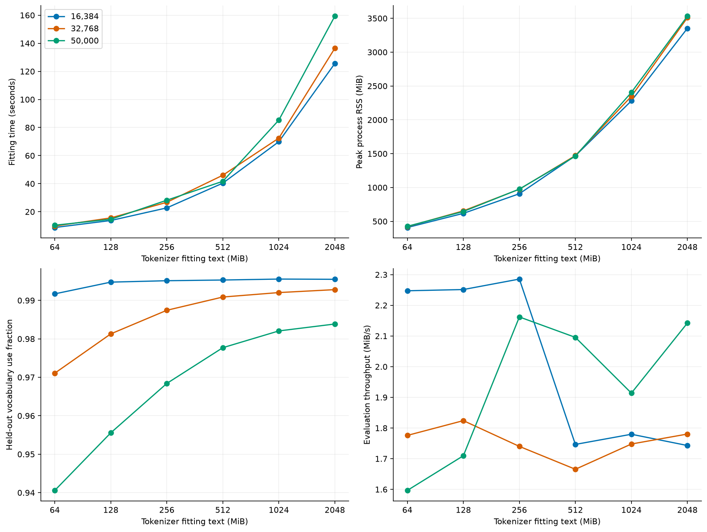
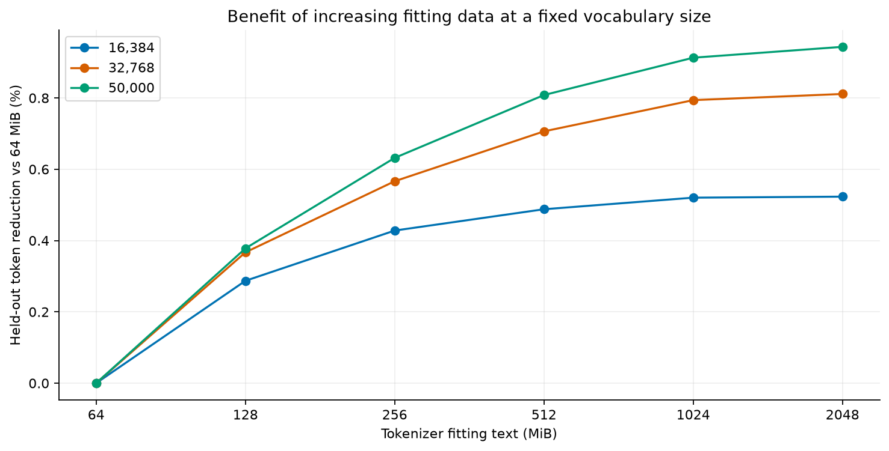
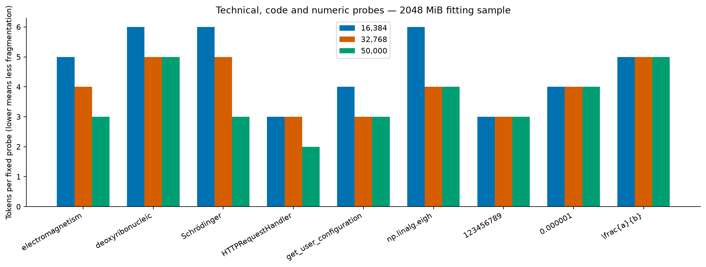

# Tokenizer learning-curve research report

## Overview

18 of 18 requested candidates have measured Modal results. The grid doubles fitting text from 64 MiB through 2 GiB and compares 16,384, 32,768 and 50,000 vocabulary entries. All fresh candidates use the same source-weighted, parent-held-out evaluation corpus. A higher bytes-per-token value means fewer tokens for the same text; it does not establish better language-model quality. The strongest observed compression is 4.1786 bytes/token at 2048 MiB and 50,000 entries. This identifies a compression result, not a final model-optimal vocabulary.

**Status: complete.**

## Main findings

- The strongest observed compression is 4.1786 bytes/token at 2048 MiB and 50,000 entries. This identifies a compression result, not a final model-optimal vocabulary.
- At 16,384 entries, 64 MiB → 2 GiB reduces held-out token count by 0.52%; the final doubling contributes 0.003%. The smallest sample within 1% of this vocabulary's best observed token count is 64 MiB. The 1% tolerance is an analysis heuristic.
- At 32,768 entries, 64 MiB → 2 GiB reduces held-out token count by 0.81%; the final doubling contributes 0.017%. The smallest sample within 1% of this vocabulary's best observed token count is 64 MiB. The 1% tolerance is an analysis heuristic.
- At 50,000 entries, 64 MiB → 2 GiB reduces held-out token count by 0.94%; the final doubling contributes 0.031%. The smallest sample within 1% of this vocabulary's best observed token count is 64 MiB. The 1% tolerance is an analysis heuristic.
- At 2 GiB, 32K uses 6.87% fewer tokens than 16K; 50K uses 9.88% fewer. At width 768, tied vocabulary parameters increase by 12.58M and 25.82M respectively. Untied input/output matrices double these deltas.
- The published default is the 2 GiB / 32K candidate, a practical starting point balancing compression and vocabulary parameter overhead. All 18 variants are published for comparison. This choice has not been validated by matched-compute language-model training.

## Experimental design

- All 12 pinned source inventories from the scholarly/code plan are eligible; the experiment samples them rather than claiming to process every upstream record.
- Nested per-source UTF-8 byte prefixes: 64, 128, 256, 512, 1,024 and 2,048 MiB. 16K means 16,384 entries, 32K means 32,768, and 50K means exactly 50,000.
- Source weights follow the plan, applied to bytes for tokenizer fitting. This is distinct from the eventual model-training token mixture.
- Shared 32 MiB evaluation corpus; parent-level train/evaluation/test separation before chunking. Test parents are excluded. The final evaluation caps each document and parent at 16 KiB to broaden coverage; fitting data are unchanged.
- Byte-level BPE, full byte alphabet, no normalization or automatic boundaries; the frozen v1 pretokenization rules are held fixed. The original tokenizer is unchanged.
- Seeded shard permutation, sequential records within shards, a 64 KiB document cap and 256 KiB parent cap for fitting. Exact whitespace-normalized duplicate chunks are removed; cross-split conflicts are quarantined before freezing.
- CPU-only Modal: eight-CPU and 64 GiB memory requests, with a two-hour candidate timeout; at most three candidates concurrently. Peak RSS includes fitting and evaluation. CPU/memory requests are not hard caps; Rayon uses eight threads. Final rescoring uses two CPUs and 8 GiB RAM (requests and hard caps), at most three workers and a 20-minute timeout. Throughput includes encoding, decoding, counting and checks; peak RSS refers to the original fitting/evaluation process.

## Evaluation coverage audit

The initial evaluation had only five LibreTexts parent books. Before interpreting the candidate curves, evaluation was rebuilt with a 16 KiB parent cap and the same 32 MiB source quotas. Every candidate was rescored on that shared corpus. An initial 8 KiB cap could not fill the LibreTexts quota (636,017 bytes after exhausting the pinned inventory), so a fresh evaluation version used 16 KiB. Fitting text and tokenizer weights were preserved. Original fitting chunks were reserved in the dedup index to exclude exact normalized chunk overlap. Original result.json files remain on Modal; result-balanced-evaluation.json contains final metrics.

## Frozen corpus composition

| Source | Weight % | Fit MiB | Fit parents | Eval MiB | Eval parents |
|---|---:|---:|---:|---:|---:|
| fineweb_edu | 10 | 204.80 | 46886 | 3.20 | 845 |
| code_python | 30 | 614.40 | 39130 | 9.60 | 1394 |
| finemath_4plus | 20 | 409.60 | 87795 | 6.40 | 1573 |
| pes2o | 10 | 204.80 | 7302 | 3.20 | 214 |
| pubmed | 3 | 61.44 | 1689 | 0.96 | 66 |
| arxiv | 2 | 40.96 | 859 | 0.64 | 42 |
| pressbooks | 3 | 61.44 | 859 | 0.96 | 67 |
| libretexts | 3 | 61.44 | 367 | 0.96 | 67 |
| doab | 4 | 81.92 | 661 | 1.28 | 83 |
| gutenberg | 5 | 102.40 | 1886 | 1.60 | 108 |
| pre_1929_books | 7 | 143.36 | 2672 | 2.24 | 149 |
| library_of_congress | 3 | 61.44 | 1211 | 0.96 | 65 |

Parent counts use the adapter's source-scoped identifiers; equivalent works across sources are not fully reconciled.

## Aggregate learning curve

Shading is a 95% parent-bootstrap interval, stratified by source with fixed source-byte weights (256 paired replicates). It describes evaluation-sample uncertainty, not uncertainty across training seeds.

| MiB | Vocabulary requested / actual | Bytes/token | Token reduction vs 64 MiB | Fit seconds | Peak RSS MiB | Correctness |
|---:|---:|---:|---:|---:|---:|---|
| 64 | 16,384 / 16,384 | 3.7463 | 0.00% | 8.8 | 409 | pass |
| 64 | 32,768 / 32,768 | 4.0110 | 0.00% | 9.8 | 422 | pass |
| 64 | 50,000 / 50,000 | 4.1392 | 0.00% | 10.4 | 427 | pass |
| 128 | 16,384 / 16,384 | 3.7571 | 0.29% | 13.8 | 618 | pass |
| 128 | 32,768 / 32,768 | 4.0258 | 0.37% | 15.6 | 655 | pass |
| 128 | 50,000 / 50,000 | 4.1549 | 0.38% | 14.7 | 646 | pass |
| 256 | 16,384 / 16,384 | 3.7624 | 0.43% | 22.8 | 908 | pass |
| 256 | 32,768 / 32,768 | 4.0338 | 0.57% | 26.7 | 975 | pass |
| 256 | 50,000 / 50,000 | 4.1655 | 0.63% | 28.2 | 977 | pass |
| 512 | 16,384 / 16,384 | 3.7646 | 0.49% | 40.4 | 1469 | pass |
| 512 | 32,768 / 32,768 | 4.0395 | 0.71% | 46.0 | 1472 | pass |
| 512 | 50,000 / 50,000 | 4.1729 | 0.81% | 41.7 | 1463 | pass |
| 1024 | 16,384 / 16,384 | 3.7659 | 0.52% | 69.9 | 2281 | pass |
| 1024 | 32,768 / 32,768 | 4.0431 | 0.79% | 72.4 | 2347 | pass |
| 1024 | 50,000 / 50,000 | 4.1774 | 0.91% | 85.3 | 2406 | pass |
| 2048 | 16,384 / 16,384 | 3.7660 | 0.52% | 125.6 | 3352 | pass |
| 2048 | 32,768 / 32,768 | 4.0438 | 0.81% | 136.5 | 3510 | pass |
| 2048 | 50,000 / 50,000 | 4.1786 | 0.94% | 159.3 | 3532 | pass |

## Source-level comparisons

## Resource use and vocabulary utilization

Unseen vocabulary includes special/control entries. A low utilization fraction alone is not evidence of a poor tokenizer on this finite evaluation set.

## Gains from more fitting data

## Vocabulary-size tradeoffs

| MiB | Vocabulary | Token reduction vs 16K | Paired 95% interval |
|---:|---:|---:|---|
| 64 | 16,384 | 0.00% | 0.00% to 0.00% |
| 64 | 32,768 | 6.60% | 6.53% to 6.68% |
| 64 | 50,000 | 9.49% | 9.41% to 9.61% |
| 128 | 16,384 | 0.00% | 0.00% to 0.00% |
| 128 | 32,768 | 6.67% | 6.60% to 6.76% |
| 128 | 50,000 | 9.58% | 9.49% to 9.69% |
| 256 | 16,384 | 0.00% | 0.00% to 0.00% |
| 256 | 32,768 | 6.73% | 6.66% to 6.82% |
| 256 | 50,000 | 9.68% | 9.58% to 9.79% |
| 512 | 16,384 | 0.00% | 0.00% to 0.00% |
| 512 | 32,768 | 6.80% | 6.74% to 6.89% |
| 512 | 50,000 | 9.78% | 9.69% to 9.90% |
| 1024 | 16,384 | 0.00% | 0.00% to 0.00% |
| 1024 | 32,768 | 6.86% | 6.79% to 6.94% |
| 1024 | 50,000 | 9.85% | 9.75% to 9.96% |
| 2048 | 16,384 | 0.00% | 0.00% to 0.00% |
| 2048 | 32,768 | 6.87% | 6.80% to 6.95% |
| 2048 | 50,000 | 9.88% | 9.77% to 9.99% |

Larger vocabularies reduce sequence length but add embedding/output parameters. At width 768 with tied embeddings, 32K adds 12.58M parameters over 16K; 50K adds 25.82M. Untied input/output weights double those increases. A final choice needs matched model-compute experiments.

## Fixed-term fragmentation

These are diagnostic examples, not a representative task benchmark. Fewer pieces are not automatically better, particularly for numbers.

## Interpretation and limitations

Do not select a winner from an incomplete matrix. Once complete, examine same-vocabulary gains from each doubling, source regressions, fragmentation probes and resource use together. A compression plateau is evidence of diminishing tokenizer-fitting returns, not proof of downstream optimality.

This experiment uses one corpus sampling seed. It does not establish stability across independent corpus samples. Near duplicates with changed wording or shifted chunk boundaries and equivalent books/papers across sources may remain. These limitations must be resolved for strong generalization claims. The frozen v1 collector split is not reproducible from its handoff, so its historical results are not mixed into this matched learning curve.

Token-level language-model perplexity is not compared here. Downstream evaluation should use the same held-out text and bits per byte under matched model size and compute. No model quality or billing-cost improvement is claimed.

## Reproduction and evidence

- Published tokenizer variants: [jfrick/scholarly-code-tokenizer](https://huggingface.co/jfrick/scholarly-code-tokenizer).
- `measurements.json` contains compact metrics, per-source comparisons, fragmentation probes and raw-result hashes. Full parent totals and candidate tokenizers remain on the Modal results volume.
- `corpus-manifest.json` records source pins, sampling settings, corpus hashes and collection decisions; `evaluation-corpus-manifest.json` pins the broader held-out corpus. `modal-smoke.json` records remote test execution.
- Run `python tokenizer_report.py <results-folder>` to regenerate this report and Matplotlib PNG/SVG/PDF figures from downloaded raw result JSONs.
