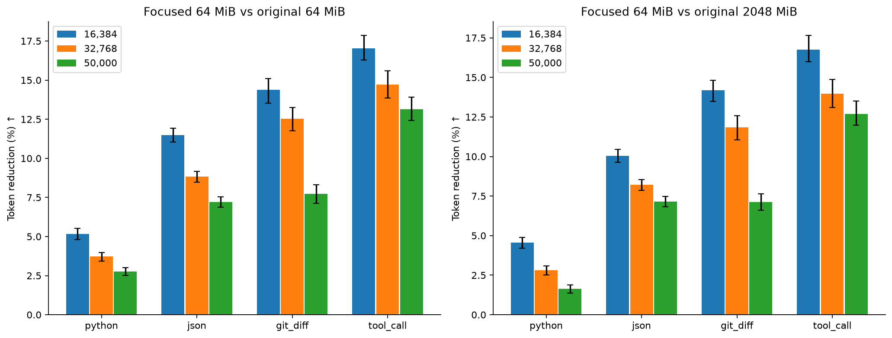
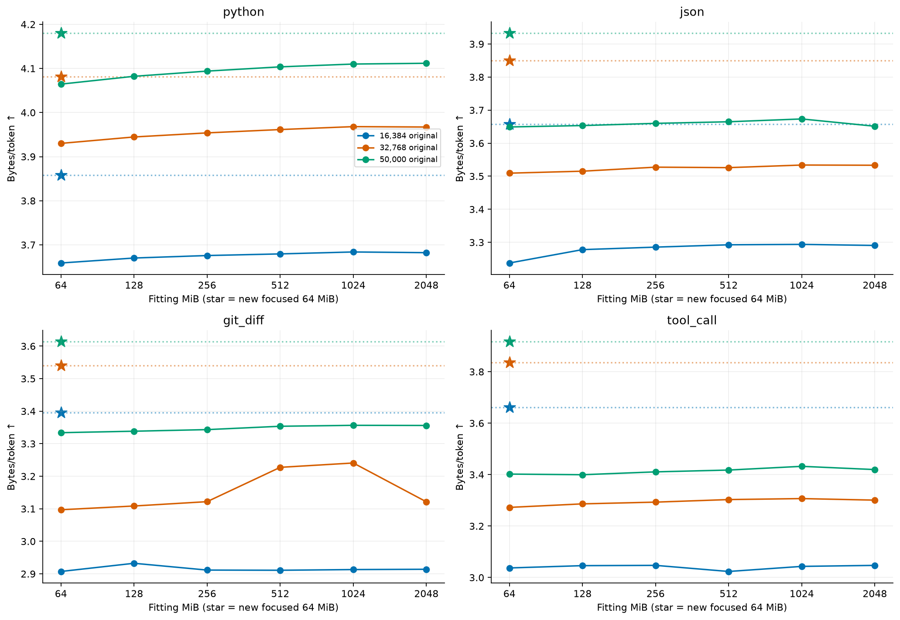
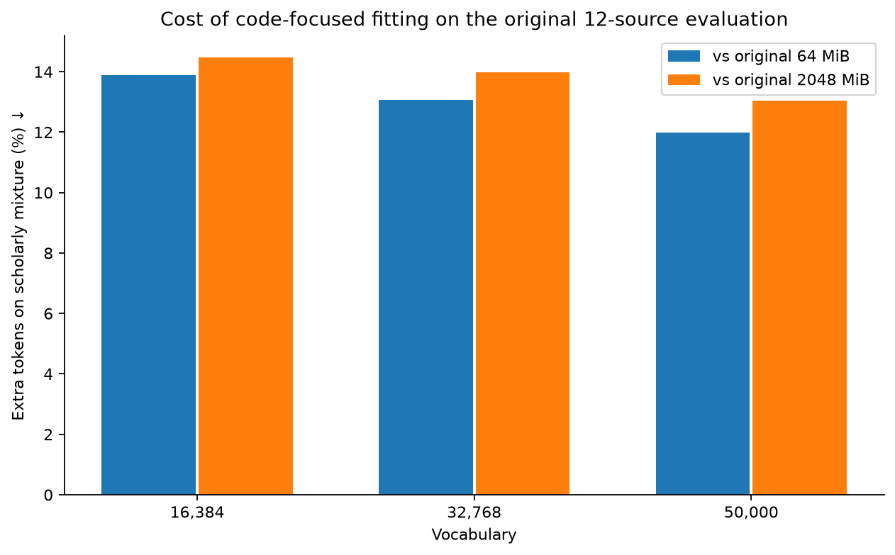

# JSON, code, Git diff and tool-call tokenizer study

## Overview

All 18 original tokenizers and three fresh code-focused tokenizers were scored on Modal. The new fits use approximately 64 MiB each at 16,384, 32,768 and 50,000 vocabulary entries. Existing tokenizers and the published default are unchanged.

## Method

- 512 held-out Python parent identifiers, one source excerpt per parent, sampled with seed 20261016 from the prior frozen evaluation. Each supplies four benchmark examples (2,048 total).
- Python uses real code excerpts. JSON, Git diffs and tool calls are generated controlled fixtures derived from those excerpts. They are not a representative collection of production tool traces.
- JSON includes nested metadata, booleans/null/numbers, compact/pretty formatting, escaped code and Unicode. Tool formats include schemas, argument objects, JSON-encoded arguments, calls and results.
- Unified patches include insertions, deletions and identifier replacements. Generated fixture patches pass git apply checks in tests; binary patches, renames and multi-file edits are not covered.
- The focused fitting mixture is 40% Python, 20% JSON, 20% diffs, 20% tool formats by UTF-8 bytes. Whole examples may slightly exceed each quota. Fitting parents are disjoint from evaluation parents; generator templates are shared.
- Same byte-level BPE, pretokenization, full byte alphabet, four special tokens, min frequency 2 and maximum learned token length 32 as the original experiment. No 120K experiment.
- Paired 95% intervals use 1,000 bootstrap samples of source parents. They quantify variation within this fixture set, not production generalization or training-seed variance.
- Actual fitting bytes: 67,116,295; fitting source parents: 14,911.
- All 21 structured evaluations passed exact round-trip and zero-UNK checks. The three new fits were also evaluated on the original shared 32 MiB scholarly mixture.

## Focused fits versus matched 64 MiB originals

| Vocabulary | Python token savings | JSON | Git diff | Tool call |
|---:|---:|---:|---:|---:|
| 16384 | 5.16% | 11.50% | 14.38% | 17.04% |
| 32768 | 3.72% | 8.84% | 12.52% | 14.70% |
| 50000 | 2.76% | 7.22% | 7.74% | 13.15% |

Positive savings mean fewer tokens; negative values mean more. Comparisons are within each workload, not an aggregate dominated by long code strings.

## All 21 candidates

| Candidate | Python bytes/token | JSON | Git diff | Tool call |
|---|---:|---:|---:|---:|
| focused-64mib-16384 | 3.8580 | 3.6581 | 3.3957 | 3.6610 |
| focused-64mib-32768 | 4.0817 | 3.8494 | 3.5404 | 3.8366 |
| focused-64mib-50000 | 4.1800 | 3.9329 | 3.6137 | 3.9169 |
| original-64mib-16384 | 3.6588 | 3.2375 | 2.9073 | 3.0371 |
| original-64mib-32768 | 3.9300 | 3.5093 | 3.0970 | 3.2725 |
| original-64mib-50000 | 4.0644 | 3.6491 | 3.3339 | 3.4020 |
| original-128mib-16384 | 3.6701 | 3.2780 | 2.9325 | 3.0461 |
| original-128mib-32768 | 3.9446 | 3.5153 | 3.1085 | 3.2862 |
| original-128mib-50000 | 4.0822 | 3.6533 | 3.3384 | 3.3995 |
| original-256mib-16384 | 3.6757 | 3.2855 | 2.9116 | 3.0472 |
| original-256mib-32768 | 3.9539 | 3.5274 | 3.1219 | 3.2930 |
| original-256mib-50000 | 4.0939 | 3.6599 | 3.3433 | 3.4107 |
| original-512mib-16384 | 3.6794 | 3.2926 | 2.9111 | 3.0234 |
| original-512mib-32768 | 3.9614 | 3.5260 | 3.2274 | 3.3029 |
| original-512mib-50000 | 4.1036 | 3.6648 | 3.3536 | 3.4177 |
| original-1024mib-16384 | 3.6838 | 3.2938 | 2.9131 | 3.0432 |
| original-1024mib-32768 | 3.9681 | 3.5338 | 3.2407 | 3.3068 |
| original-1024mib-50000 | 4.1099 | 3.6733 | 3.3565 | 3.4321 |
| original-2048mib-16384 | 3.6823 | 3.2906 | 2.9141 | 3.0471 |
| original-2048mib-32768 | 3.9672 | 3.5332 | 3.1214 | 3.3007 |
| original-2048mib-50000 | 4.1117 | 3.6512 | 3.3561 | 3.4196 |

## General-text regression check

| Vocabulary | New bytes/token | Extra tokens vs original 64 MiB | Extra tokens vs original 2 GiB |
|---:|---:|---:|---:|
| 16384 | 3.2895 | 13.88% | 14.48% |
| 32768 | 3.5474 | 13.07% | 13.99% |
| 50000 | 3.6963 | 11.98% | 13.05% |

## Tool-format breakdown: focused 32K vs published 2 GiB / 32K

Long code-bearing tool results dominate aggregate bytes. This separate breakdown checks the smaller calls and schemas as well.

| Format | Examples | Original mean tokens | Focused mean tokens | Token savings |
|---|---:|---:|---:|---:|
| read_file_call | 138 | 61.18 | 51.86 | 15.23% |
| apply_patch_call | 120 | 307.64 | 257.26 | 16.38% |
| tool_result | 134 | 1748.65 | 1520.01 | 13.08% |
| schema_and_search_call | 120 | 107.39 | 83.28 | 22.45% |

## Interpretation and limits

At 32K, the focused fit saves 14.70% of tokens on tool fixtures versus the matched 64 MiB original, but costs 13.07% extra tokens on the general mixture. Against the published 2 GiB / 32K default, tool-fixture savings are 13.97% and the general-mixture cost is 13.99%. A structured-output slice in a balanced mixture is a more promising next experiment than wholesale replacement with this code-only mixture. This is a controlled specialization experiment. Better encoding of generated tool formats does not demonstrate valid tool selection, schema adherence, applicable generated patches or functional code. Repeated shared schema/template structure can favor the focused candidates. Confirm findings with independent real tool traces before promoting a tokenizer or changing the model-training mixture.

The original 32K tokenizer remains the default. Treat the new fits as research candidates; their general-text regressions and practical model-level results must inform any replacement.

## Evidence

`measurements.json` includes byte/token counts, mean and p95 tokens per example, exact round-trip/UNK checks and fixed-fragment token counts. `paired-comparisons.json` retains both matched-64-MiB and original-2-GiB contrasts with intervals. Corpus, source files and tokenizers are hashed. Full per-parent measurements and new tokenizer artifacts remain on Modal under `tokenizer-research/structured-code-v1/`. The local report regenerates from `runs/structured-code-v1/scores.json`.

Run: `modal run --detach modal_structured_tokenizer.py`, then `python structured_tokenizer_report.py`. A fresh corpus version is required for a rerun; existing artifact paths refuse overwrite. Resource bounds and actual test outcomes are in `execution.json`.
