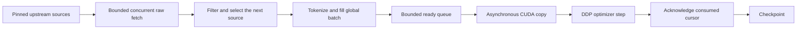

# Prepare ahead while GPUs train

`modal_streaming_train.py` starts GPU training from an initial upstream prefix,
without waiting to download, count or tokenize the entire target corpus. Rank
zero runs one producer thread that builds global batches on CPUs; up to three
fetch workers read pinned source shards ahead. The source mixture is selected by
actual consumed loss-token deficits. Prepared batches enter a bounded queue.
Pinned host memory and a dedicated CUDA stream copy batches while prior GPU
computation runs. CUDA events ensure each batch is ready before its first use.



## Reviewable behavior

- Source weights, frozen tokenizer, BOS/EOS, document-local windows, ignored
  padding and the at-most-two-pass policy remain explicit. A missing/slow source
  blocks that source's turn; no silent substitution changes the mixture.
- `prefetch_batches: 0` keeps the synchronous path. Positive values from 1 to 64
  enable overlap for frozen snapshots; a live manifest requires positive prefetch
  and the scoped `experimental_data` flag. The provided live recipe uses 16 ready
  batches. One further batch may be in preparation, and one may be in training.
- GPU availability is not guaranteed. The queue absorbs short download stalls;
  a sustained CPU/network bottleneck can drain it. Metrics include cumulative
  `data_wait_seconds`, queue depth and per-update `data_fetch_seconds`.
- Checkpoints save the **acknowledged optimizer cursor**, rather than the
  producer's speculative position. Restart discards unconsumed prefetched rows,
  tokens and batches, then reconstructs them. Document token offsets and source
  exposure counts restore exactly. Checkpointing does not require serializing
  the batch queue or persisting speculative GPU buffers.
- The live loader keeps an append-only exact-content seen ledger. Newly discovered
  cross-split duplicates raise an error and pause the run for reconciliation;
  this cannot retroactively guarantee a globally deduplicated corpus. Global
  deduplication and eligibility/contamination audits remain separate limitations.
- The ledger has a configurable default cap of five million unique documents;
  it grows with accepted/scanned content and is included in checkpoints. Ready
  queues are bounded, but the ledger can occupy substantial RAM/checkpoint space.
  A disk-indexed ledger is an explicit later optimization, not implemented here.
- Live ordering differs from immutable content-hash ordering. Resumed live runs
  pin the same manifest and source code. Old checkpoint source hashes do not
  match this new trainer; the completed 5B run is kept on its original source.

## Start a bounded experiment

From `training/`, after reviewing the code:

```sh
modal run --detach modal_streaming_train.py \
  --config recipes/scholarly-modern-10m-live.json \
  --run-id modern-live-example --gpu H100 --max-steps 100 --max-seconds 900
```

The CPU initialization function only freezes an inline source recipe/manifest;
it does not prepare a full corpus. GPU startup builds a small fixed validation
prefix and the first training batch. Raw fetches and batch preparation continue
while subsequent optimizer steps run. The launcher copies source/config/tokenizer
provenance to the training volume just like the existing DDP worker.

To resume, supply a fresh run ID, the original `--snapshot` path and `--resume`
checkpoint path; settings (including buffer depth) and source hashes must match.
This PR exposes bounded sessions; it does not deploy or start a new 5B run.
The completed 5B checkpoint is unaffected.

## Validation

CPU tests cover queue bounds, explicit acknowledgement, discarded speculative
batches, producer errors, upstream document-offset resume, mixture order, two-pass
exhaustion and split-conflict stops. A separate three-GPU qualification compares
synchronous vs prefetched updates and uninterrupted vs interrupted/resumed
training on the same frozen synthetic dataset. Live upstream prefixes require
an additional end-to-end smoke test; retained results describe exactly what ran.
